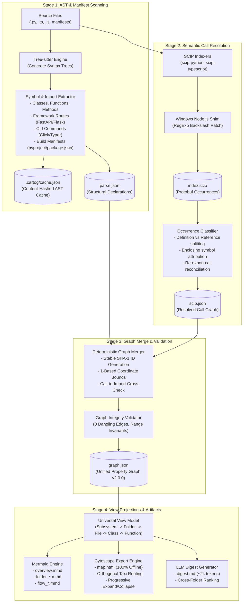
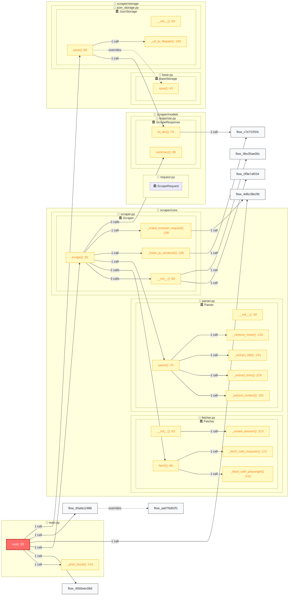

# Cartog

> **Cartography for codebases.**  
> A compiler-grade static analysis and architectural mapping engine that turns complex codebases into deterministic property graphs, interactive offline blueprint maps, call-flow traces, and LLM context digests.

**Security:** Cartog treats the analyzed repository as untrusted. See
[SECURITY.md](SECURITY.md) for the threat model, controls, and what is not
protected.

[]()
[]()
[]()
[]()
[]()

---

## What is Cartog?

**Cartog** is a developer tool and architecture engine that automatically maps and visualizes real-world software systems. Point it at any Python, TypeScript, or JavaScript repository, and Cartog scans the concrete syntax, resolves cross-file call graphs with compiler-grade precision, and generates:

1. **Deterministic Code Property Graphs (`graph.json`):** A unified property graph (Schema 2.0.0) recording every file, class, method, function, route, and CLI command, connected by verified `imports`, `calls`, `references`, and `overrides` relationships with 1-based source coordinate bounds.
2. **Interactive Offline Architecture Maps (`map.html`):** A single, 100% self-contained HTML blueprint powered by bundled Cytoscape.js and fCoSE layout physics. Features clean orthogonal schematic wiring (`curve-style: 'taxi'`), progressive compound disclosure, multi-call edge rollups, and one-click `vscode://` jump-to-definition links—with zero external network requests.
3. **Execution Call-Flow Traces (`flow.mmd` / Mermaid):** Targeted multi-hop call graphs tracing execution paths outward from web API routes (`GET /users`), CLI commands (`click.group`), or application entrypoints (`main()`) to reveal how control actually flows through the codebase.
4. **LLM Architectural Digests (`digest.md`):** Token-budgeted summaries (~1,000–3,000 tokens) ranked by cross-boundary call density, designed specifically to inject high-density architectural context into AI agent prompts without exceeding context windows.
5. **Architectural Integrity Reports (`cartog check`):** Comprehensive validation checks enforcing physical coordinate containment, detecting dangling edges, and performing call-to-import cross-checks to expose architectural drift or circular dependencies.

```text
  [ Your Repository ]  (Python, TypeScript, JavaScript)
           │
           ▼
    ┌─────────────┐
    │   CARTOG    │  Tree-sitter (AST & Manifests) + SCIP (Semantic Call Graph)
    └─────────────┘
           │
           ├──► graph.json    (Deterministic property graph with 1-based source bounds)
           ├──► map.html      (100% offline interactive Cytoscape blueprint)
           ├──► flow.mmd      (Mermaid call-flow traces from routes & entrypoints)
           ├──► digest.md     (Token-budgeted architectural summary for LLM prompts)
           └──► check report  (Validation cross-check: 0 errors, 0 dangling edges)
```

---

## Table of Contents

- [What is Cartog?](#what-is-cartog)
- [Why Cartog? (The Problem It Solves)](#why-cartog-the-problem-it-solves)
- [System Architecture](#system-architecture)
- [Key Engineering Decisions](#key-engineering-decisions)
- [Interactive Map (`cartog view`)](#interactive-map-cartog-view)
- [Real-World Case Study: WebScrapper](#real-world-case-study-webscrapper)
- [Call Flow Tracing Example](#call-flow-tracing-example)
- [CLI Reference](#cli-reference)
- [Repository Roadmap & Audit Log](#repository-roadmap--audit-log)
- [Getting Started](#getting-started)

---

## Why Cartog? (The Problem It Solves)

Understanding the architecture of large software systems is notoriously difficult. Developers face a stark dichotomy:

1. **Static visual diagrams (Visio, Lucidchart, Miro):** Hand-drawn diagrams degrade into technical debt the moment code is committed. They capture author intent, not ground reality.
2. **Naive regex / AST linters:** Tools that match import strings or syntax trees suffer from high false-positive rates, cannot resolve dynamic re-exports (`__init__.py` or `index.ts` barrels), and fail to distinguish declarations from invocations.
3. **Heavyweight compiler tooling / LSP servers:** Full compiler toolchains require hermetic build environments, valid dependency lockfiles, and extensive memory, making them brittle on monorepos, microservices, or untrusted checkouts.
4. **Graph visualization "hairballs":** Naive dependency graphers dump 10,000 raw lines onto a canvas, creating illegible spherical clumps resembling atomic orbitals rather than actionable architecture schematics.

### The Cartog Approach

Cartog was engineered as a **dual-engine cartography system** designed to solve these exact problems:

- **Dual-Engine Precision:** Combines **Tree-sitter** for fault-tolerant concrete syntax extraction (classes, methods, imports, web framework routes, and build manifests) with **SCIP** (Sourcegraph Code Intelligence Protocol) for compiler-grade definition/reference resolution.
- **Fail-Soft & Deterministic:** Operates on complete or partial repositories. Employs stable SHA-1 node IDs, 1-based physical coordinate containment checks, and cryptographic AST content-hashing for instant warm reruns.
- **Signal-over-Noise Heuristics:** Automatically detects and filters noise files (re-export barrels, type-only modules, `if TYPE_CHECKING:` guards), rewiring import lines directly to defining files without corrupting call attribution.
- **Budget-Capped Progressive Disclosure:** Aggregates symbols into a **Universal View Model** capped at a configurable node budget (default: 60 nodes). Collapses internal helpers while highlighting boundary functions.
- **100% Offline Interactive Blueprint:** Exports a self-contained single-file HTML map (`map.html`) utilizing orthogonal Manhattan routing (`taxi`), edge rollup badges, reference noise suppression, and clickable `vscode://` editor jumps.
- **LLM Context Budgeting:** Generates concise architectural digests (`digest.md`, ~1,000–3,000 tokens) ranked by cross-folder connectivity, designed to serve as system prompt context for autonomous AI agents.

---

## System Architecture

Cartog operates as a four-stage unidirectional pipeline:



### Pipeline Breakdown

1. **Stage 1 — Concrete Syntax Extraction (`cartog parse`):**
   - Parses Python, TypeScript, and JavaScript source files using tree-sitter grammars.
   - Extracts symbol hierarchies, import declarations, and pattern bindings (Flask `@app.route`, FastAPI routes, Click groups/commands, and `if __name__ == '__main__':` entrypoints).
   - Ingests package manifests (`pyproject.toml`, `requirements.txt` with UTF-8/UTF-16 LE BOM support, `package.json`, `Dockerfile`, `docker-compose.yml`, and GitHub Actions workflows).
   - Computes SHA-256 content hashes to maintain warm incremental parsing via `.cartog/cache.json`.

2. **Stage 2 — Semantic Indexing (`cartog scip`):**
   - Invokes `@sourcegraph/scip-python` and `@sourcegraph/scip-typescript` with `--output` isolation to guarantee zero side-effects in target repos.
   - Decodes SCIP protobuf occurrence streams, splitting definitions from references.
   - Attributes call sites to their tightest enclosing symbol using 1-based source coordinate intervals.
   - Employs `cartog/scip/windows_shim.js` to dynamically patch upstream Node.js V8 regular expression bugs on Windows paths.

3. **Stage 3 — Graph Merging & Integrity Checking (`cartog build`, `cartog check`):**
   - Combines structural AST declarations and semantic SCIP relationships into a unified property graph (`graph.json`).
   - Schema 2.0.0: Omits redundant `contains` edges by persisting tree hierarchy directly via `parent` foreign keys.
   - Verifies physical source range bounds (caller containment, child-within-parent validation).
   - Cross-checks calls against imports with 3-category accounting: matched direct calls, explained barrel/transitive calls, and unexplained call anomalies.

4. **Stage 4 — Projection & Export (`cartog map`, `cartog view`, `cartog flow`, `cartog digest`):**
   - **`cartog map`:** Generates high-level Mermaid architecture diagrams (`overview.mmd`) and per-package folder diagrams (`folder_*.mmd`).
   - **`cartog view`:** Builds a standalone single-file interactive map (`map.html`) embedding Cytoscape.js, `layout-base`, `cose-base`, `cytoscape-fcose`, and `cytoscape-expand-collapse`.
   - **`cartog flow`:** Performs BFS call-flow traversal starting from user-selected routes, commands, or functions up to `--depth` hops (default: 3).
   - **`cartog digest`:** Synthesizes an LLM-optimized summary ranking files and subsystems by cross-boundary call density.

---

## Key Engineering Decisions

Cartog's design is documented in [`docs/ISSUES_AND_DECISIONS.md`](./docs/ISSUES_AND_DECISIONS.md). Key architectural highlights include:

| Issue & Decision | Problem | Resolution & Tradeoff |
|---|---|---|
| **C-Extension Memory Safety** ([#1, #2, #3](./docs/ISSUES_AND_DECISIONS.md#issue-1-tree-sitter-access-violation-c0000005-during-deep-ast-traversal)) | Upstream `py-tree-sitter` native C pointer garbage collection caused Windows access violations (`c0000005`) on deep AST traversals (>3,000 LOC). | Migrated entirely to top-level Tree-sitter Queries (`Query.matches`) with cursor recycling; pinned `tree-sitter==0.26.0`. |
| **Windows V8 Regex Patch** ([#12](./docs/ISSUES_AND_DECISIONS.md#issue-12-windows-scip-python-regexp-bug-and-scip_windows_shimjs)) | `@sourcegraph/scip-python` crashed on Windows due to unescaped backslashes in regex path matching (`\U` interpreted as invalid unicode escape). | Injected `cartog/scip/windows_shim.js` pre-loader monkey-patching `RegExp.prototype` to normalize Windows backslashes transparently. |
| **Re-Export Call Reconciliation** ([#14, #25](./docs/ISSUES_AND_DECISIONS.md#issue-14-second-cross-root-definition-reconciliation-rule)) | Re-exports through barrel files (`__init__.py`, `index.ts`) caused SCIP local-symbol call disconnects (`local 4`). | Implemented synthetic symbol derivation and transitive barrel definition matching (`confidence: "reconciled"`). |
| **Deterministic Noise Filtering** ([#22](./docs/ISSUES_AND_DECISIONS.md#issue-22-deterministic-noise-file-filtering-and-view-import-rewiring)) | Constants modules, re-export barrels, and type-only files flooded diagrams with uninformative crossing lines. | Built AST/syntactic classifiers for barrel and typing files (`if t.TYPE_CHECKING:`); rewired imports to defining symbols while preserving call semantics. |
| **Universal View Model & Schema 2.0.0** ([#23](./docs/ISSUES_AND_DECISIONS.md#issue-23-universal-view-model-hierarchy-boundary-function-rollup-schema-200-compact-serialization-and-flow-tracing)) | Large codebases produced 50MB+ JSON graphs and unrenderable Mermaid diagrams. | Designed `ViewNode` hierarchy, boundary symbol selection, and hierarchical `parent` serialization, slashing payload sizes by 44–50%. |
| **Orthogonal Schematic Routing** ([#27, #28](./docs/ISSUES_AND_DECISIONS.md#issue-27--decision-27-interactive-map-layout-orthogonal-taxi-edge-routing-reference-noise-suppression-and-progressive-compound-disclosure)) | Cytoscape bezier curves produced concentric "atomic orbital" ellipses with cramped compound boxes. | Standardized on Manhattan right-angle routing (`curve-style: 'taxi'`), multi-call edge rollups (`N calls`), 35–50px container padding, and internal helper retention. |

---

## Interactive Map (`cartog view`)

Cartog generates a **100% self-contained offline single-file HTML map** (`map.html`):

- **Zero External Network Calls:** All JS engines (Cytoscape v3.34.4, fCoSE v2.2.0, Expand-Collapse v4.1.1) and CSS themes are inlined directly. No CDN requests, no local HTTP servers, zero data exfiltration.
- **Orthogonal Manhattan Routing:** Replaces curved bezier arcs with crisp 90° schematic lines (`taxi`), making complex service architectures readable at a glance. Includes instant toolbar switching between `Orthogonal`, `Straight`, and `Curved`.
- **Edge Rollup & Reference Filtering:** Parallel calls between symbols roll up into a single edge with an autorotating count badge (`N calls`). Variable and type references (`kind="references"`) are hidden by default with a `References: Off / On` toggle.
- **Progressive Compound Disclosure:** Files and classes start collapsed into high-level containers. Clicking container expand cues (`+`) drills down into internal functions without disrupting canvas layout.
- **Internal Helper Retention:** Helper functions and private methods are retained as child nodes with dashed styling, and caller-to-helper links are drawn with a `Helpers: Shown / Hidden` toolbar toggle.
- **Symbol Inspector Sidebar:** Selecting any node displays qualified names, caller trees, callee trees, routes served, and clickable `vscode://file/<path>:<line>` links that open directly in your local editor.

---

## Real-World Case Study: WebScrapper

To demonstrate Cartog on a production-style codebase, we analyze [**`webscrapper`**](https://github.com/rishi-0205/webscrapper.git), an asynchronous multi-strategy web scraper featuring Playwright browser automation, Requests HTTP fallbacks, BeautifulSoup HTML parsing, and structured JSON storage.

### Summary Metrics Generated by Cartog

```text
Target: samples/webscrapper
Discovered: 22 source files (4 skipped)
Total Nodes: 195 (18 classes, 109 functions/methods, 1 entrypoint)
Total Edges: 476 (219 calls, 165 references, 47 depends_on, 38 imports, 6 overrides, 1 starts)
Integrity Status: PASS (0 validation errors, 0 dangling edges, 107/107 calls matched)
```

### Architectural Connectivity Ranking

Generated automatically via `cartog digest samples/webscrapper`:

| Module Directory | Files | Cross-Folder Interactions | Primary Responsibility |
|---|---|---|---|
| `scraper/models/` | 3 | **277** connections | Request/Response domain models (`ScrapeRequest`, `ScrapeResponse`) |
| `scraper/core/` | 4 | **275** connections | Core pipeline orchestration (`fetcher.py`, `scraper.py`, `parser.py`) |
| `scraper/storage/` | 3 | **36** connections | Persistence adapters (`base.py`, `json_storage.py`) |
| `scraper/utils/` | 4 | **32** connections | URL normalization, header rotation, and logging |
| `./` | 2 | **20** connections | CLI entrypoints (`main.py`) |
| `scraper/config/` | 2 | **6** connections | Runtime environment configuration (`settings.py`) |

---

## Call Flow Tracing Example

The diagram below was generated by running:

```powershell
cartog flow samples/webscrapper "run" --depth 3
```

Cartog discovers the CLI `run()` function in `main.py` and performs a multi-hop BFS trace across classes, methods, and storage layers:



---

## CLI Reference

```text
Usage: cartog [OPTIONS] COMMAND [ARGS]...

Options:
  --version, -v       Show the Cartog version and exit.
  --help              Show this message and exit.

Commands:
  analyze             Run the whole pipeline and write the stable output tree.
  doctor              Inspect local environment for tree-sitter grammars and SCIP indexers.
  map                 Run full pipeline (parse -> scip -> build -> export) and emit Mermaid diagrams.
  view                Launch or export the 100% offline interactive Cytoscape codebase map.
  flow                Trace call flows from entrypoints, routes, or functions across depth hops.
  digest              Generate a compact architectural digest (~2,000 tokens) for LLM prompts.
  check               Validate graph integrity, containment bounds, and call cross-checks.
  parse               Stage 1: Execute AST syntax, imports, and framework pattern extraction.
  scip                Stage 2: Execute SCIP indexers and decode into scip.json.
  build               Stage 3: Merge parse representations into graph.json.
  query               Fast single-question code graph queries (callers, callees).
```

`cartog analyze` is the unified entry point. It writes the complete run under
the per-user data directory (`%LOCALAPPDATA%\cartog` on Windows,
`~/Library/Application Support/cartog` on macOS, `$XDG_DATA_HOME/cartog` on
Linux) as `projects/<name>-<sha1(path)[:8]>/runs/<run-id>/`, with a copied
`latest/` beside it. It opens no browser unless `--open` is passed, and
`--keep N` keeps the newest `N` complete runs (default `1`, so no history).
The stage commands keep `cartog-out/` and their existing flags. See
[`docs/USAGE.md`](./docs/USAGE.md) for the output tree and exit codes.

### Essential Workflows

```powershell
# 1. Analyze a repository with one command (full layout, no browser)
cartog analyze ./my-project

# 2. Analyze and open the generated viewer
cartog analyze ./my-project --open

# 3. Inspect environment tools and grammars
cartog doctor

# 4. Map an entire codebase into Mermaid diagrams (stage command)
cartog map ./my-project --out cartog-out/my-map --include-tests

# 5. Generate and open the interactive Cytoscape HTML viewer
cartog view ./my-project --out cartog-out/my-view

# 6. Trace execution flow from a route or entrypoint
cartog flow ./my-project "GET /users" --depth 4

# 7. Generate an interactive call flow trace in HTML
cartog view ./my-project --flow "run" --out cartog-out/flow-view

# 8. Generate an architectural digest for LLM prompt context
cartog digest ./my-project --out cartog-out/digest

# 9. Validate graph integrity with strict checking
cartog check cartog-out/my-map/graph.json --strict
```

---

## Repository Roadmap & Audit Log

Cartog adheres to a strict formal development protocol where every capability is backed by red-green tests, real execution evidence, and architectural decision records:

- [`docs/HANDOFF.md`](./docs/HANDOFF.md): Project status, milestone index, and next active tasks.
- [`docs/USAGE.md`](./docs/USAGE.md): Unified command, output tree, exit codes, stage commands, and examples.
- [`docs/IMPLEMENTATION_PLAN.md`](./docs/IMPLEMENTATION_PLAN.md): Complete milestone checklists (M0 through M13).
- [`docs/ISSUES_AND_DECISIONS.md`](./docs/ISSUES_AND_DECISIONS.md): Architectural problem archive with root-cause analyses and tradeoffs (Issues 1–28).
- [`docs/BUILD_LOG.md`](./docs/BUILD_LOG.md): Append-only chronological engineering record (Entries 1–23).
- [`docs/ALIGNMENT.md`](./docs/ALIGNMENT.md): Verification matrix documenting test coverage across all milestones.
- [`docs/cartog-report.md`](./docs/cartog-report.md): Engineering milestone delivery report.

### Milestone Progress

| Milestone | Capability | Status |
|---|---|---|
| **M0** | Installable package skeleton & CLI scaffolding | ✅ Complete |
| **M1** | Python Tree-sitter AST & import extraction | ✅ Complete |
| **M2** | AST import resolution graph & Mermaid overview | ✅ Complete |
| **M3** | Python framework patterns (Flask, FastAPI, Click) & build manifests | ✅ Complete |
| **M4** | JS/TS Tree-sitter extraction & monorepo multi-root support | ✅ Complete |
| **M5** | Python SCIP call-graph resolution & Windows shim injection | ✅ Complete |
| **M6** | JS/TS SCIP indexing & multi-package monorepo linking | ✅ Complete |
| **M6.5**| Hardening, carry-over verification, and 1-based coordinates | ✅ Complete |
| **M7** | Strict validation checks & call-to-import mismatch categorization | ✅ Complete |
| **M8** | `.cartogignore` hierarchical precedence & manifest isolation | ✅ Complete |
| **M9** | Deterministic noise filtering & import rewiring | ✅ Complete |
| **M10**| Universal View Model, compact Schema 2.0.0, & LLM architectural digest | ✅ Complete |
| **M10.1**| BFS call-flow tracing engine (`cartog flow`) & route candidate selector | ✅ Complete |
| **M11**| Offline interactive Cytoscape viewer (`cartog view`) with orthogonal routing | ✅ Complete |
| **M12**| Human-written subsystem map (`subsystems.toml`) | ⏳ Next |
| **M13**| Comparative verification (Grimp/Madge) & final release | ⏳ Pending |

---

## Getting Started

### Prerequisites

- **Python:** 3.11, 3.12, or 3.13
- **Node.js:** v18+ (required for SCIP indexing engines `@sourcegraph/scip-python` and `@sourcegraph/scip-typescript`)

### Installation

Clone the repository and install Cartog in editable mode within a virtual environment:

```powershell
# Clone the repository
git clone https://github.com/rishi-0205/cartog.git
cd cartog

# Create and activate virtual environment
python -m venv venv
.\venv\Scripts\activate

# Install Cartog in editable development mode
pip install -e .
```

### Running the Test Suite

```powershell
# Run the complete test suite (216 tests)
pytest tests/ -v
```

All 216 unit and integration tests run deterministically without external network access.
