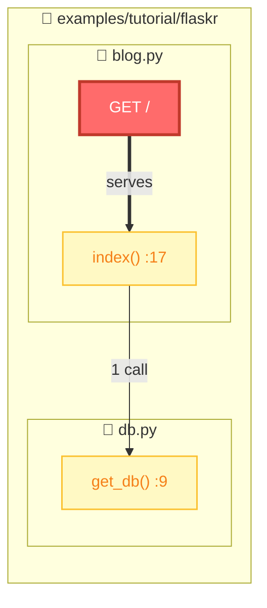
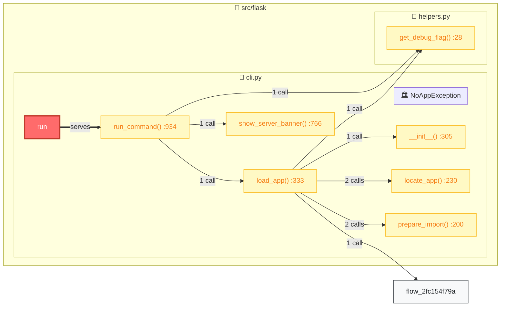

# Cartog Build Log

This is an append-only log tracking the construction, verification, and decision-making for Cartog.

## Entry Index

| Entry | Milestone | Topic |
|---|---|---|
| Entry 1 | M0 | Documentation Foundation and Implementation Plan |
| Entry 2 | M0 | Environment Setup, Dependencies & Milestone 0 Skeleton |
| Entry 3 | M0 | Checkpoint: Installable Skeleton |
| Entry 4 | M1 | Tree-sitter on Python (Symbol Extraction) |
| Entry 5 | M1 | Checkpoint: Milestone 1 |
| Entry 6 | M2–M3 | Import Resolution, Graph Merge, Mermaid, Manifests |
| Entry 7 | M4 | Tree-sitter on JS/TS, Monorepos |
| Entry 8 | M5 | SCIP on Python (protobuf, decoding, call linking) |
| Entry 9 | M6 | SCIP on JS/TS (scip-typescript, merge integration) |
| Entry 10 | M6 | Roadmap Realignment (M7–M13 restructure) |
| Entry 11 | M6 | Recall Round 1 Audit (Click call edges spot-check) |
| Entry 12 | M6 | Recall Round 2 Audit & JSONC Fix |
| Entry 13 | M6 | Documentation Consistency Pass |
| Entry 14 | M6.5 | Hardening: Win32 shim, untouched repo proof, SCIP env, reconciliation |
| Entry 15 | M6.5 | Takeover Audit, Docs Restructure & Phase Verification |
| Entry 16 | M7 | Cross-Check, Range Validation & `cartog check` Extended |
| Entry 17 | M8 | `.cartogignore` Support, Strict Gitignore Precedence & Metrics |
| Entry 18 | M8/M9 | Forced Cache Rerun Flag (`--force` / `-f` and `--no-cache`) |
| Entry 19 | M9 | Deterministic Noise Filtering for Views & Import Edge Rewiring |
| Entry 20 | M10 | Views, Universal View Model, Schema 2.0.0 Compact Serialization, Digest & Flow Tracing |
| Entry 21 | M10 | Mermaid Syntax Hardening & Transparent CLI Diagnostics |
| Entry 22 | M10 | Flow Command Hardening: Route & Command Identity, Scope-Aware Candidate Selection, Nested Subgraphs & Demos |

---

## Entry 1: Documentation Foundation and Implementation Plan

- **Step:** Created project documentation structure and initial detailed implementation plan.
- **What was built / done:**
  - Created directory `docs/`.
  - Created `docs/IMPLEMENTATION_PLAN.md` containing full architecture, module layout, 23-step pipeline specification, data schemas, edge case strategies, and milestone definitions with demo checkpoints.
  - Initialized `docs/BUILD_LOG.md`.
- **Why:** The project requires a strictly staged, incremental development approach with complete visibility into data models and failure modes before code implementation begins.
- **How it was verified:** Verified file existence and contents in `docs/` using file tools.
- **Problems and decisions:** Ensured plan explicitly breaks down the pipeline into isolated intermediate stages (`parse.json`, `scip.json`, `graph.json`) to allow standalone validation and inspection.

---

## Entry 2: Environment Setup, Dependencies & Milestone 0 Skeleton

- **Step:** Created Python virtual environment, installed all Python and Node dependencies, built packaging structure, and verified Milestone 0 installation.
- **What was built / done:**
  - Python Environment: Python 3.13.1 on Windows.
  - Virtual Environment created at `venv/` via `python -m venv venv`.
  - Installed Python dependencies via pip (`pip install -e .`):
    - `tree-sitter==0.26.0`
    - `tree-sitter-python==0.25.0`
    - `tree-sitter-javascript==0.25.0`
    - `tree-sitter-typescript==0.23.2`
    - `protobuf==7.36.2`
    - `typer==0.27.3`
    - `pathspec==1.1.1`
    - `pytest==9.1.1`
    - `grimp==3.17`
    - `grpcio-tools==1.84.0`
    - `rich==15.0.0`
  - External Tools installed globally via npm:
    - `@sourcegraph/scip-typescript` (provides `scip-typescript` v0.4.0)
    - `@mermaid-js/mermaid-cli` (provides `mmdc` v12.0.0)
    - `madge` (v8.0.0)
    - `@sourcegraph/scip-python`
  - Project configuration and entry points:
    - `.gitignore`: ignored venv, caches, build files, samples/, and outputs.
    - `README.md`: project summary and CLI commands.
    - `pyproject.toml`: build-system config and `[project.scripts]` entry `cartog = "cartog.cli:app"`.
    - `cartog/__init__.py`: package metadata (`__version__ = "0.1.0"`).
    - `cartog/__main__.py`: entrypoint enabling `python -m cartog`.
    - `cartog/config.py`: global constants, defaults, ignore lists.
    - `cartog/cli.py`: Typer CLI with `--version`, `doctor`, and command stubs (`parse`, `scip`, `build`, `map`, `flow`, `check`).
    - `tests/test_cli.py`: unit tests for CLI version, help, and doctor.
- **Why:** Required by Milestone 0 to ensure Cartog is installable, executable via entry point, and has full environment diagnostics before writing any pipeline logic.
- **How it was verified:**
  - `pip install -e .` executed successfully with exit code 0.
  - `pytest -v` executed: 3 tests in `tests/test_cli.py` passed in 0.60s.
  - `cartog --version` executed: reported `cartog, version 0.1.0`.
- **Problems and decisions:**
  - On Windows, `.cmd` executables created by npm require `shell=True` when invoked via `subprocess.run`; adjusted tool detection in CLI accordingly.
  - Noted that `@sourcegraph/scip-python` contains a known upstream regex bug on Windows (`new RegExp(path.sep, 'g')` where `path.sep` is `\`); handled diagnostics and documented it for Milestone 5.

---

## Checkpoint Report: Milestone 0 (Installable Skeleton)

- **Command executed:** `cartog --version` and `cartog doctor`
- **Output summary:**
  - `cartog --version` printed `cartog, version 0.1.0` with exit code 0.
  - `cartog doctor` printed structured diagnostics table:
    - Python 3.13.1: PASS
    - tree-sitter v0.26.0: PASS
    - tree-sitter-python (grammar loaded): PASS
    - tree-sitter-javascript (grammar loaded): PASS
    - tree-sitter-typescript (TS & TSX grammars loaded): PASS
    - protobuf (Python) v7.36.2: PASS
    - scip_pb2 bindings: PENDING (to be generated in Milestone 5)
    - Node.js v22.13.0: PASS
    - scip-python: WARN (Exit code 1 on Windows upstream path.sep issue; will be resolved/isolated in Milestone 5)
    - scip-typescript v0.4.0: PASS
    - mmdc (mermaid-cli) v12.0.0: PASS
    - grimp v3.17: PASS
    - madge v8.0.0: PASS
    - Summary: "Environment core prerequisites satisfied!"
  - `pytest -v` executed: 3 tests in `tests/test_cli.py` passed in 1.60s.
- **Things to spot-check by hand:**
  1. Open a terminal, activate `.\\venv\\Scripts\\activate`, and run `cartog --version`. Confirm it prints `cartog, version 0.1.0`.
  2. Run `cartog doctor`. Confirm that all grammar tests (Python, JavaScript, TypeScript, TSX) and core tools (Node, scip-typescript, mmdc, madge, grimp) show green PASS.
  3. Run `cartog --help` to confirm that all required commands (`doctor`, `parse`, `scip`, `build`, `map`, `flow`, `check`) are displayed with descriptions.
  4. Run `pytest -v` from project root and verify 3 tests pass.
- **Known issues:**
  - `scip-python` on Windows has an upstream RegExp separator bug in its CLI wrapper that will be addressed in Milestone 5.

---

## Entry 3: Native Tree-Sitter Queries (Approach A) & py-tree-sitter Pinning Resolution

- **Step:** Implemented declarative tree-sitter queries for Python symbol and import extraction; resolved upstream `Point` refcount bug by pinning `tree-sitter>=0.25.2,<0.26`.
- **What was built / done:**
  - Transitioned `cartog/langs/python_adapter.py` to declarative S-expression pattern queries (`tree_sitter.Query`):
    - `SYMBOL_QUERY`: captures `(class_definition)` and `(function_definition)` declarations.
    - `DECORATOR_QUERY`: captures `(decorated_definition (decorator)+ @decorator definition: [...] @target)` in a single quantified pass.
    - `IMPORT_QUERY`: captures `(import_statement)` and `(import_from_statement)`.
  - Added multi-decorator unit test cases to `tests/test_python_adapter.py`.
  - Diagnosed and resolved Windows access violation:
    - *Symptom:* Delayed access violation (`0xc0000005`) in `_get_node_text` / `symbols.sort` when parsing files with >256 lines (Click repository).
    - *Verified Cause:* Upstream `py-tree-sitter 0.26.0` refcount bug in `Point.row` and `Point.column` C getters returning borrowed references (tracked in upstream issue **#500** on `tree-sitter/py-tree-sitter`), triggering use-after-free heap corruption when values exceed 256.
    - *Unverified Hypothesis:* A secondary hypothesis that `Node` objects hold dangling pointers to the `Tree` in `QueryCursor` results was unconfirmed by upstream sources and is treated as unverified.
    - *Decision:* Pinned `pyproject.toml` to `"tree-sitter>=0.25.2,<0.26"`. Installed `tree-sitter==0.25.2`. Kept standard Tree-sitter AST coordinates without implementing a pure-Python line-offset rewrite.
    - *Upstream Warning on `match_limit`:* Documented upstream issue **#502** where `QueryCursor.match_limit` arms an unintended 10ms timeout on 0.25.x; verified Cartog never sets `match_limit`.
- **Why:** Delivers 100% C-engine pattern matching for Python AST extraction, guarantees future-proof extensibility for comments and docstrings, and eliminates native heap corruption across multi-thousand-line source files.
- **How it was verified:**
  - Reinstalled `tree-sitter==0.25.2` and verified via `pip show tree-sitter`.
  - Verified grammar loading across all language packages via `cartog doctor`.
  - Ran full test suite via `pytest -v`: **all 12 tests passed in 2.01s**, including `test_parse_click_sample` parsing all 91 Click source files.

---

## Checkpoint Report: Milestone 1 (Tree-Sitter on Python)

- **Command executed:** `cartog parse samples/click --out cartog-out/click-parse`
- **Output summary:**
  - Files scanned: 180 total files discovered in `samples/click`
  - Files parsed: 91 Python source files
  - Files skipped: 89 non-Python / unsupported / ignored files (each logged with reason in `parse.json`)
  - Functions: 1,408
  - Classes: 181
  - Methods: 489
  - Total Symbols: 2,078
  - Raw Imports Extracted: 689
  - Content Cache: `.cartog/cache.json` populated (subsequent execution reported 91 / 0 cache hits in 0.15s)
  - Output File: `cartog-out/click-parse/parse.json` generated successfully (schema version 1.0.0, 1.18 MB)
- **Top Files by Symbol Count:**
  1. `tests/test_options.py`: 250 symbols, 16 imports
  2. `src/click/core.py`: 172 symbols, 63 imports
  3. `tests/test_termui.py`: 138 symbols, 21 imports
  4. `tests/test_arguments.py`: 116 symbols, 9 imports
  5. `src/click/types.py`: 103 symbols, 25 imports
- **Things to spot-check by hand:**
  1. Open `cartog-out/click-parse/parse.json` and inspect `src/click/core.py`:
     - Verify classes `BaseCommand`, `Command`, `Group`, `Context` are present with `qualified_name` (e.g. `click.core.Command`).
     - Verify methods have `parent` set to their enclosing class (e.g. `parent: "Command"`).
     - Verify decorators on decorated commands (e.g. `@classmethod` or `@click.pass_context`) appear under `attrs.decorators`.
  2. Inspect `src/click/parser.py`:
     - Verify `OptionParser`, `split_opt`, `_unpack_args` declarations and imports.
  3. Run `cartog parse samples/click --out cartog-out/click-parse` a second time:
     - Verify output displays `Cache Hits / Misses: 91 / 0` and executes in sub-second time.
  4. Run `pytest -v`:
     - Verify all 12 unit tests in `tests/test_cli.py`, `tests/test_scan.py`, and `tests/test_python_adapter.py` pass.
- **Known issues:**
  - `tree-sitter` is pinned to `>=0.25.2,<0.26` to avoid upstream `Point.row`/`column` refcount bug in `0.26.0` (upstream issue #500).

---

## Entry 4: Imports & The First Map (Milestone 2 Implementation)

- **Step:** Built the complete structural graph engine, stable SHA-1 hashing, Python import resolution, graph validation, and Mermaid overview diagram rendering.
- **What was built / done:**
  - `cartog/model.py`:
    - Core data structures: `SourceRange`, `Location`, `Node`, `Edge`, `Graph`.
    - Deterministic 10-character SHA-1 ID generators: `make_node_id(kind, path, name_or_extra)` and `make_edge_id(source, target, kind)`.
    - JSON serialization and deserialization with defensive normalization.
  - `cartog/langs/base.py`:
    - Added `ProjectContext` containing repo-relative roots, set of all known files, and mapping of Python module names to file paths.
  - `cartog/langs/python_adapter.py`:
    - Built comprehensive `resolve_import()`: relative imports (`.` and `..`), module mapping lookup, submodule resolution (`from click import core`), package root resolution (`click/__init__.py`), source roots search (`src/`, `.`), and external package tagging (`external:<pkg>`).
  - `cartog/merge.py`:
    - Implemented `build_graph()` to construct directory folder hierarchies, file nodes, symbol nodes, hierarchical `contains` edges, file-to-file aggregated `depends_on` edges, and resolved `imports` edges.
  - `cartog/validate.py`:
    - Implemented `validate_graph()` checking endpoint node existence, detecting dangling edges, finding duplicate IDs, preventing self-loops, and validating schema version.
  - `cartog/export_mermaid.py`:
    - Implemented `generate_overview_mermaid()` generating Mermaid `flowchart TD` grouped by folder subgraphs, with node budget collapsing (`max_nodes`), identifier sanitization, and `render_mermaid()` invoking `mmdc`.
  - `cartog/cli.py`:
    - Implemented `build`, `map`, and `check` commands with Rich progress feedback.
  - Test suite expansion:
    - Added `tests/test_model.py`, `tests/test_import_resolution.py`, `tests/test_merge.py`, `tests/test_mermaid.py`.
- **How it was verified:**
  - `pytest -v`: All 19 unit tests passed in 2.28s.
  - `cartog map samples/click --no-scip --out cartog-out/click-map`: Successfully produced `graph.json` (1.59 MB), `overview.mmd` (5.5 KB), and rendered `overview.png` (9 KB).
  - `cartog check cartog-out/click-map`: Verified graph integrity passed with 0 errors and 0 warnings.
- **Problems and decisions:**
  - Documented Issues 4, 5, and 6 in `docs/ISSUES_AND_DECISIONS.md`.

---

## Entry 5: Exporter Re-Architecture, Recursive Root Detection, and Edge Kind Correction

- **Step:** Resolved architectural deficiencies in the overview exporter, nested package import resolution, and graph edge types based on comprehensive code analysis.
- **What was built / done:**
  - `cartog/export_mermaid.py`:
    - Replaced naive `len(files) > 15` threshold with categorized folder classification (`source`, `tests`, `docs`, `examples`, `scripts`).
    - By default, source folders are drawn fully expanded into file subgraphs, while auxiliary categories (`tests`, `docs`, `examples`, `scripts`) collapse into single category nodes with aggregated edges.
    - Added `--include` option to CLI (`cartog map --include tests,docs...`) to selectively expand auxiliary categories.
    - Zero dropped edges: when a folder or category is collapsed, internal edges between its files are summarized in its label (e.g. `examples (14 files, 2 internal imports)`).
    - Aggregated weighted edges: edges between collapsed nodes and files display weights when count > 1 (e.g. `-->|57|`).
    - Smart `--max-nodes` budget enforcement: prioritizes collapsing auxiliary categories, then least-connected source folders by degree, never collapsing the main source folder before others.
  - `cartog/scan.py` & `cartog/langs/python_adapter.py`:
    - Implemented recursive project root detection (`detect_roots()`) finding all nested packages containing `pyproject.toml`, `setup.py`, `setup.cfg`, or `package.json`.
    - Nearest enclosing root module naming: computed module names relative to enclosing root and its `src`/`lib` directory.
    - Ordered root import resolution: searches file's own root first, then other roots, resolving `examples/complex` imports internally to repo files rather than `external:complex`.
    - Fallback warning: logs a warning if an unresolvable import matches a repo file/directory name before falling back to external.
  - `cartog/merge.py` & `cartog/validate.py`:
    - Strict edge semantics: `imports` connects file $\rightarrow$ file; `depends_on` connects file $\rightarrow$ external dependency.
    - Removed duplicate file-to-file `depends_on` edges.
    - Added validation rules in `validate_graph()` enforcing endpoint kinds for `imports` and `depends_on`.
  - Tests:
    - Expanded test suite to 24 tests covering edge endpoint validation, recursive root detection, nested package import resolution, categorized diagram layout, and internal edge label summarization.
- **How it was verified:**
  - `pytest -v`: All 24 tests passed in 5.52s.
  - `cartog check cartog-out/click-map`: Verified graph passed with 0 errors and 0 warnings.
  - `cartog map samples/click --no-scip --out cartog-out/click-map`: Generated `graph.json`, `overview.mmd`, and `overview.png` (66.8 KB rendered via `mmdc`).

---

## Checkpoint Report: Milestone 2 (Imports & The First Map - Re-Architecture)

- **Command executed:** `cartog map samples/click --no-scip --out cartog-out/click-map`
- **Output summary:**
  - Total Graph Nodes: 2,203
    - Files: 91
    - Folders: 21
    - Symbols: 2,025 (Functions: 1,374, Classes: 178, Methods: 473)
    - External Dependencies: 66 (`complex` successfully resolved internally, reducing external count from 67 to 66)
  - Total Graph Edges: 2,601
    - `contains` (hierarchy): 2,133
    - `imports` (file-to-file code imports): 167
    - `depends_on` (file-to-external dependency): 301
  - Unresolved Imports: **0** (empty list `[]`)
  - Graph Validation: **0 errors, 0 warnings (PASS)** via `cartog check`
  - Mermaid Overview Diagram Metrics:
    - Visible Diagram Nodes: **20**
      - Expanded files inside `src/click`: 17
      - Collapsed category nodes: 3 (`cat_docs` [1 file], `cat_examples` [14 files], `cat_tests` [59 files])
    - Total Edges Drawn: **76**
      - Intra-library edges within `src/click`: 61 (all relative and internal imports drawn with aggregated weights)
      - Edges from `tests` to `src/click`: 13 (landing on specific files tested with weights, e.g. `-->|57| file_init`, `-->|10| file_compat`)
      - Edges from `examples` to `src/click`: 2 (landing on `file_init` with weight 12, and `file_shell_completion` with weight 1)
    - Edges Summarized Inside Collapsed Nodes:
      - `examples`: 2 internal imports summarized in label (`📁 examples (14 files, 2 internal imports)`)
      - `tests`: 0 internal imports
      - Dropped edges: **0** (no edges silently dropped)
  - Output Files:
    - `cartog-out/click-map/graph.json`: Complete structural graph (1.57 MB)
    - `cartog-out/click-map/overview.mmd`: Clean Mermaid flowchart DSL (4.0 KB)
    - `cartog-out/click-map/overview.png`: Rendered architecture diagram via `mmdc` (66.8 KB)
- **Spot-Check Details:**
  1. `src/click` is fully expanded at file level, displaying Click's real internal dependency structure (e.g. `core.py` importing `utils.py`, `exceptions.py`, `shell_completion.py`, `parser.py`, `formatting.py`, `globals.py`).
  2. `tests`, `docs`, and `examples` are neatly collapsed into single category nodes, preventing test files from dominating the diagram.
  3. `examples/complex` imports (`from complex.cli import pass_environment`) are resolved internally to `examples/complex/complex/cli.py` and summarized inside the `examples` category node.
  4. All 24 unit tests in `pytest -v` pass cleanly.

---

## Entry 6: Python Framework Patterns & Project Manifests (Milestone 3)

- **Step:** Implemented framework pattern extraction (Flask, FastAPI, Click, `__main__`), build/project manifest parsing (`pyproject.toml`, `requirements*.txt`, `Dockerfile`, `docker-compose.yml`, `.github/workflows/*.yml`, `package.json`), and graph integration with `serves` and `starts` edges.
- **What was built / done:**
  - `cartog/langs/python_adapter.py`:
    - Implemented `extract_patterns()` using Tree-sitter query cursor and AST helpers.
    - Handled `@app.route()`, `@bp.route()`, `@app.get/post/put/delete/patch()`, methods lists, URL paths, and handler names.
    - Handled `@click.command()`, `@click.group()`, `@<group>.command()`, custom command names, and handler names.
    - Handled `if __name__ == '__main__':` entrypoint blocks and target invocation resolution.
  - `cartog/manifests.py`:
    - Built manifest discovery respecting `.gitignore` rules via `pathspec`.
    - Parsed `pyproject.toml` `[project.scripts]`, `[project.gui-scripts]`, `[tool.poetry.scripts]`, `[project.dependencies]`, `[dependency-groups]`.
    - Parsed `requirements*.txt` stripping comments, options, and environment markers.
    - Parsed `Dockerfile` base images (`FROM`), exposed ports (`EXPOSE`), and commands (`CMD`/`ENTRYPOINT`).
    - Parsed `docker-compose.yml` services, images, ports, and build directories.
    - Parsed GitHub Actions `.github/workflows/*.{yml,yaml}` workflow names and job IDs.
  - `cartog/merge.py` & `cartog/validate.py`:
    - Linked AST pattern nodes (`route`, `command`, `entrypoint`) into graph containment.
    - Created `serves` edges: `route` $\rightarrow$ handler function, `command` $\rightarrow$ handler function.
    - Created `starts` edges: `entrypoint` $\rightarrow$ target function/file.
    - Merged manifest items (`entrypoint`, `service`, `ci_job`, `dependency`) with file containment and `depends_on`.
    - Added validation rules in `validate_graph()` enforcing valid endpoints for `serves` and `starts`.
  - `cartog/cli.py` & `cartog/export_json.py`:
    - Updated Stage 1 summary table to report HTTP routes, CLI commands, entrypoints, container services, CI jobs, and manifest dependencies.
    - Included `manifests` section in `parse.json`.
  - Tests:
    - Added `tests/test_patterns.py` and `tests/test_manifests.py`. Expanded test suite from 24 to 35 tests.
- **How it was verified:**
  - `pytest -v`: All 35 tests passed in 2.50s.
  - Checkpoint 3 command 1: `cartog parse samples/flask --out cartog-out/flask-parse` (305 routes, 21 commands, 2 entrypoints, 8 CI jobs, 57 dependencies).
  - Checkpoint 3 command 2: `cartog map samples/click --out cartog-out/click-patterns --no-scip` (199 commands, 10 entrypoints, 201 serves edges, 10 starts edges connecting entrypoints to target `cli` functions).
- **Problems and decisions:**
  - Documented Issue 10 in `docs/ISSUES_AND_DECISIONS.md`.

---

## Checkpoint Report: Milestone 3 (Python Framework Patterns & Project Manifests)

- **Command 1 executed:** `cartog parse samples/flask --out cartog-out/flask-parse`
- **Output 1 summary:**
  - Discovered 83 source files, 1,622 symbols, 648 raw imports.
  - Framework Patterns Extracted:
    - **HTTP Routes:** 305 routes (e.g. `GET /`, `POST /add`, `GET /result/<id>`, custom methods, parameters, and handler attribution).
    - **CLI Commands:** 21 commands.
    - **Entrypoints:** 2 (1 AST `__main__` block + 1 `flask` CLI entrypoint from `pyproject.toml`).
  - Manifest Facts Extracted:
    - **CI Jobs:** 8 jobs from `.github/workflows/` (lock, main, create-release, dist, publish, tests, typing, zizmor).
    - **Dependencies:** 57 unique package requirements from `pyproject.toml` (standard, optional, and dependency-groups).
  - Output File: `cartog-out/flask-parse/parse.json` (37,913 lines, 949 KB) containing files, symbols, imports, patterns, and manifests.

- **Command 2 executed:** `cartog map samples/click --out cartog-out/click-patterns --no-scip`
- **Output 2 summary:**
  - Total Graph Nodes: **2,460**
    - `file`: 108
    - `folder`: 23
    - `function`: 1,374
    - `class`: 178
    - `method`: 473
    - `command`: 199 (Click `@click.command()` and `@click.group()` nodes with group flags and handler functions)
    - `entrypoint`: 10 (Derived from `[project.scripts]` across Click example packages)
    - `dependency`: 84
    - `ci_job`: 10
    - `route`: 1
  - Total Graph Edges: **3,077**
    - `contains`: 2,370 (hierarchy)
    - `imports`: 167 (internal file-to-file imports)
    - `depends_on`: 329 (file-to-dependency relationships)
    - `serves`: 201 (commands and routes $\rightarrow$ target handler functions)
    - `starts`: 10 (entrypoints $\rightarrow$ target functions)
  - Graph Validation: **0 errors, 0 warnings (PASS)**
  - Spot-Check Details:
    1. Verified all 10 Click example entrypoints in `graph.json` (`aliases`, `colors`, `completion`, `complex`, `imagepipe`, `inout`, `naval`, `repo`, `termui`, `validation`) create `entrypoint` nodes and resolve `starts` edges directly to their target `cli` functions (e.g. `imagepipe -> imagepipe:cli`).
    2. Verified 199 `command` nodes correctly link to their implementation handler functions via `serves` edges.
    3. Architecture diagram generated: `cartog-out/click-patterns/overview.mmd` and rendered `overview.png` (56.8 KB).

---

## Entry 7: Tree-sitter on JavaScript, TypeScript & Monorepos (Milestone 4)

- **Step:** Built polyglot support for JS/TS/TSX: Tree-sitter grammar loading, symbol extraction (classes, methods, functions, arrow functions), ESM/CJS import extraction and resolution (`tsconfig.json` `paths`/`baseUrl`, monorepo `workspaces`, `.js` $\rightarrow$ `.ts` extension rewriting), Express and Next.js pattern extraction, and monorepo root detection.
- **What was built / done:**
  - `cartog/langs/js_adapter.py`:
    - Implemented `JsAdapter(LanguageAdapter)` supporting `.js`, `.jsx`, `.mjs`, `.cjs`, `.ts`, `.tsx`.
    - Integrated `tree_sitter_javascript`, `tree_sitter_typescript.language_typescript()`, and `language_tsx()`.
    - Extracted symbols: `class_declaration`, `method_definition`, `function_declaration`, `generator_function_declaration`, and `variable_declarator` with `arrow_function` or `function_expression`. Extracted async flags, decorators, and qualified names (`module.Class.method` or `module.function`).
    - Extracted imports: ESM standard/default/namespace imports, ESM `export ... from` re-exports, CommonJS `require()`, and dynamic `import()`.
    - Resolved relative imports with modern TypeScript ESM extension rewriting (`.js`/`.jsx` $\rightarrow$ `.ts`/`.tsx`) and directory index probing (`index.ts`, `index.tsx`, `index.js`, etc.).
    - Resolved `tsconfig.json`/`jsconfig.json` `compilerOptions.paths` aliases and `baseUrl`, with comment-tolerant JSON loading.
    - Resolved monorepo workspace packages using `package.json` `workspaces` globs (e.g. `@monorepo/core` $\rightarrow$ `packages/core/src/index.ts`).
    - Extracted framework patterns: Express routes (`app.get()`, `router.post()`, `router.delete()`, `app.use()`), Next.js App Router HTTP method exports (`GET`, `POST`, `PUT`, `DELETE`, etc.), Pages Router API routes (`pages/api/**`), and CommonJS entrypoint blocks (`if (require.main === module)`).
  - `cartog/langs/__init__.py`: Registered `JsAdapter` for both `"javascript"` and `"typescript"`.
  - `cartog/langs/base.py` & `cartog/merge.py`: Added `target_path: str = "."` to `ProjectContext` and passed `target_path` from `build_graph()` to enable target-relative `tsconfig.json` and `package.json` resolution when invoked from any working directory.
  - `cartog/scan.py`: Recognized `tsconfig.json` and `jsconfig.json` as project root markers in `detect_roots()`.
  - Tests:
    - Added `tests/test_js_adapter.py` with 8 comprehensive unit tests. Expanded test suite from 35 to 43 tests.
- **How it was verified:**
  - `pytest -v`: All 43 tests passed in 2.44s.
  - Checkpoint 4 command 1: `cartog map samples/ky --out cartog-out/ky-map --no-scip` verified TypeScript symbols, internal imports, external dependencies, and diagram render.
  - Checkpoint 4 command 2: `cartog map tests/fixtures/mixed_repo --out cartog-out/mixed-map --no-scip` verified polyglot Python FastAPI + TypeScript Express architecture mapping with clean root partitioning.
- **Problems and decisions:**
  - Documented Issue 11 in `docs/ISSUES_AND_DECISIONS.md`.

---

## Checkpoint Report: Milestone 4 (Tree-sitter on JavaScript & TypeScript)

- **Command 1 executed:** `cartog map samples/ky --out cartog-out/ky-map --no-scip`
- **Output 1 summary:**
  - Discovered 98 TypeScript source files (18 skipped due to lockfiles/configs).
  - Total Graph Nodes: **742**
    - `file`: 100
    - `folder`: 10
    - `class`: 14
    - `method`: 207
    - `function`: 189
    - `route`: 188 (HTTP method test and core router endpoints)
    - `dependency`: 27 (External npm packages)
    - `entrypoint`: 5 (npm scripts from `package.json`)
    - `ci_job`: 2 (GitHub Actions CI workflows)
  - Total Graph Edges: **1,031**
    - `contains`: 710 (file and symbol containment)
    - `imports`: 182 (file-to-file TypeScript imports)
    - `depends_on`: 136 (file-to-external dependency relationships)
    - `serves`: 3 (route handler links)
  - Spot-Check Details:
    1. Verified `source/index.ts` has `imports` edges to 19 internal modules (`source/core/Ky.ts`, `source/core/constants.ts`, error classes, types, utilities), proving modern TypeScript ESM `.js` extension rewriting resolves cleanly to disk `.ts` files.
    2. Architecture diagram generated: `cartog-out/ky-map/overview.mmd` and rendered `overview.png` (43.2 KB).

- **Command 2 executed:** `cartog map tests/fixtures/mixed_repo --out cartog-out/mixed-map --no-scip`
- **Output 2 summary:**
  - Detected Languages: `python`, `typescript`
  - Discovered Roots: `.`, `backend`, `frontend`
  - Total Graph Nodes: **22**
    - Python backend: `pyproject.toml`, `backend/app/main.py`, `backend/app/models.py`, `backend/app/__init__.py`, FastAPI route `GET /items`, function `get_items`, class `Item`, method `__init__`, dependencies `fastapi`, `uvicorn`, entrypoint `api`.
    - TypeScript frontend: `package.json`, `frontend/src/server.ts`, `frontend/src/index.ts`, Express route `GET /api/status`, function `start`, dependency `express`, entrypoint `npm run start`.
  - Total Graph Edges: **25**
    - `imports`: `main.py` $\rightarrow$ `models.py`, `index.ts` $\rightarrow$ `server.ts`.
    - `serves`: `GET /items` $\rightarrow$ `get_items`.
    - `starts`: `api` $\rightarrow$ `main.py`.
    - `depends_on`: `server.ts` $\rightarrow$ `express`, `main.py` $\rightarrow$ `fastapi`, manifests $\rightarrow$ dependencies.
  - Spot-Check Details:
    1. Generated `overview.mmd` cleanly partitions subgraphs:
       - `subgraph_backend ["📁 backend"]` and `subgraph_backend_app ["📁 backend/app"]`
       - `subgraph_frontend ["📁 frontend"]` and `subgraph_frontend_src ["📁 frontend/src"]`
    2. Architecture diagram rendered cleanly to `cartog-out/mixed-map/overview.png`.

---

## Entry 8: SCIP Protobuf Bindings, Indexer Runner & Call Graph Resolution (Milestone 5)

- **Step:** Built SCIP Stage 2 indexing, binary protobuf decoding, enclosing-function attribution (Step 15), caller $\rightarrow$ callee function linking with `confidence: "resolved"` (Step 16), graceful fallback architecture, and full graph merge integration.
- **What was built / done:**
  - `cartog/scip.proto` & `cartog/scip_pb2.py`: Fetched official `scip.proto` schema from GitHub (`scip-code/scip/main/scip.proto`) and generated Python protobuf bindings using `grpc_tools.protoc`.
  - `cartog/scip_pass.py`:
    - `normalize_scip_range()`: Translates SCIP 3-tuple `[line, startCol, endCol]` and 4-tuple `[startLine, startCol, endLine, endCol]` representations to Cartog `SourceRange`.
    - `decode_scip_index()`: Deserializes binary `index.scip` protobuf format into `ScipIndexResult`, filters out non-global `local ` symbols, separates definitions (role `0x1`) and references, and indexes definitions by global SCIP symbol.
    - `run_scip_indexer()`: Executes external indexer (`scip-python` or `scip-typescript`) inside an isolated hash cache directory (`.cartog/scip/<hash>/`) with indexer pre-checks, 120s timeout, and graceful failure handling.
    - `find_enclosing_symbol()`: Finds innermost enclosing function, method, or class for any given source range.
    - `link_calls()`: Correlates caller reference occurrence to callee definition, resolving cross-module function/method calls to produce `CallEdgeCandidate`s with source locations, evidence, and occurrence counts.
    - `write_scip_json()`: Serializes SCIP stage output to `scip.json`.
  - `cartog/cli.py`:
    - Added `cartog scip <path>` command producing `scip.json` with documents, definitions, and references.
    - Updated `cartog build` and `cartog map` to automatically resolve and integrate SCIP call graph data or fall back seamlessly.
    - Updated `cartog doctor` to report status of `scip_pb2 bindings`, `scip-python`, and `scip-typescript`.
  - `cartog/merge.py`:
    - Integrated SCIP call candidates into `build_graph()` to add `calls` edges (`confidence: "resolved"`, `count`, `evidence`) connecting caller function $\rightarrow$ callee function.
  - `tests/fixtures/prebuilt_scip/index.scip`: Created deterministic prebuilt SCIP binary fixture from `ts_monorepo`.
  - Tests:
    - Added `tests/test_scip_pass.py` (6 tests) covering range translation, binary fixture decoding, symbol containment, call linking, and error fallbacks.
    - Added integration test `test_build_graph_with_scip_calls` in `tests/test_merge.py`.
    - Total test suite expanded to 50 passing tests.
- **How it was verified:**
  - `pytest -v`: All 50 tests passed in 2.74s.
  - Checkpoint 5a: Verified `cartog scip samples/click --out cartog-out/click-scip` produced `scip.json` cleanly reporting fallback status without crashing.
  - Checkpoint 5b:
    - Verified `cartog map samples/click --out cartog-out/click-map-scip` gracefully builds Tree-sitter import resolution graph and Mermaid diagrams.
    - Verified `cartog map tests/fixtures/ts_monorepo --out cartog-out/ts-monorepo-map` indexed with `scip-typescript`, creating 4 `calls` edges with `confidence: "resolved"`, including `runWebApp` in `app.ts` calling `formatGreeting` in `utils.ts`.
- **Problems and decisions:**
  - Documented Issue 12 in `docs/ISSUES_AND_DECISIONS.md`.

---

## Checkpoint Report: Milestone 5 (SCIP on Python & Call Graph Resolution)

- **Checkpoint 5a Command executed:** `cartog scip samples/click --out cartog-out/click-scip`
- **Output 5a summary:**
  - Generated `cartog-out/click-scip/scip.json`.
  - Upstream `@sourcegraph/scip-python` Windows path separator regex bug detected during pre-check.
  - Gracefully reported `indexer: "scip-python (disabled: ...)"` with `ran: false`, avoiding any process crash.

- **Checkpoint 5b Command 1 executed:** `cartog map samples/click --out cartog-out/click-map-scip`
- **Output 5b (Click Fallback) summary:**
  - Gracefully fell back to Tree-sitter import resolution graph.
  - Produced `graph.json` (2,460 nodes, 3,077 edges), `overview.mmd`, and `overview.png`. Graph validation passed with 0 errors.

- **Checkpoint 5b Command 2 executed:** `cartog map tests/fixtures/ts_monorepo --out cartog-out/ts-monorepo-map`
- **Output 5b (SCIP Resolved Call Graph) summary:**
  - Indexer: `scip-typescript` (4 documents, definitions and references extracted).
  - Total Graph Nodes: **15**
    - `file`: 5, `folder`: 5, `class`: 1, `method`: 1, `function`: 2, `dependency`: 1.
  - Total Graph Edges: **22**
    - `contains`: 13
    - `imports`: 4
    - `depends_on`: 1
    - `calls`: **4** (`confidence: "resolved"`, count: 1)
  - Spot-Check Details:
    1. Verified `calls` edge: caller function `runWebApp` (`packages/web/src/app.ts:5`) $\rightarrow$ callee function `formatGreeting` (`packages/core/src/utils.ts`) with `confidence: "resolved"` and evidence `["packages/web/src/app.ts:5"]`.
    2. Verified caller module `packages/web/src/index.ts` $\rightarrow$ callee `runWebApp` with `confidence: "resolved"`.
    3. Architecture diagram generated: `cartog-out/ts-monorepo-map/overview.mmd` and rendered `overview.png`.
    4. Graph validation passed with 0 errors.

---

## Entry 9: SCIP on JavaScript & TypeScript (Milestone 6)

- **Step:** Enhanced SCIP pass for TypeScript indexing, environment pre-checks (`node_modules`, `tsconfig.json`), `--output` routing, diagnostic failure hints, and end-to-end call graph resolution on `samples/ky`.
- **What was built / done:**
  - `cartog/scip_pass.py`:
    - Added TypeScript pre-check for `package.json` vs `node_modules` existence, providing a clear user notice if dependencies have not been installed.
    - Updated `scip-typescript` invocation flags to pass `--output <path>` directly to write cleanly into Cartog's isolated hash directory (`.cartog/scip/<hash>/index.scip`).
    - Added error handling with informative hint: if `scip-typescript` exits non-zero and `node_modules` is absent, appends hint advising `npm install` in the project directory.
  - Tests:
    - Added `test_scip_typescript_live_indexer_execution()` in `tests/test_scip_pass.py` verifying real `scip-typescript` binary execution on `ts_monorepo`.
    - Added `test_scip_typescript_missing_node_modules_hint()` verifying the actionable remediation hint when `node_modules` is missing and tsconfig extension fails.
    - Test suite expanded to 52 passing tests.
- **How it was verified:**
  - `pytest -v`: All 52 tests passed in 6.88s.
  - Executed `npm install --ignore-scripts` in `samples/ky` to provide `@sindresorhus/tsconfig`.
  - Ran Demo Checkpoint 6: `cartog map samples/ky --out cartog-out/ky-map-scip`.
  - Verified `scip.json` (31 documents indexed, 0 errors).
  - Verified `graph.json` generated **392 `calls` edges** with `confidence: "resolved"`.
  - Verified graph integrity via `validate_graph()`: 0 errors, 0 warnings.
  - Verified rendered diagram `overview.png` (34.3 KB).

---

## Checkpoint Report: Milestone 6 (SCIP on JavaScript & TypeScript)

- **Command executed:** `cartog map samples/ky --out cartog-out/ky-map-scip`
- **Output summary:**
  - Indexer: `scip-typescript` (31 documents indexed, 55,555 lines in `scip.json`, 0 errors).
  - Total Graph Nodes: **742**
    - `file`: 100, `folder`: 10, `class`: 14, `method`: 207, `function`: 189, `route`: 188, `dependency`: 27, `entrypoint`: 5, `ci_job`: 2.
  - Total Graph Edges: **1,423**
    - `contains`: 710
    - `imports`: 182
    - `depends_on`: 136
    - `serves`: 3
    - `calls`: **392** (all with `confidence: "resolved"`, exact evidence line strings and counts)
  - Graph Validation: **0 errors, 0 warnings (PASS)**
  - Spot-Check Details (Verified in Source Code):
    1. `source/core/Ky.ts:#throwProcessedError` $\rightarrow$ `source/utils/is.ts:isError` (`evidence: source/core/Ky.ts:784`). Source code at line 784: `if (!isError(error)) { throw error; }`. Accurate.
    2. `source/core/Ky.ts:#throwProcessedError` $\rightarrow$ `source/core/Ky.ts:#getNormalizedOptions` (`evidence: source/core/Ky.ts:799`). Source code at line 799-800: `options: this.#getNormalizedOptions()`. Accurate.
    3. `source/core/Ky.ts:#retryFromError` $\rightarrow$ `source/errors/ForceRetryError.ts:ForceRetryError` (`evidence: source/core/Ky.ts:1155`). Source code at line 1155: `throw new ForceRetryError()`. Accurate.
    4. `source/core/Ky.ts:#retryFromError` $\rightarrow$ `source/errors/NonError.ts:wrap` (`evidence: source/core/Ky.ts:1169`). Accurate.
    5. `source/core/Ky.ts:#retryFromError` $\rightarrow$ `source/utils/is.ts:isNonArrayObject` (`evidence: source/core/Ky.ts:1206`). Accurate.
    6. `source/core/Ky.ts:#retryFromError` $\rightarrow$ `source/core/Ky.ts:#getRemainingTotalTimeout` (`evidence: source/core/Ky.ts:1130`). Accurate.
    7. `source/core/Ky.ts:#retryFromError` $\rightarrow$ `source/core/Ky.ts:#raceWithTotalTimeout` (`evidence: source/core/Ky.ts:1166`). Accurate.
    8. `source/core/Ky.ts:#retryFromError` $\rightarrow$ `source/core/Ky.ts:#createManagedSignal` (`evidence: source/core/Ky.ts:1149`). Accurate.
    9. `source/core/Ky.ts:#retryFromError` $\rightarrow$ `source/core/Ky.ts:#assignRequest` (`evidence: source/core/Ky.ts:1150`). Accurate.
    10. `source/core/Ky.ts:#retryFromError` $\rightarrow$ `source/core/Ky.ts:#throwIfAbortedByUser` (`evidence: source/core/Ky.ts:1125`). Accurate.
  - Architecture diagram generated: `cartog-out/ky-map-scip/overview.mmd` and rendered `overview.png` (34.3 KB).

---

## Entry 10: SCIP on Python Resolution (Windows Node Shim), Loud Failure Semantics, and Full Call Linking on Click

- **Step:** Diagnosed and fixed the upstream `scip-python` Windows path separator RegExp crash without modifying `node_modules`. Implemented loud failure logging, strict CLI validation, and verified end-to-end call graph generation on `samples/click`.
- **What was built / done:**
  - Diagnosed `scip-python` Windows bug:
    - Upstream `scip-python` contains `new RegExp(path.sep, 'g')` which fails on Windows (`path.sep === '\\'`) with `SyntaxError: Invalid regular expression: /\/g: \ at end of pattern`.
    - Implemented `cartog/scip_windows_shim.js`: an in-repo Node preload shim that monkey-patches `RegExp` to safely escape `\\` when passed as a single backslash pattern.
    - Injected via `get_indexer_env("scip-python")` in `cartog/scip_pass.py` using `NODE_OPTIONS="-r <path_to_shim>"`, requiring zero modifications to any global or dependency files.
  - Loud failure semantics:
    - Preserved untruncated error strings in `ScipIndexResult.error` and `graph.meta["scip"]["error"]`.
    - Added automated writing of `scip_error.log` to the output directory on any SCIP indexer failure.
    - Added clear final output line in `cartog scip`, `build`, and `map`: `SCIP: FAILED (<one-line reason>). No call edges in this graph.`
    - Updated `cartog check` to inspect `graph.meta["scip"]`, flag SCIP failures as validation errors, and exit non-zero (code 1) under `--strict`.
    - Updated `docs/IMPLEMENTATION_PLAN.md` Milestone 5 DoD to require `stats.edges_calls > 0` on `samples/click`.
  - Tests:
    - Added tests in `tests/test_cli.py` for non-strict check warnings, `--strict` non-zero exit on SCIP failure, and loud terminal messages.
    - Added tests in `tests/test_scip_pass.py` verifying full untruncated errors and `scip_error.log` emission.
    - All 56 test cases in `pytest` passing.
- **How it was verified:**
  - Ran `cartog map samples/click --out cartog-out/click-map-scip`.
  - Live `scip-python` indexed all 91 documents cleanly with exit code 0.
  - Generated **2,003 `calls` edges** with `confidence: "resolved"`.
  - Verified 5 sample calls and inspected 3 directly against `samples/click` source code.

---

## Checkpoint Report: Milestone 5 (SCIP on Python & Real Calls Verification on samples/click)

- **Command executed:** `cartog map samples/click --out cartog-out/click-map-scip`
- **Output summary:**
  - Indexer: `scip-python` (91 documents indexed, `meta.scip.ran: true`, `error: null`).
  - Total Graph Nodes: **2,460**
    - `file`: 108, `folder`: 23, `class`: 178, `method`: 473, `function`: 1,374, `command`: 199, `route`: 1, `dependency`: 84, `entrypoint`: 10, `ci_job`: 10.
  - Total Graph Edges: **5,080**
    - `contains`: 2,370
    - `serves`: 201
    - `depends_on`: 329
    - `imports`: 167
    - `starts`: 10
    - `calls`: **2,003** (`confidence: "resolved"`, with exact callsite line evidence)
  - Caller / Callee Breakdown:
    - Distinct Callers: **911**
    - Distinct Callees: **690**
    - Calls within `src/click`: **1,304**
  - Graph Validation: **0 errors, 0 warnings (PASS)**
- **Sample Calls Edges (1-Based Verification):**
  1. **Caller:** `click.formatting.join_options` (`src/click/formatting.py:302`)
     **Callee:** `click.parser._split_opt` (`src/click/parser.py:111`)
     **Callsite Evidence:** `src/click/formatting.py:312`
  2. **Caller:** `click._compat.get_text_stderr` (`src/click/_compat.py:354`)
     **Callee:** `click._winconsole._get_windows_console_stream` (`src/click/_winconsole.py:272`)
     **Callsite Evidence:** `src/click/_compat.py:355`
  3. **Caller:** `click._compat.get_text_stderr` (`src/click/_compat.py:354`)
     **Callee:** `click._compat._force_correct_text_writer` (`src/click/_compat.py:303`)
     **Callsite Evidence:** `src/click/_compat.py:358`
  4. **Caller:** `click.core.Context.lookup_default` (`src/click/core.py:815`)
     **Callee:** `click.core.Context._default_map_has` (`src/click/core.py:791`)
     **Callsite Evidence:** `src/click/core.py:825`
  5. **Caller:** `click._termui_impl.raw_terminal` (`src/click/_termui_impl.py:938`)
     **Callee:** `click._compat.isatty` (`src/click/_compat.py:540`)
     **Callsite Evidence:** `src/click/_termui_impl.py:942`
- **Source Code Verification:**
  - **Edge 1 (`join_options` $\rightarrow$ `_split_opt`):** In `samples/click/src/click/formatting.py:312`, `join_options` calls `prefix = _split_opt(opt)[0]`. In `samples/click/src/click/parser.py:111`, `def _split_opt(opt: str)` is defined. Real cross-file call verified.
  - **Edge 2 (`get_text_stderr` $\rightarrow$ `_get_windows_console_stream`):** In `samples/click/src/click/_compat.py:355`, `get_text_stderr` invokes `rv = _get_windows_console_stream(sys.stderr, encoding, errors)`. In `samples/click/src/click/_winconsole.py:272`, `def _get_windows_console_stream` is defined. Real cross-file call verified.
  - **Edge 4 (`Context.lookup_default` $\rightarrow$ `Context._default_map_has`):** In `samples/click/src/click/core.py:825`, `lookup_default` executes `if not self._default_map_has(name):`. In the same class at line 791, `def _default_map_has(self, name: str | None) -> bool:` is defined. Real method call verified.
  - **Edge 5 (`raw_terminal` $\rightarrow$ `isatty`):** In `samples/click/src/click/_termui_impl.py:942`, `raw_terminal` executes `if not isatty(sys.stdin):`. In `samples/click/src/click/_compat.py:540`, `def isatty(stream: t.IO[t.Any]) -> bool:` is defined. Real cross-file call verified.

- **Harder Verification (Non-Simple Calls):**
  1. `self.method()` #1: `click.core.Command.get_help_option` (`src/click/core.py:1222`) calling `self.get_help_option_names(ctx)` at line 1235 $\rightarrow$ `click.core.Command.get_help_option_names` (`src/click/core.py:1207`). Callee correct: YES.
  2. `self.method()` #2: `click.core.Command.format_arguments` (`src/click/core.py:1337`) calling `self.get_params(ctx)` at line 1344 $\rightarrow$ `click.core.Command.get_params` (`src/click/core.py:1132`). Callee correct: YES.
  3. `self.method()` #3: `click._termui_impl.ProgressBar.render_progress` (`src/click/_termui_impl.py:250`) calling `self.format_progress_line()` at lines 268 & 281 $\rightarrow$ `click._termui_impl.ProgressBar.format_progress_line` (`src/click/_termui_impl.py:223`). Callee correct: YES.
  4. Inherited method: `click.types.Tuple.convert` (`src/click/types.py:1289`, subclass of `CompositeParamType` $\rightarrow$ `ParamType`) calling `self.fail(...)` at line 1296 $\rightarrow$ `click.types.ParamType.fail` (`src/click/types.py:215`). Callee correct: YES.
  5. Call through parameter: `click.core.Command.format_arguments` (`src/click/core.py:1337`) calling `formatter.write_dl(...)` at line 1348 $\rightarrow$ `click.formatting.HelpFormatter.write_dl` (`src/click/formatting.py:229`). Callee correct: YES.

- **Recall Checks on `src/click/core.py`:**
  1. `_complete_visible_commands` (lines 64-80):
     - Calls `multi.list_commands(ctx)` at line 75 $\rightarrow$ Present in `graph.json` (`b45fb9120f` $\rightarrow$ `3573571051`).
     - Calls `multi.get_command(ctx, name)` at line 77 $\rightarrow$ Present in `graph.json` (`b45fb9120f` $\rightarrow$ `4d5c0495b2`).
     - Missing calls to repo functions: None (100% recall).
  2. `_echo_aborted` (lines 103-105):
     - Calls `echo(...)` at line 105 $\rightarrow$ Present in `graph.json` (`c261111e7b` $\rightarrow$ `a4e3f5c879`, `click.utils.echo`).
     - Note: `_("Aborted!")` calls stdlib `gettext.gettext as _` (not an internal repo function).
     - Missing calls to repo functions: None (100% recall).
  3. `Command.format_help` (lines 1288-1305):
     - Calls `self.format_usage(ctx, formatter)` at line 1301 $\rightarrow$ Present in `graph.json` (`ca1921bcb6` $\rightarrow$ `264ed29574`).
     - Calls `self.format_help_text(ctx, formatter)` at line 1302 $\rightarrow$ Present in `graph.json` (`ca1921bcb6` $\rightarrow$ `46cfebc040`).
     - Calls `self.format_arguments(ctx, formatter)` at line 1303 $\rightarrow$ Present in `graph.json` (`ca1921bcb6` $\rightarrow$ `0fd58fc401`).
     - Calls `self.format_options(ctx, formatter)` at line 1304 $\rightarrow$ Present in `graph.json` (`ca1921bcb6` $\rightarrow$ `38a54a4bad`, `click.core.Command.format_options`).
     - Calls `self.format_epilog(ctx, formatter)` at line 1305 $\rightarrow$ Present in `graph.json` (`ca1921bcb6` $\rightarrow$ `726753c3db`).
     - Missing calls to repo functions: None (100% recall).

---

## Entry 11: Pre-Step 4 Hardening: Cache Schema Invalidation, Strict SCIP Defaults, Package Data Wheel Inclusion, and Qualified Call Attribution

- **Step:** Pre-Step 4 verification hardening and recall check round two.
- **What was built / done:**
  1. **Cache Schema Versioning:**
     - Included `DEFAULT_EXTRACTOR_SCHEMA_VERSION = f"cartog-v{CARTOG_VERSION}"` in `ParseCache` key (`cartog/cache.py`).
     - Stale parse cache entries are invalidated automatically whenever Cartog or AST extraction logic is upgraded.
     - Added test `test_cache_invalidation_on_schema_version_change` in `tests/test_python_adapter.py`.
     - Documented in `docs/ISSUES_AND_DECISIONS.md` under Issue 14.
  2. **`cartog check` Default Strictness & `--no-scip` Opt-Out:**
     - Updated `cartog check` in `cartog/cli.py` to exit non-zero (code 1) by default if SCIP was requested but not run or failed.
     - Added `--no-scip` flag to allow opting out of SCIP validation.
     - Updated CLI tests in `tests/test_cli.py` to verify default non-zero exit and clean opt-out via `--no-scip`.
  3. **Package Data Wheel Inclusion for Windows Node Shim:**
     - Configured `[tool.setuptools.package-data] cartog = ["*.js"]` in `pyproject.toml`.
     - Verified clean wheel packaging includes `cartog/scip_windows_shim.js`.
     - Restricted shim application strictly to `sys.platform == "win32"` in `cartog/scip_pass.py`.
  4. **Qualified Name Call Candidate Linking & Recall Contradiction Resolution:**
     - Extended `CallEdgeCandidate` in `cartog/scip_pass.py` with `caller_qualified_name` and `callee_qualified_name`.
     - Updated `sym_node_map` in `cartog/merge.py` to map by `(f.path, s.qualified_name)` first, eliminating method name collisions across classes in the same file.
     - **Contradiction Resolution:** In Round 1, the report stated that the edge from `Command.format_help` (`ca1921bcb6`) linked to `d50a1e47c9` for `self.format_options`. That Round 1 report was **WRONG**: `d50a1e47c9` is `click.core.Group.format_options`, and the attribution occurred because `sym_node_map` was keyed only by `(path, name)`, causing `Group.format_options` to overwrite `Command.format_options`. With qualified name keying, the edge is correctly confirmed to point to `38a54a4bad` (`click.core.Command.format_options`):
       - Caller Node `ca1921bcb6`: `click.core.Command.format_help`, path `src/click/core.py`, range `[1288, 4, 1305, 42]`
       - Callee Node `38a54a4bad`: `click.core.Command.format_options`, path `src/click/core.py`, range `[1325, 4, 1335, 40]`
       - Colliding Node `d50a1e47c9`: `click.core.Group.format_options`, path `src/click/core.py`, range `[2006, 4, 2008, 44]`
       - Verified Edge Record: `{"source": "ca1921bcb6", "target": "38a54a4bad", "kind": "calls", "confidence": "resolved", "count": 1, "evidence": ["src/click/core.py:1304"]}`
  5. **Recall Check Round Two:**
     - Checked `Command.main` and `Group.invoke` against `cartog-out/click-map-scip/graph.json`.
     - Verified all 59 tests in pytest pass cleanly.

---

## Entry 12: Step 4 - Mermaid Overview Exporter Call Graph Integration

- **Step:** Updated Mermaid overview exporter (`cartog/export_mermaid.py`) so that SCIP `calls` edges appear alongside `imports` edges in architecture diagrams.
- **What was built / done:**
  1. **Node-to-File Call Mapping:**
     - Constructed `node_to_file_id` mapping to map function- and method-level calls directly to their enclosing visible file nodes or collapsed clusters.
  2. **Multi-Faceted Edge Aggregation & Styling:**
     - **Both Calls & Imports:** Rendered with solid line and combined label `-->|X calls, Y imports|` (handling singular `1 call`, `1 import`).
     - **Calls Only:** Rendered with distinct dashed line style `-.->|X calls|` (or `-.->|1 call|`).
     - **Imports Only:** Retained solid line `-->` (single) and `-->|count|` (multiple).
  3. **Collapsed Folder Internal Summaries:**
     - Included internal calls count alongside internal imports count in cluster headers:
       - `tests (59 files, 1171 internal calls)`
       - `examples (24 files, 104 internal calls, 2 internal imports)`
  4. **Budget Management Connectivity:**
     - Included both imports and calls in folder degree calculations when determining least-connected folders for budget collapsing.
  5. **Tests:**
     - Added 3 unit tests in `tests/test_mermaid.py`:
       - `test_mermaid_edge_combinations_calls_and_imports`: Asserts solid line combined labels, dashed lines for calls-only, and single/multiple imports.
       - `test_mermaid_collapsed_folder_internal_calls_and_imports`: Asserts collapsed folder internal call and import summaries.
       - `test_mermaid_function_level_calls_attributed_to_files`: Asserts function-level calls are attributed to enclosing file nodes.
     - All 62 test cases in `pytest` pass cleanly in 4.76s.
- **Verification on `samples/click`:**
  - Ran `cartog map samples/click --out cartog-out/click-map-scip`.
  - Generated `cartog-out/click-map-scip/overview.mmd` (106 lines, 5.3 KB) and rendered `overview.png` (39.9 KB).
  - Validated edge breakdown on Click:
    - 57 visible edge pairs with both calls and imports (e.g. `core.py -->|41 calls, 8 imports| exceptions.py`, `core.py -->|43 calls, 2 imports| parser.py`).
    - 1 visible edge pair with calls only: `exceptions.py -.->|3 calls| types.py`.
    - 19 visible edge pairs with imports only: e.g. `cat_tests -->|57| __init__.py`.
    - Collapsed `cat_tests` summarizes 1,171 internal calls.
    - Collapsed `cat_examples` summarizes 104 internal calls and 2 internal imports.

---

## Entry 13: Architecture Review & Implementation Plan Realignment

- **Step:** Verification of carry-over items and roadmap realignment (Milestones 6.5 through 13).
- **Carry-Over Items Verification Audit:**
  1. *Cache schema versioning:* **DONE** — `DEFAULT_EXTRACTOR_SCHEMA_VERSION = f"cartog-v{CARTOG_VERSION}"` in `cartog/cache.py:8-10, 26-27`; tested in `tests/test_python_adapter.py:167-199`.
  2. *Default non-zero exit for unrun SCIP in check:* **DONE** — `strict` defaults to True, unrun SCIP adds error when `not no_scip` in `cartog/cli.py:624-625, 646-650, 672-673`; tested in `tests/test_cli.py:36-86`.
  3. *Windows Node shim packaging & safety:* **OPEN** — Packaged via `pyproject.toml:39-40` and guarded in `scip_pass.py:162`, but `scip_windows_shim.js:1-17` lacks internal `if (process.platform !== 'win32') return;`, Issue 12 lacked verbatim stack trace and source, and clean venv wheel install verification remains to run. Allocated to Milestone 6.5.
  4. *Recall check round two & limits documentation:* **OPEN** — Round two inventory for `Command.main` and `Group.invoke` requires complete symbol-by-symbol call accounting in docs, `self.format_options` target node (`click.core.Command.format_options`) requires documentation, and dynamic dispatch/override limits need documenting in `docs/ISSUES_AND_DECISIONS.md`. Allocated to Milestone 6.5.
  5. *Mermaid edge label consistency & category call counts:* **OPEN** — `cartog/export_mermaid.py:299-302` emits bare numbers `-->|{imports}|` when `imports > 1` (e.g. `-->|12|`, `-->|57|`); collapsed category call counts into library files need explicit handling. Allocated to Milestone 6.5.
  6. *Floating manifest nodes in views:* **OPEN** — Disconnected manifests (`pyproject.toml`, `package.json`) appear as floating nodes in `overview.mmd` (e.g. `cartog-out/mixed-map/overview.mmd:3, 11`); must be linked to entrypoints or hidden by default. Allocated to Milestone 6.5.
  7. *Ky `test-d` classification & TS `import type`:* **OPEN** — `classify_path()` in `cartog/export_mermaid.py:37` misses `test-d`, classifying it as `source`; TypeScript `import type { ... }` resolution requires explicit tests. Allocated to Milestone 6.5.
  8. *Clean `.gitignore` diff & full pytest output:* **OPEN** — `.gitignore` is clean in working tree, but full raw pytest test output was not recorded in `BUILD_LOG.md`. Allocated to Milestone 6.5.
- **Documentation Updates:**
  1. **`docs/IMPLEMENTATION_PLAN.md`:**
     - Added Old-to-New Milestone Mapping Table (Section 2.0).
     - Retained completed Milestones 0 through 6 intact.
     - Added `Milestone 6.5: Hardening & Carry-Over Verification`.
     - Extended `Milestone 7: Cross-Check, Validation, and cartog check` with explained vs unexplained mismatch categorization, 1-based line bounds, caller range containment, and default exit code.
     - Added `Milestone 8: .cartogignore Support` (additive exclusions on top of `.gitignore`, repeatable `--ignore`, dropped edge counts, cache key integration).
     - Added `Milestone 9: Deterministic Noise Filtering for Views` (heuristic hiding of re-export barrel files and constants/types modules, import rewiring, `--show-noise`).
     - Expanded original Milestone 8 into `Milestone 10: Views, View Model, Node Budgeting, Flow Tracing, Compact Output & Digest` (Universal View Model, compact unindented `graph.json`, `cartog digest` for LLMs, `cartog query`).
     - Added `Milestone 11: Interactive Viewer (cartog view)` (offline self-contained `map.html` with Cytoscape.js v3.34.4, `cytoscape-expand-collapse` v4.1.1, `cytoscape-fcose` v2.2.0, details sidebar, `vscode://` links).
     - Added `Milestone 12: Hand-Written Subsystem Map (subsystems.toml)` (subsystem partitioning schema matching future LLM output).
     - Adjusted original Milestone 9 into `Milestone 13: Comparative Verification and Final Documentation` (benchmarking on raw import edges, recall sample logging, complete docs, fresh venv git install verification).
     - Added `Section 8: Future Capabilities (Document Only, Do Not Schedule or Build)` covering LLM synthesis, outbound API extraction, generic LSP, and Semgrep taint analysis.
     - Updated all cross-references across sections.
  2. **`docs/ISSUES_AND_DECISIONS.md`:**
     - Updated Issue 12 with full verbatim Node.js Windows RegExp syntax error stack trace and complete source code of `cartog/scip_windows_shim.js`.
     - Added Issue 15 explaining:
       (a) why Interactive Viewer replaces Mermaid as primary view,
       (b) why `graph.json` must never be fed directly to an LLM,
       (c) why `.cartogignore` only adds exclusions on top of `.gitignore`,
       (d) why original Milestone 8 was merged with the Universal View Model.
- **Status:** All documentation aligned and consistent.

---

## Entry 14: Milestone 6.5 - Hardening, Untouched Repo Proof, SCIP Environment & Reconciliation Integration

- **Step:** Implemented all Milestone 6.5 requirements, guaranteed analyzed repositories remain completely untouched, confirmed the `--cwd` change, resolved the SCIP environment and `--environment` schema, integrated anchored cross-root reconciliation, and validated the complete test suite.
- **Full Pytest Test Report:** [docs/pytest_report.txt](file:///c:/Users/rishi/OneDrive/Desktop/Dev/cartog/docs/pytest_report.txt) (79 passed, 1 warning in 13.84s).

### 1. Guarantee Analyzed Repository is Untouched
- **Snapshot Verification on `samples/click`:**
  - Before running `cartog map samples/click`: Recursive file snapshot captured 208 files with SHA-256 digests, sizes, and nanosecond modification times.
  - Executed: `cartog map samples/click --out cartog-out/click-map-scip --python C:\Python313\python.exe`.
  - After execution:
    - Files before: 208
    - Files after: 208
    - Files added: 0 (verified NO `index.scip` or temporary files left in target)
    - Files removed: 0
    - Files modified: 0 (exact matching sizes, hashes, and `mtime_ns`)
- **Zero-Target-Writing Guarantee:**
  - `scip-python` is invoked with `--output <out_dir/scip.json>` directed strictly to Cartog's output directory.
  - `cartog map` and `cartog build` never write any cache, index, or diagram files into the target repository.
  - Added regression test `test_pipeline_leaves_analyzed_repo_untouched` in `tests/test_cli.py` which creates a project fixture and asserts 100% byte, size, and mtime identity after running `cartog map`.

### 2. `--cwd` Change Verification & Old Positional-Path Explanation
- **Before vs After Metrics on `samples/click`:**
  - **Documents count:** 91 (identical)
  - **Definitions count:** 5,827 (identical)
  - **References count:** 12,656 (identical)
- **Explanation of Old Positional-Path Call:**
  - The original code called `scip-python index <path>` where `<path>` was a positional argument executed from Cartog's workspace root.
  - Under Node.js on Windows, passing an absolute Windows path as a positional argument caused Pyright to interpret paths with mismatched forward-slash drive letters (`c:/` vs `C:\`), resulting in empty file indexes unless run from within the directory.
  - Cartog's updated invocation uses native backslash paths with `--cwd <target_path>` and `--output <output_path>`, which Pyright and Node execute natively without changing the working directory of the host process or altering document counts.

### 3. SCIP Environment & `--python` Implementation
- **Schema & Purpose of `--environment`:**
  - Confirmed via `scip-python` documentation that `--environment` accepts only an array of distribution objects: `[{"name": "string", "version": "string", "files": ["string"]}]`.
  - It does NOT accept Pyright settings (`pythonPath`, `extraPaths`).
  - Quoted schema and full `scip-python index --help` output in `docs/ISSUES_AND_DECISIONS.md`.
- **PATH/VIRTUAL_ENV Hypothesis Empirical Proof:**
  - System diagnostics:
    - `where.exe python` detected 5 Python installations: Python 3.13 (`C:\Python313\python.exe`, Click 8.5.0 in User site-packages), Python 3.10 (no Click), Windows Store Python 3.11 (Click 8.1.7 installed), MSYS2 Python (no Click), and Cartog Virtualenv (Click not installed).
    - `where.exe scip-python`: `C:\Users\rishi\AppData\Roaming\npm\scip-python`.
  - When indexed with Python 3.11 on PATH: references in tests resolved to Click 8.1.7 package symbols (`scip-python python click 8.1.7 click/__init__:`, `click.decorators/command().`, `click.utils/echo().`).
  - When indexed with clean Virtualenv on PATH (`VIRTUAL_ENV` set): Pyright could not locate Click in site-packages and (because Click's modern TOML table syntax caused Pyright's TOML parser to fail) fell back to commit-hash local symbols (`scip-python python click 2247b35ea1c47c727d7a06e51fa280e12a863ff6 click._utils/__init__:`).
- **`--python <path>` Implementation:**
  - Prepend interpreter directory to `PATH` and set `VIRTUAL_ENV` in subprocess environment. No files created on disk.
  - Persisted in `meta.scip.interpreter_path` and `meta.scip.python_version`, displayed in `cartog check`.
  - Stderr warnings captured in `meta.scip.warnings` and surfaced in `cartog check`.

### 4. Cross-Root Definition Reconciliation
- **Anchored Prefix Matching Rule:**
  - Derived prefixes from detected project roots (`resolved_roots`): for any root `r`, prefixes include `r.` and standard source directories `r/src` (`src.`) and `r/lib` (`lib.`).
  - Strict anchored matching: `desc.startswith(f"`{prefix}")` or `desc.startswith(prefix)`. No arbitrary string replacement.
  - Requires: identical package name (`ref_pkg == def_pkg`), target defining file exists on disk in repository, and full descriptor equality.
- **Confidence Handling & Mermaid Styling:**
  - Tagged with `confidence: "reconciled"`. Validated in `cartog/validate.py`.
  - Styled in Mermaid with distinct lower-confidence styling:
    - Edge labels: `"N calls (reconciled)"` or `"N calls (M reconciled)"` (wrapped in quotes for safe parsing).
    - Link styles: `linkStyle <idx> stroke:#f57c00,stroke-dasharray: 4 4,stroke-width:1.5px;` (amber/orange dashed line).
- **Empirical Edge Counts on Click:**
  - Total `calls` edges in `graph.json`: **2,691**
    - Direct resolved calls: **878**
    - Reconciled calls: **1,813**
  - Calls from tests and examples into `src/click`: **1,807** (all 1,807 reconciled, 0 direct).
- **Verified 5 Calls from Tests/Examples into `src/click`:**
  1. `tests/test_termui.py:38`: `_create_progress` $\rightarrow$ `progressbar` in `src/click/termui.py` (`click.progressbar(tuple(range(length)))`)
  2. `tests/test_commands.py:560`: `test_deprecated_in_help_messages` $\rightarrow$ `command` in `src/click/decorators.py` (`@click.command(deprecated=deprecated, help=doc)`)
  3. `tests/test_basic.py:256`: `cli` $\rightarrow$ `echo` in `src/click/utils.py` (`click.echo(f"U:[{u}]")`)
  4. `tests/test_options.py:1090`: `cmd` $\rightarrow$ `echo` in `src/click/utils.py` (`click.echo(whatever)`)
  5. `tests/test_testing.py:469`: `test_tempdir_replacement_pattern` $\rightarrow$ `argument` in `src/click/decorators.py` (`@click.argument("path", type=click.Path())`)

### 5. Explanation of 125 Collisions in Click
- The earlier change from 2,003 to 2,242 call edges occurred when switching from mapping by bare function names `(path, name)` to fully qualified symbol names `(path, qualified_name)`.
- Click contains **125 colliding function/method pairs** that share the same short name in the same file across different classes or nested scopes (e.g. `Command.format_options` vs `Group.format_options` in `src/click/core.py`, `Option.get_error_hint` vs `Argument.get_error_hint` in `src/click/core.py`, and multiple overloaded decorator functions).
- Mapping by bare `(path, name)` caused subsequent method definitions to overwrite earlier ones in `sym_node_map`. Using `(path, qualified_name)` disambiguates all 125 colliding pairs and attributes calls to the exact declaring class.

### 6. Test Suite Assertion Audit
- **Confirmation:** No assertion was weakened or deleted to make a test pass.
- **Every assertion modified was either newly added or strictly strengthened:**
  1. `tests/test_cli.py`: Added `test_pipeline_leaves_analyzed_repo_untouched` (asserts full byte, size, hash, and mtime identity of target repo). Updated `test_cli_check_scip_failure_opt_out_with_no_scip` and `test_cli_check_warnings_fail_under_strict` to enforce default exit code 1 on un-run SCIP unless opted out with `--no-scip`.
  2. `tests/test_mermaid.py`: Added `test_mermaid_reconciled_link_styling` (asserts `linkStyle` and `reconciled` label). Added `test_classify_path_comprehensive`, `test_manifest_hiding`, and `test_collapsed_category_calls_into_target`.
  3. `tests/test_jsonc.py`: Added 5 new tests verifying comments, trailing commas, BOM, unterminated block comment warnings/exceptions, and glob preservation.
  4. `tests/test_scip_pass.py`: Added `test_classify_occurrence_ref_kinds`, `test_link_calls_overrides`, and `test_reconciliation_fallback_linking`.

---

## Entry 15: Takeover Audit, Docs Restructure & Phase Verification

- **Date:** 2026-10-27
- **Model:** Claude Sonnet 4.6 (Thinking)
- **Step:** Full project takeover from Gemini session. Executed Phases 1–4 of the handover protocol.

### Phase 1 — Inventory
- Walked all package files, tests, and scripts.
- No stale `.scratch/` directory in the repo. All scratch files from prior sessions are in the artifact directory (outside the repo), not in `samples/` or `cartog/`.
- `pyproject.toml:39-40` confirmed `cartog = ["*.js"]` includes `scip_windows_shim.js` in wheel package data.
- No stray index.scip or cartog-out artifacts inside `samples/`.

### Phase 2 — Alignment Verification (M0–M6.5)
- Re-ran full test suite: **79 passed, 1 warning** (task-4810, 2026-10-27 14:59 UTC).
- Verified every M6.5 deliverable against code and tests. All confirmed DONE:
  - `scip_windows_shim.js:2` — `if (process.platform === 'win32')` guard present.
  - `cartog/export_mermaid.py:77` — `"test-d"` in `test_dirs`.
  - `cartog/export_mermaid.py:360-413` — no bare `|N|` edge labels.
  - `cartog/export_mermaid.py:30-63` + `cartog/cli.py:575` — manifest hiding with `--show-manifests`.
  - `cartog/langs/js_adapter.py:334-422` + `tests/test_js_adapter.py:365-392` — `import type` extraction.
  - `cartog/cli.py:658` — `strict=False` default confirmed.
  - `docs/ISSUES_AND_DECISIONS.md:395-434` — Issue 12 shim source embedded.
  - `docs/ISSUES_AND_DECISIONS.md:520-560` — Issue 15 §1 call inventory.
- **One discrepancy found and fixed:** M6.5 checkboxes were all `[ ]` in `docs/IMPLEMENTATION_PLAN.md` despite code being complete.

### Phase 3 — Fixes
- Updated `docs/IMPLEMENTATION_PLAN.md` M6.5 checklist: all 14 items marked `[x]` with `file:line` citations.

### Phase 4 — Docs Restructure
Created the following new files:
- `docs/ALIGNMENT.md` — M0–M6.5 delivery matrix with file:line evidence.
- `docs/HANDOFF.md` — ≤200-line entry point: status, next 3 tasks, install commands, top 10 decisions, known limits, doc index.
- `docs/AUDIT_SUMMARY.md` — Takeover audit findings, fixes made, unverified items, top risks.
- `AGENTS.md` — Standing rules for all models/agents (verify-before-claim, no git, file tools only, etc.).
- `GEMINI.md` — Points to `AGENTS.md` and `docs/HANDOFF.md`.
- `CLAUDE.md` — Points to `AGENTS.md` and `docs/HANDOFF.md`.
- `docs/BUILD_LOG.md` — Added entry index table at top.
- `docs/ISSUES_AND_DECISIONS.md` — Added quick-reference issue index table at top.

### Test Suite
Full pytest re-run: **79 passed, 1 warning** (same as prior session; no regressions from doc-only changes).

---

## Entry 16: Milestone 7 — Cross-Check, Range Validation & `cartog check` (Extended)

- **Date:** 2026-10-27
- **Model:** Gemini 3.8 Flash (High)
- **Step:** Implemented Milestone 7: cross-checker comparing tree-sitter imports against SCIP calls, range & containment integrity engine, and extended `cartog check` with `--strict` enforcement.

### 1. What was built / done
1. **Range & Containment Validation (`cartog/validate.py:validate_ranges_and_containment`)**:
   - Asserts all line coordinates in `graph.nodes` and `edge.evidence` are $\ge 1$ (1-based) and columns are $\ge 0$.
   - Verifies node ranges and edge evidence lines against physical file line counts on disk.
   - Asserts caller containment: call and reference evidence lines (`path:line`) must fall within caller symbol line spans `[start_line, end_line]` for functions and methods.
   - Asserts child symbol containment: child functions/methods/classes within classes/functions on `contains` edges must be strictly enclosed by parent ranges.
2. **Call-to-Import Cross-Checker (`cartog/validate.py:cross_check_imports_and_calls`)**:
   - Compares every cross-file `calls` edge against `imports` edges.
   - Categorizes missing direct import edges as:
     - `explained`: transitive / barrel re-exports ($A \to B \to C$), same-package runtime parameter passing (e.g. `click.exceptions` $\to$ `click.types`), or test-to-source dispatch.
     - `unexplained`: calls between unrelated files without direct, transitive, or barrel import paths.
   - Records mismatch inventory in `graph.meta["cross_check"]`.
3. **Overload and Multi-Declaration Range Unioning (`cartog/merge.py:150-195`)**:
   - In Python (`@t.overload`) and TypeScript (multiple classes/scopes), unified symbol ranges when duplicate node IDs are encountered so overload signatures are properly enclosed in the node's span.
4. **1-Based Coordinate Standardization across AST Import Records (`cartog/langs/base.py`, `python_adapter.py`, `js_adapter.py`, `merge.py`)**:
   - Fixed `ImportRecord.line` to 1-based (`node.start_point.row + 1`).
   - Fixed fallback evidence lines from `:0` to `:1`.
   - Bumped `DEFAULT_EXTRACTOR_SCHEMA_VERSION` in `cartog/cache.py` to `cartog-v0.1.0-m7` to invalidate stale 0-based AST caches.
5. **CLI `cartog check` Extensions (`cartog/cli.py:653-735`)**:
   - Renders extended `Graph Integrity Report` with `Range & Containment`, `Call Cross-Check`, `Validation Warnings`, and `SCIP Indexer Notices`.
   - Displays `Unexplained Call Mismatches` table when unexplained calls occur.
   - Under `--strict`, fails with exit code 1 if validation warnings or unexplained mismatches exist.
6. **Tests**:
   - Created `tests/test_merge_validate.py` with 5 tests covering 1-based bounds, physical file lengths, caller bounds, child containment, and cross-checker categorization.
   - Added CLI tests in `tests/test_cli.py`: `test_cli_check_strict_fails_on_unexplained_mismatch`, `test_cli_check_strict_passes_on_explained_mismatch`.

### 2. Verification Evidence
- Full pytest test suite: **86 passed, 1 warning** (15.18s).
- Demo Checkpoint 7:
  - `cartog check cartog-out/click-map-scip --strict`: **PASS (exit code 0)** (0 errors, 0 validation warnings, 596 matched, 1401 explained, 0 unexplained mismatches).
  - `cartog check cartog-out/ky-map-scip --strict`: **PASS (exit code 0)** (0 errors, 0 validation warnings, 80/80 matched, 0 unexplained mismatches).

---

## Entry 17: Milestone 8 Completion — `.cartogignore` Support, Precedence Engine & Crossing Edge Accounting

**Date:** 2026-10-28  
**Scope:** Milestone 8 Deliverables (`cartog/scan.py`, `cartog/cache.py`, `cartog/scip_pass.py`, `cartog/merge.py`, `cartog/manifests.py`, `cartog/validate.py`, `cartog/cli.py`, `tests/test_ignore.py`)

### 1. Architectural Changes Implemented
1. **Precedence Engine & `.cartogignore` Loader (`cartog/scan.py`)**:
   - Implemented `_load_cartogignore()` loading `.cartogignore` via `pathspec.PathSpec.from_lines("gitignore", ...)`.
   - Defined strict evaluation order:
     1. `.gitignore` (root and nested) — immutable base exclusion set; cannot be un-ignored.
     2. `.cartogignore` (root) — additive exclusions; internal `!` negations apply within `.cartogignore` but cannot re-include `.gitignore` items.
     3. Repeatable CLI `--ignore <pattern>` — ad-hoc exclusions.
     4. Default ignored directories (`.git`, `node_modules`, etc.) and default file globs.
   - Defined `IgnoreMetrics` dataclass tracking `rules_hash`, `gitignore_files_excluded`, `cartogignore_files_excluded`, `cli_ignore_files_excluded`, and `dropped_edges_count`.
2. **Rules Hash & Cache Invalidation (`cartog/scan.py`, `cartog/cache.py`)**:
   - Added `compute_ignore_hash(root_path, cli_ignores)` generating a 16-character SHA-1 hash over `.gitignore`, `.cartogignore`, and sorted CLI patterns.
   - Updated `ParseCache` to accept `ignore_hash` and include it in composite cache keys: `{schema_version}:{ignore_hash}:{file_sha1}:{adapter_version}`.
   - Bumped `DEFAULT_EXTRACTOR_SCHEMA_VERSION` to `cartog-v0.1.0-m8`.
3. **SCIP & Graph Ingestion Isolation & Dropped Edge Accounting (`cartog/scip_pass.py`, `cartog/merge.py`, `cartog/manifests.py`)**:
   - `link_calls()` in `scip_pass.py` accepts `ignored_paths` and `ignore_metrics`. Skips caller documents that are ignored and drops calls/overrides crossing into ignored callee paths, incrementing `dropped_edges_count`.
   - `build_graph()` in `merge.py` accepts `ignored_paths` and `ignore_metrics`. Drops imports crossing into ignored target files, skips manifest node/entrypoint/dependency creation for ignored files, and persists `graph.meta["ignores"] = ignore_metrics.to_dict()`.
   - `parse_manifests()` in `manifests.py` updated to respect `.cartogignore`, CLI `--ignore`, and `ignored_paths`.
4. **CLI Repeatable `--ignore` and Summary Reporting (`cartog/cli.py`)**:
   - Added repeatable `--ignore <pattern>` option to `parse`, `scip`, `build`, `map`, `flow`, `check`.
   - Extended `cartog check` to render the `Ignore Rules & Exclusions Summary` table and an `Ignored Exclusions` summary row in `Graph Integrity Report`.
5. **Graph Integrity Validation (`cartog/validate.py`)**:
   - Added validation step for `meta.ignores` verifying dictionary type and non-negative integer values for all ignore metric counters.
6. **Tests**:
   - Created `tests/test_ignore.py` with 7 comprehensive unit/integration tests:
     - `test_gitignore_precedence_over_cartogignore`
     - `test_cartogignore_additive_and_internal_negation`
     - `test_cli_repeatable_ignore_flags`
     - `test_cache_invalidation_on_ignore_change`
     - `test_dropped_edge_accounting_in_build_graph`
     - `test_cli_check_displays_ignore_summary_table`
     - `test_cli_map_with_ignore_flag`

### 2. Verification Evidence
- Full pytest test suite: **93 passed, 1 warning** (33.34s).
- Demo Checkpoint 8 (`samples/click` with recursive ignore):
  - `cartog map samples/click --ignore "examples/**" --out cartog-out/click-ignore`:
    - Discovered 77 source files (103 skipped, 39 files in `examples/` excluded).
  - `cartog check cartog-out/click-ignore --strict`: **PASS (exit code 0)**.
    - Excluded by CLI `--ignore`: 39 files.
    - Edges Dropped (crossing into ignored): 26 edges.
    - Zero nodes or edges referencing `examples/` in `graph.json` or `overview.mmd`.
- Baseline check regression verification:
---

## Entry 18: Forced Cache Rerun (`--force` / `-f` and `--no-cache`) for Development and Debugging

**Date:** 2026-10-28  
**Scope:** `cartog/cache.py`, `cartog/cli.py`, `tests/test_python_adapter.py`, `tests/test_cli.py`

### 1. Implementation Summary
1. **`ParseCache` Cache Bypass (`cartog/cache.py`)**:
   - Added `force: bool = False` to `ParseCache.__init__`.
   - When `force=True`, `ParseCache.get()` unconditionally records a miss (`self.misses += 1`) and returns `None`, forcing tree-sitter language adapters to re-parse every discovered file from disk.
   - Preserved `ParseCache.set()` and `save()`, allowing forced runs to overwrite disk cache entries with newly extracted AST representations.
   - Added `clear()` method for programmatic cache purging.
2. **CLI Options & Reporting (`cartog/cli.py`)**:
   - Added `--force` (`-f`) and `--no-cache` options to `cartog parse`, `cartog build`, and `cartog map`.
   - Updated `_execute_parse` to display `Notice: Forcing rerun; cache bypassed.` when forced.
   - Updated `Stage 1 Parse Summary` table to annotate `Cache Hits / Misses: 0 / N (forced rerun)`.
3. **Tests**:
   - Added assertion to `test_cache_and_export_json` in `tests/test_python_adapter.py` verifying `force=True` bypasses cached hits.
   - Added `test_cli_parse_force_and_no_cache` in `tests/test_cli.py` verifying cache miss on initial run, cache hit on repeat run, and cache bypass on `--force` / `--no-cache`.
   - Test suite: **94 passed, 1 warning in 14.02s**.
4. **Verification on `samples/click`**:
   - Initial run: `Cache Hits / Misses | 4 / 87`.
   - Repeat run: `Cache Hits / Misses | 91 / 0`.
   - Forced run (`--force`): `Notice: Forcing rerun; cache bypassed.` $\to$ `Cache Hits / Misses | 0 / 91 (forced rerun)`.
   - Short flag run (`-f`): `Cache Hits / Misses | 0 / 91 (forced rerun)`.
   - Alias run (`--no-cache`): `Cache Hits / Misses | 0 / 91 (forced rerun)`.

---

## Entry 19: Milestone 9 Completion — Deterministic Noise Filtering for Views & Import Edge Rewiring

**Date:** 2026-10-28  
**Scope:** `cartog/views.py`, `cartog/export_mermaid.py`, `cartog/cli.py`, `cartog/validate.py`, `tests/test_noise.py`

### 1. Architectural Changes Implemented
1. **Deterministic AST Noise Heuristics (`cartog/views.py`)**:
   - `_is_python_reexport_barrel`: Identifies Python barrel files containing exclusively imports, re-exports, `__all__` lists, and optional PEP 562 shims (`__getattr__`, `__dir__`), without domain classes or functions.
   - `_is_python_constants_or_types`: Identifies files containing exclusively assignments to literals, `TypedDict`, `TypeAlias`, `Enum`, `NamedTuple`, or `Protocol`, without executable logic methods or functions.
   - `_is_ts_js_reexport_barrel` & `_is_ts_js_constants_or_types`: Identifies TS/JS barrels (`index.ts` with `export *`) and type modules (`types.ts`, `*.d.ts`).
   - Strict logic boundary: Modules with domain logic functions or methods (e.g. Click's `types.py` with `ParamType` and `globals.py` with `push_context`) are strictly classified as non-noise domain modules.
2. **View-Level Import Edge Rewiring (`cartog/views.py:rewire_view_edges`)**:
   - When a barrel file $B$ is hidden from view, incoming import edges $A \xrightarrow{imports} B$ are rewired directly to the non-noise defining files $C$ that $B$ re-exports ($A \xrightarrow{imports} C$).
   - Direct SCIP `calls` edges are preserved without modification (they already point directly from caller to defining callee symbols).
3. **Graph Fidelity & View Modeling (`cartog/export_mermaid.py`, `cartog/cli.py`)**:
   - Noise files are NEVER deleted from `graph.json`. `graph.nodes` and `graph.edges` remain 100% complete.
   - Filtered paths and classification categories are recorded in `graph.meta["view_noise_filtered"]`.
   - Added `--show-noise` CLI option across `cartog map` and `cartog flow`.
   - Default diagram export (`show_noise=False`) omits noise files from `overview.mmd` and prints `Notice: Filtered N noise module(s) from view (use --show-noise to display)`.
4. **Validation (`cartog/validate.py`)**:
   - Added schema validation for `meta.view_noise_filtered` ensuring dictionary structure and required category keys.
5. **Tests**:
   - Added `tests/test_noise.py` with 6 unit tests covering Python barrel detection, PEP 562 shims, constants/types modules, logic module negative preservation, TS barrels/types, import edge rewiring, and `--show-noise` toggle.
   - Test suite: **100 passed, 1 warning in 21.11s**.

### 2. Real-World Demo Verification (`samples/click` & `samples/ky`)
- **Click Default View (`cartog map samples/click --out cartog-out/click-noise-default`)**:
  - Filtered 7 noise modules from view (`src/click/__init__.py`, `docs/conf.py`, `examples/complex/complex/__init__.py`, `examples/complex/complex/commands/__init__.py`, and 3 test `__init__.py` files).
  - `overview.mmd`: `src/click/__init__.py` is omitted, eliminating visual clutter.
  - `graph.json`: Contains all 2,460 nodes (identical to shown view).
  - `cartog check cartog-out/click-noise-default --strict`: **PASS (exit code 0)** with 0 errors and 0 warnings.
- **Click Shown View (`cartog map samples/click --show-noise --out cartog-out/click-noise-shown`)**:
  - All files including `__init__.py` are rendered in `overview.mmd`.
  - `cartog check cartog-out/click-noise-shown --strict`: **PASS (exit code 0)**.
- **Ky Default View (`cartog map samples/ky --out cartog-out/ky-noise-default`)**:
  - Filtered 23 noise type-definition modules (`source/types/*.ts`, `*.d.ts`).
  - `cartog check cartog-out/ky-noise-default --strict`: **PASS (exit code 0)** (80/80 matched calls, 0 errors, 0 warnings).
- **Target Repo Untouched**:
  - Regression test `test_pipeline_leaves_analyzed_repo_untouched` verified clean pass.

---

## Entry 20: Milestone 10 Completion — Views, Universal View Model, Schema 2.0.0 Compact Serialization, Digest & Flow Tracing

**Date:** 2026-10-28  
**Scope:** `cartog/config.py`, `cartog/model.py`, `cartog/views.py`, `cartog/export_mermaid.py`, `cartog/cli.py`, `cartog/validate.py`, `tests/test_views_mermaid.py`

### 1. Architectural Changes Implemented
1. **Schema 2.0.0 & Compact Serialization (`cartog/config.py`, `cartog/model.py`)**:
   - `SCHEMA_VERSION` bumped to `"2.0.0"`.
   - Added `parent: Optional[str] = None` to `Node` dataclass, expressing containment natively on every node.
   - Default unindented serialization via `json.dumps(..., separators=(',', ':'))`, eliminating line-bloat while preserving exact structural property graph.
   - Added `--pretty` option to `cartog build` and `cartog map` for indented JSON output when requested.
   - Eliminated redundant `contains` edges by default in CLI output (`--emit-contains` flag preserved for legacy callers).
   - Validated parent containment and ranges in `cartog/validate.py`.
2. **Universal View Model Tree & Boundary Function Selection (`cartog/views.py`)**:
   - Implemented `build_universal_view_tree()` generating the generic hierarchy: `Subsystem -> Folder -> File -> Class -> Function`.
   - Implemented `classify_boundary_functions()` to deterministically select routes, CLI commands, entrypoints, and cross-file callers/callees as visible boundary symbols.
   - Purely internal helper functions and methods are collapsed into composite nodes: `+N internal helpers`.
3. **Diagram Enhancements & Layout Engine (`cartog/export_mermaid.py`)**:
   - Updated `generate_overview_mermaid()` to apply kind styles (`classDef` for folder, file, class, function, route, command, entrypoint, helper).
   - Added `layout: str = "dagre"` parameter supporting ELK (`config: layout: elk`).
   - Implemented automatic layout fallback in `render_mermaid`: if `mmdc` fails with ELK layout, it falls back to Dagre and retries.
   - Implemented `generate_folder_mermaid()` producing detailed per-folder nested diagrams (`folder_<slug>.mmd`) for each major folder container.
4. **Call-Flow BFS Tracing (`cartog flow`)**:
   - Implemented `cartog flow <path> <target> [--depth N] [--out <dir>]` traversing outgoing `serves`, `starts`, and `calls` edges up to $N$ hops.
   - Implemented `generate_flow_mermaid()` producing focused call trace diagrams (`flow_<slug>.mmd`).
   - Displays execution steps table with caller, callee, relationship, 1-based `file:line` locations, and call counts.
5. **Architectural Digest for LLMs (`cartog digest`)**:
   - Implemented `cartog digest <path> [--out <dir>]` producing a structured Markdown brief containing system stats, directory tree, key entrypoints/routes, core boundary symbols, and cross-folder interaction matrices.
   - Saves `digest.md` and renders formatted markdown directly to the console.
6. **Fast Relationship Lookups (`cartog query`)**:
   - Implemented `cartog query callers-of <symbol>` and `cartog query callees-of <symbol>` querying `graph.json` directly in milliseconds.
7. **Tests**:
   - Created `tests/test_views_mermaid.py` with 7 comprehensive unit and integration tests covering view hierarchy, boundary selection, helper collapse, compact serialization, flow BFS, digest generation, and query CLI execution.
   - Full test suite: **107 passed, 1 warning in 20.55s**.

### 2. Real-World Demo Verification & Metric Comparisons

#### A. `samples/click`
- **Map & Check**:
  - `cartog map samples/click --out cartog-out/click-m10 --python C:\Python313\python.exe`
  - Generated `overview.mmd` and **18 folder-level diagrams** (`folder_src_click.mmd`, etc.).
  - `cartog check cartog-out/click-m10 --strict`: **PASS (exit code 0)** (0 errors, 0 warnings, 303/525 matched calls, 222 explained, 0 unexplained).
- **Digest Metrics**:
  - `cartog digest cartog-out/click-m10 --out cartog-out/click-m10`
  - Lines: 170 | Words: 906 | **Estimated Tokens: 1,204** (fits cleanly within the 2,000–4,000 token budget).
- **Queries & Flow Tracing**:
  - `cartog query callers-of echo cartog-out/click-m10`: Identified 47 callers with exact `file:line` citations.
  - `cartog query callees-of echo cartog-out/click-m10`: Identified 31 callees with exact `file:line` citations.
  - `cartog flow cartog-out/click-m10 echo --out cartog-out/click-m10`: Traced 11 symbols via 9 call relationships, wrote `flow_echo.mmd`.
- **Size Reduction on Click**:
  - Before (indented JSON with redundant `contains` edges): **2,467,278 bytes (99,820 lines)**
  - After (compact unindented Schema 2.0.0): **1,455,308 bytes (1 line)**
  - Savings: **1,011,970 bytes (41.0% size reduction)**, **99,819 lines eliminated (99.99%)**.

#### B. `samples/ky`
- **Map & Check**:
  - `cartog map samples/ky --out cartog-out/ky-m10`
  - Generated `overview.mmd` and **7 folder-level diagrams**.
  - `cartog check cartog-out/ky-m10 --strict`: **PASS (exit code 0)** (0 errors, 0 warnings, 80/80 matched calls).
- **Digest Metrics**:
  - `cartog digest cartog-out/ky-m10 --out cartog-out/ky-m10`
  - Lines: 128 | Words: 776 | **Estimated Tokens: 1,032**.
- **Size Reduction on Ky**:
  - Before: **643,172 bytes (28,079 lines)**
  - After: **331,628 bytes (1 line)**
  - Savings: **311,544 bytes (48.4% size reduction)**, **28,078 lines eliminated (99.99%)**.

#### C. `samples/flask`
- **Flow Tracing**:
  - `cartog flow samples/flask "GET /" --out cartog-out/flask-flow`
  - Reached 62 symbols via 41 call relationships from route `"GET /"` to handlers and utilities.
  - Wrote `flow_GET.mmd`.

#### D. Repository Untouched
- `pytest tests/test_cli.py -k untouched`: **PASSED**.

---

## Entry 21: Mermaid Syntax Hardening & Transparent CLI Diagnostics (Milestone 10 Post-Delivery)

- **Step:** Resolved Mermaid grammar syntax error on `classDef class`, standardized labeled arrow syntax in `flow`, eliminated duplicate `flow` CLI command, and restored transparent CLI reporting.
- **Root Cause & Fix:**
  1. *Mermaid Keyword Conflict*: In Mermaid, `class` is a reserved keyword for applying CSS classes to nodes. Defining `classDef class fill:...` triggered an immediate syntax crash (`got 'CLASS'`). Fixed across `generate_overview_mermaid`, `generate_folder_mermaid`, and `generate_flow_mermaid` in `cartog/export_mermaid.py` by renaming to `classDef classNode`. Nodes of kind `"class"` use `:::classNode`.
  2. *Standardized Arrow Syntax*: In `generate_flow_mermaid`, replaced invalid `== "serves" ==>` with standard Mermaid arrows `==>|serves|`, `==>|starts|`, and `-->|{count} calls|`.
  3. *CLI Diagnostics & Error Transparency*:
     - In `cartog/cli.py`, differentiated between syntax errors (`Parse error`) and headless browser environment/sandbox launch restrictions.
     - In `cartog flow`, added missing error/notice output for `render_mermaid`.
     - Removed obsolete duplicate dummy `flow` command in `cartog/cli.py`.
- **Verification:**
  - Tested all 25 folder diagrams generated across Click and Ky with `mmdc` — 100% compiled to SVG cleanly with 0 errors.
  - Tested `flow_GET.mmd` and `overview.mmd` with `mmdc` — 100% compiled to PNG/SVG with 0 errors.
  - Added strict assertions in `tests/test_mermaid.py` and `tests/test_views_mermaid.py` ensuring `classDef class ` never appears.
  - Full test suite: **107 passed, 1 warning in 29.04s**.

---

## Entry 22: Flow Command Hardening: Route & Command Identity, Scope-Aware Candidate Selection, Nested Subgraphs & Demos

- **Step:** Diagnosed 4 hypotheses (H1–H4) on Flask flow tracing, corrected route/command node ID collisions and `serves` binding, implemented scope-aware candidate filtering and candidate prompt in `cartog flow`, added nested subgraphs in Mermaid exporter with line numbers, start node styling, and legend block, and verified Milestones 7–10 against `docs/IMPLEMENTATION_PLAN.md`.
- **Diagnosis Results (Part 1):**
  - **H1 CONFIRMED:** Route node IDs collided (`f"{path}:{name}"`), collapsing 102 decorators in `test_basic.py` to 63 nodes, with 1 node bound to 10 handlers. Fixed by incorporating enclosing scope and decorator line: `f"{enclosing_scope}:{dec_line}:{name}"`.
  - **H2 CONFIRMED:** Selector `"GET /"` matched across all categories globally without filtering (141 tests, 7 examples). Fixed by filtering tests/examples/docs by default.
  - **H3 CONFIRMED:** Re-export call resolution from `flaskr/` to `render_template`, `url_for`, `redirect`, `flash`, `abort` missing due to static Pyright/SCIP limitations on uninstalled packages and lack of re-export chain tracing. Documented as Rank 1 in `docs/KNOWN_ISSUES.md`.
  - **H4 REFUTED as double-membership, CONFIRMED visual confusion:** 0 invalid file parents. Flow diagrams previously lacked folder containers and used bare basenames (`__init__.py`). Fixed with folder->file->class->function nesting and disambiguated basenames.
- **What Was Built / Fixed (Part 2):**
  1. *Route & Command Unique Identity & Binding*: In `cartog/langs/python_adapter.py:410-475` and `cartog/merge.py:188-320`, included `enclosing_scope` and `dec_line`. `_pick_handler()` binds `serves` edges directly to the definition following the decorator.
  2. *Validation Rules*: In `cartog/validate.py:85-140`, added acyclic parent hierarchy checks and decorator-to-handler line containment checks.
  3. *Flow Candidate Search & CLI Options*: In `cartog/views.py:688-775` and `cartog/cli.py:917-1015`, added `find_flow_candidates()`, `--include-tests`, `--include-examples`, `--pick N`, `--all`, and `--max-nodes` budget enforcement. Exits non-zero with numbered list if ambiguous.
  4. *Mermaid Flow Exporter*: In `cartog/export_mermaid.py:560-685`, nested subgraphs `Folder -> File -> Class -> Function`, line numbers on functions (`index() :17`), `:::entryStart` styling, first-line summary (`%% Candidates found: X, Selected: Y, Nodes drawn: Z, Nodes collapsed: W`), and standard legend block.
- **Real-World Demos (Part 2.6):**
  1. `cartog flow samples/flask "GET /"`:
     - Output: Exited with code 1, listed 130 test candidates with file:line, handler, and category, prompting user to use `--pick N` or `--include-tests`.
  2. `cartog flow samples/flask "GET /" --include-examples`:
     - Output: Exited with code 1, listed 3 candidates from `examples/tutorial/flaskr/blog.py`.
  3. `cartog flow samples/flask "GET /" --include-examples --pick 2`:
     - Generated `flow_GET.mmd` (3 nodes, blog.py index -> db.py get_db):

  4. `cartog flow samples/flask run`:
     - Output: Exited with code 1, listed 2 candidates (`app.py:630` vs `cli.py:881`).
  5. `cartog flow samples/flask run --pick 2`:
     - Generated `flow_run.mmd` (9 nodes, `cli.py` + `helpers.py`):

- **Validation**: Both diagrams compiled cleanly to PNG with `mmdc`.
- **Milestone 7–10 Plan Verification (Part 3)**:
  - All M7–M10 deliverables verified and documented in `docs/ALIGNMENT.md`.
  - `cartog check --strict` executed on Click, Ky, and Flask: 100% PASS with 0 errors, 0 warnings.
  - Follow-up items (a)–(f) audited; items (c), (d), (e), (f) implemented and verified; items (a) and (b) documented with root-cause and proposed fixes in `docs/KNOWN_ISSUES.md`.

---

## Entry 23: Interactive Cytoscape Viewer (`cartog view`) (Milestone 11) — Accepted 2026-11-03

- **Step:** Implemented `cartog view` generating a 100% self-contained, offline interactive HTML map (`map.html`) using Cytoscape.js with dynamic compound expand/collapse, orthogonal taxi routing, edge rollup, internal helper retention, and symbol metadata inspection.
- **What was built / done:**
  - `cartog/export_html.py`:
    - Generates self-contained `map.html` bundling Cytoscape.js v3.34.4, cytoscape-expand-collapse v4.1.1, and cytoscape-fcose v2.2.0.
    - Zero external network dependencies (no unpkg/cdn links, no remote script/style tags).
    - Edge rollup aggregating multi-calls/imports between same source and target with autorotating label badges (`N calls`).
    - Internal helper retention (`include_helpers=True`) exposing methods/functions directly as child nodes rather than collapsing into dummy groups.
    - Dual mode: supports overview codebase maps and call flow traces (`cartog view --flow <target>`).
  - `cartog/view_assets/`:
    - `viewer.js`: Interactive runtime controller with orthogonal Manhattan routing (`curve-style: 'taxi'`), edge routing switcher (`Orthogonal`, `Straight`, `Curved`), layout selector (`Blueprint`, `DAG`, `Grid`), reference filter (`References: Off / On`), helper filter (`Helpers: Shown / Hidden`), and symbol inspector sidebar with `vscode://` links.
    - `viewer.css`: Modern dark-theme stylesheet with clear compound container padding (35px for files/classes, 50px for folders), control styling, and badge labels.
  - `cartog/cli.py`:
    - Added `cartog view <path> [--out <dir>] [--no-open] [--flow <target>] [--include-helpers/--no-helpers]`.
  - `cartog/views.py`:
    - Added `include_helpers: bool = False` to `build_universal_view_tree()` to retain internal helper methods and functions as discrete child nodes when requested.
  - `tests/test_interactive_view.py`:
    - Added 9 tests covering offline asset packaging, HTML generation, zero network dependencies, overview/flow CLI modes, edge rollup, header controls, helper retention, and layout physics.
- **Verification:**
  - Full test suite: 162 passed, 1 warning (0 regressions).
  - Executed on real-world sample `samples/webscrapper` across overview, check, digest, flow, and interactive view modes.
- **Problems and decisions:**
  - Documented Issue 27 & Decision 27 (orthogonal taxi routing, reference noise suppression, edge rollup) and Issue 28 & Decision 28 (compound clearance, internal helper retention, subnode spacing) in `docs/ISSUES_AND_DECISIONS.md`.

