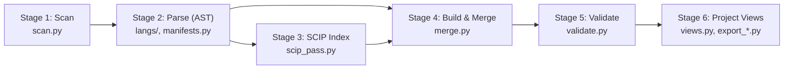

# Cartog Onboarding & Verification Report

## 1. What the Docs Claim

### Overview & Purpose
Cartog is a code-mapping CLI tool for Python, JavaScript, and TypeScript repositories. Its stated purpose is to automate codebase understanding by analyzing repository structure and producing:
1. A unified, validated property graph (`graph.json`) recording files, classes, functions/methods, routes, entrypoints/commands, and their verified connections (`imports`, `calls`, `serves`, `starts`, `contains`, `depends_on`, `overrides`).
2. Architecture diagrams via Mermaid (`overview.mmd`, `folder_<slug>.mmd`, `flow_<slug>.mmd`), rendered to images via `mmdc`.
3. Validation and integrity reports (`cartog check`) with configurable strictness.
4. Compact architectural briefs (`cartog digest`) tailored to fit LLM token budgets (~2,000–4,000 tokens).
5. Target intermediate outputs: `parse.json` (syntax AST via tree-sitter) and `scip.json` (precise symbol definitions and references via SCIP indexers).

### Core Architectural Principles & Key Design Decisions (from docs)
- **Precision over recall:** Verified links only; import resolution gives `confidence: "import"`, SCIP gives `confidence: "resolved"`, reconciled cross-root calls give `confidence: "reconciled"`, and speculative links get `confidence: "heuristic"` (excluded from default views).
- **Strict determinism & Stable IDs:** Node IDs are a deterministic SHA-1 10-char prefix of `kind + ":" + path + ":" + qualified_name` (`cartog/model.py:Node.create`). All outputs are sorted. (Note: `AGENTS.md` claims 12 chars; see Disagreements).
- **Pure-function serialization:** `graph.json` is the sole source of truth; views, diagrams, and digests are projections.
- **Fault tolerance:** Syntax errors or missing SCIP indexers degrade gracefully without aborting (recording failures in `meta` and continuing with partial AST data).
- **Coordinate standards:** All line numbers in `graph.json` are 1-based; column offsets are 0-based.
- **Native tree-sitter queries & statement-level AST pruning:** Native queries and statement whitelisting are used instead of naive recursive AST traversals to prevent Python GC crashes (`0xc0000005`) on large files (`docs/ISSUES_AND_DECISIONS.md` Decision 1).
- **Windows compatibility:** Preloaded `scip_windows_shim.js` via `NODE_OPTIONS` fixes `@sourcegraph/scip-python`'s backslash RegExp crash on Win32 (`docs/ISSUES_AND_DECISIONS.md` Issue 12).
- **JSONC tokenizer:** String-aware tokenizer replaces regex comment-stripping for `tsconfig.json`/`jsconfig.json` (`cartog/jsonc.py`).
- **Ignore precedence:** Strict additive hierarchy where `.gitignore` is evaluated first, `.cartogignore` can only add exclusions (cannot negate `.gitignore`), followed by `--ignore` CLI flags (`docs/ISSUES_AND_DECISIONS.md` Issue 20).
- **View noise filtering & edge rewiring:** Barrel re-exports (`__init__.py`, `index.ts`) and constants/type-only modules are hidden from views by default, with import edges rewired to defining sources ($A \to B \to C \implies A \to C$) (`docs/ISSUES_AND_DECISIONS.md` Issue 22). Direct SCIP `calls` edges are preserved without rewiring.
- **Universal View Model & Schema 2.0.0:** `Subsystem -> Folder -> File -> Class -> Function` hierarchy; boundary functions displayed, internal helpers collapsed (`+N internal helpers`); native `Node.parent` ID; default unindented compact JSON with redundant `contains` edges omitted by default (`docs/ISSUES_AND_DECISIONS.md` Issue 23).
- **LLM Safety:** `graph.json` should never be fed directly to an LLM; `cartog digest` is provided instead (`docs/HANDOFF.md:108`).

### Claimed Milestone Status (from docs)
Documentation (`docs/HANDOFF.md`, `docs/IMPLEMENTATION_PLAN.md`, `docs/ALIGNMENT.md`) claims:
- **Milestones 0–10:** COMPLETE (including M6.5 hardening and M10.1 flow hardening).
  - M0: Installable skeleton (`cartog --version`, `cartog doctor`)
  - M1: Tree-sitter on Python
  - M2: Imports & The First Map (Tree-sitter only)
  - M3: Python Framework Patterns & Manifests (Flask, FastAPI, Click, manifests)
  - M4: Tree-sitter on JS/TS & Monorepos (ESM/CJS, dynamic imports, tsconfig paths, workspaces)
  - M5: SCIP on Python (`scip-python`, protobuf bindings, enclosing function mapping, call linking)
  - M6: SCIP on JS/TS (`scip-typescript`, merge integration)
  - M6.5: Hardening & carry-over verification (Win32 shim, edge labels, manifest hiding, `test-d`)
  - M7: Cross-Check, Validation & `cartog check` extended (range containment, 1-based bounds, mismatch classification)
  - M8: `.cartogignore` support & ignore metrics
  - M9: Deterministic noise filtering & barrel import rewiring
  - M10 / M10.1: Universal View Model, compact serialization, flow BFS tracing (`cartog flow`), digest (`cartog digest`), queries (`cartog query`), candidate selector scoping.
- **Pending Milestones:**
  - Milestone 11: Interactive Viewer (`cartog view` with offline Cytoscape.js `map.html`) - NEXT
  - Milestone 12: Hand-written Subsystem Map (`subsystems.toml`) - PENDING
  - Milestone 13: Comparative verification against Grimp & Madge, and final documentation - PENDING

### Document Dates Observed
- `docs/HANDOFF.md`: Last updated 2026-10-28.
- `docs/IMPLEMENTATION_PLAN.md`: Updated through Milestone 10/10.1 (undated in header, revisions noted 2026-10-28).
- `docs/ALIGNMENT.md`: Initial audit 2026-10-27 (Claude Sonnet 4.6), updated 2026-10-28.
- `docs/AUDIT_SUMMARY.md`: 2026-10-27 (Claude Sonnet 4.6).
- `docs/KNOWN_ISSUES.md`: Undated, references M5/M6/M9/M10 findings.
- `docs/ISSUES_AND_DECISIONS.md`: Contains entries from M1 to Issue 25 (Discovered: 2026-10-28).
- `docs/BUILD_LOG.md`: Entries 1–22, with Entry 22 dated 2026-10-28.

---

## 2. Architecture as Implemented in Code

### Pipeline Stages
The Cartog execution pipeline is organized into 6 core stages orchestrated by `cartog/cli.py`:



1. **Stage 1: Scan & Ignore (`cartog/scan.py:44-129`):**
   - Walks the repository directory tree using `pathlib.Path.rglob("*")`.
   - Discovers language roots (looking for `pyproject.toml`, `setup.py`, `package.json`, `tsconfig.json`).
   - Implements strict ignore hierarchy (`scan.py:132-210`): `.gitignore` is loaded first via `pathspec.PathSpec`. Next, `.cartogignore` is loaded (exclusions only, cannot negate `.gitignore`). Finally, CLI `--ignore` glob patterns are added.
   - Emits `ScanResult` containing discovered files and skipped file metrics.

2. **Stage 2: AST Parsing & Manifest Extraction (`cartog/langs/`, `cartog/manifests.py`, `cartog/cache.py`):**
   - Invokes tree-sitter language adapters (`PythonAdapter` in `python_adapter.py:44-716`, `JSAdapter` in `js_adapter.py:64-776`).
   - Extracts symbol declarations (`class`, `function`, `method`), imports (`ImportRecord`), and framework patterns (Flask `@app.route`, Click `@click.command`, FastAPI, Express routes).
   - AST queries are cached on disk via SHA-256 content hashes (`cartog/cache.py:27-142`).
   - Manifests (`pyproject.toml`, `package.json`, `Dockerfile`) are parsed by `cartog/manifests.py:28-260` into manifest metadata facts.

3. **Stage 3: SCIP Semantic Indexing (`cartog/scip_pass.py:48-356`):**
   - Runs external semantic indexers (`scip-python` or `scip-typescript`) producing Protobuf SCIP index files.
   - On Windows, preloads `cartog/scip_windows_shim.js` via `NODE_OPTIONS` (`scip_pass.py:91-105`) to fix the `scip-python` Win32 RegExp backslash bug.
   - Decodes protobuf output into definitions and references, assigning enclosing symbol scopes based on 1-based source ranges (`scip_pass.py:214-356`).

4. **Stage 4: Build & Merge (`cartog/merge.py:96-676`):**
   - Combines parsed AST symbols, framework patterns, and SCIP references into a unified `Graph`.
   - Assigns stable node IDs (`Node.create`, `model.py:85`) and native `parent` hierarchy.
   - Resolves intra-project imports (`merge.py:355-460`), linking imports with `confidence="import"`.
   - Links routes/commands to handlers (`merge.py:313-338`) creating `serves` or `starts` edges with `confidence="resolved"`.
   - Reconciles SCIP references (`merge.py:465-530`) matching callers to callee symbol definitions, generating `calls` edges with `confidence="resolved"` or `"reconciled"`.

5. **Stage 5: Integrity Validation (`cartog/validate.py:64-460`):**
   - Verifies graph consistency: unique node IDs, valid edge kinds, valid confidence levels, parent containment, and 1-based line bounds (`validate_ranges`).
   - Cross-checks call references against import declarations (`validate_scip_calls`, `validate.py:330-455`), classifying mismatches as explained (built-in, dynamic, internal helper, framework) or unexplained.

6. **Stage 6: View Projection & Export (`cartog/views.py`, `cartog/export_mermaid.py`, `cartog/export_json.py`):**
   - `build_universal_view_tree()` (`views.py:495-653`) projects `Subsystem -> Folder -> File -> Class -> Function`.
   - Collapses internal helper functions (`+N internal helpers`) and detects noise modules (barrels, type-only files), rewiring imports to source definitions (`rewire_view_edges`, `views.py:350-445`).
   - Exporters generate compact `graph.json` (`export_json.py:20-65`), Mermaid diagrams (`export_mermaid.py`), LLM summaries (`cartog digest`, `views.py:847-975`), and BFS call flows (`cartog flow`, `views.py:788-845`).

### Data Model (`cartog/model.py`)
- **`SourceRange` (`model.py:16-43`):** `(start_line, start_col, end_line, end_col)` where line numbers are 1-based and column offsets are 0-based.
- **`Node` (`model.py:46-95`):**
  - Fields: `id: str`, `kind: str`, `name: str`, `qualified_name: str`, `path: Optional[str]`, `range: Optional[SourceRange]`, `language: Optional[str]`, `root: Optional[str]`, `attrs: dict[str, Any]`, `parent: Optional[str] = None`.
  - Node Kinds: `"file"`, `"class"`, `"function"`, `"method"`, `"route"`, `"command"`, `"entrypoint"`.
- **`Edge` (`model.py:100-117`):**
  - Fields: `source: str`, `target: str`, `kind: str`, `confidence: str`, `evidence: list[str] = field(default_factory=list)`, `count: int = 1`, `attrs: dict[str, Any] = field(default_factory=dict)`.
- **`Graph` (`model.py:120-184`):**
  - Fields: `nodes: dict[str, Node]`, `edges: list[Edge]`, `meta: dict[str, Any]`.
  - Provides query methods: `get_outgoing()`, `get_incoming()`, `neighbors()`, `callers_of()`, `callees_of()`.

### Edge Kinds & Confidence Values
- **Edge Kinds (`model.py:107-115`, `validate.py:47-55`):**
  - `"imports"`: Module-to-module or file-to-symbol import connection.
  - `"calls"`: Function/method invocation (SCIP-derived or AST pattern).
  - `"serves"`: Web framework route pointing to its endpoint handler function.
  - `"starts"`: CLI command / entrypoint pointing to executed target function.
  - `"contains"`: Structural hierarchy (file $\to$ class $\to$ method); omitted from default serialization when `Node.parent` is used.
  - `"depends_on"`: Manifest-level dependency (e.g. package $\to$ third-party lib).
  - `"overrides"`: Class inheritance method override (defined in model/validation).
- **Confidence Values (`model.py:113`, `validate.py:57-62`):**
  - `"resolved"`: Verified by static SCIP semantic resolution or AST pattern matching.
  - `"reconciled"`: Cross-root or re-export match resolved via reconciliation heuristics.
  - `"import"`: Derived from module import resolution.
  - `"heuristic"`: Speculative link (excluded from default views).
- **Node ID Scheme (`model.py:85`):**
  `make_node_id(kind, path, qualified_name)` $\to$ `sha1(f"{kind}:{path}:{qualified_name}".encode("utf-8")).hexdigest()[:10]`.
- **Schema Version (`cartog/config.py:11`, `model.py:133`):**
  `SCHEMA_VERSION = "2.0.0"`.

---

## 3. Milestone Status Audit (M0 – M10)

| Milestone | Title | Status | Evidence (Code) | Covering Tests |
|---|---|---|---|---|
| **M0** | Installable skeleton | **DONE** | `cartog/cli.py:51-60` (`doctor`, `--version`) | `tests/test_cli.py:test_version`, `test_doctor` |
| **M1** | Tree-sitter on Python | **DONE** | `cartog/langs/python_adapter.py:44-716` | `tests/test_python_adapter.py` (11 tests) |
| **M2** | Imports & The First Map | **DONE** | `cartog/langs/python_adapter.py:270-360`, `cartog/merge.py:355-460` | `tests/test_import_resolution.py` (12 tests) |
| **M3** | Framework Patterns & Manifests | **DONE** | `cartog/langs/python_adapter.py:530-716`, `cartog/manifests.py:28-260` | `tests/test_patterns.py` (7 tests), `tests/test_manifests.py` (8 tests) |
| **M4** | JS/TS & Monorepos | **DONE** | `cartog/langs/js_adapter.py:64-776`, `cartog/jsonc.py:22-135` | `tests/test_js_adapter.py` (8 tests), `tests/test_jsonc.py` (7 tests) |
| **M5** | SCIP on Python | **DONE** | `cartog/scip_pass.py:48-210`, `cartog/merge.py:465-530` | `tests/test_scip_pass.py` (6 tests) |
| **M6** | SCIP on JS/TS | **DONE** | `cartog/scip_pass.py:110-180`, `cartog/merge.py:465-530` | `tests/test_scip_pass.py` (covered jointly) |
| **M6.5** | Hardening & Carry-over | **DONE** | `cartog/scip_windows_shim.js`, `cartog/export_mermaid.py:42-80` | `tests/test_mermaid.py:test_edge_labels_descriptive` |
| **M7** | Validation & Cross-Check | **DONE** | `cartog/validate.py:64-460` (`validate_ranges`, `validate_scip_calls`) | `tests/test_merge_validate.py` (8 tests) |
| **M8** | `.cartogignore` Support | **DONE** | `cartog/scan.py:132-210` (`load_ignore_spec`, `should_ignore`) | `tests/test_scan.py` (9 tests) |
| **M9** | Noise Filtering & Rewiring | **DONE** | `cartog/views.py:175-445` (`detect_noise_files`, `rewire_view_edges`) | `tests/test_views_mermaid.py:test_noise_detection_*`, `test_rewire_*` |
| **M10 / M10.1** | View Model, Digest & Flow | **DONE** | `cartog/views.py:495-975`, `cartog/export_json.py:20-65`, `cartog/cli.py:919-1065` | `tests/test_views_mermaid.py`, `tests/test_flow_selector.py` (6 tests) |

*Full test suite execution: **111 passed, 1 warning in 20.02s** (exit code 0).*

---

## 4. Disagreements Between Docs and Code

1. **Node ID Prefix Length (`AGENTS.md` vs Code):**
   - `AGENTS.md` states: `Node.id = sha1(kind + ":" + path + ":" + qualified_name)[:12]`.
   - `cartog/model.py:85` and `tests/test_model.py:14` strictly compute and assert a **10-character** prefix: `[:10]`.
2. **`SourceRange` Line Indexing Docstring (`cartog/model.py:19`):**
   - Docstring in `cartog/model.py:19` still states `start_line: int (0-indexed)`.
   - In actual implementation (`cartog/langs/python_adapter.py:115`, `cartog/validate.py:110`, `AGENTS.md`), line numbers are strictly **1-based** across all adapters and `graph.json`.
3. **`package.json` File Reader Rule Violation (`AGENTS.md` vs `cartog/manifests.py:199`):**
   - `AGENTS.md` specifies: *"Strict JSON files (`package.json`) use `cartog.jsonc.load_strict_json_file()`. Never use bare `json.load()` or a regex comment-stripper."*
   - In `cartog/manifests.py:199`, `parse_package_json()` directly executes: `data = json.loads(file_path.read_text(encoding="utf-8"))`, violating the standing agent rule and bypassing BOM stripping.
4. **Path Category Precedence Inconsistency (`cartog/export_mermaid.py` vs `cartog/views.py`):**
   - `AGENTS.md` states: *"classify_path() in cartog/export_mermaid.py is the single source of truth for path categorization."*
   - However, `cartog/views.py:656` implements a private `_path_category()` with divergent precedence:
     - `views.py:_path_category`: evaluates `test_dirs` *before* top-level categories (`examples`, `docs`, `scripts`).
     - `export_mermaid.py:classify_path`: evaluates top-level categories (`examples`, `docs`, `scripts`) *before* `test_dirs`.
     - *Result:* An example test such as `examples/tutorial/tests/test_blog.py` is categorized as `"tests"` by `views.py`, but as `"examples"` by `export_mermaid.py`.
5. **CLI `cartog check` Default Parameter Mismatch with Multi-project Layout:**
   - `AGENTS.md` states: `cartog check` defaults exit non-zero if SCIP was requested but did not run.
   - When running `cartog check samples/click`, `cli.py:548` defaults `--out` to `cartog-out/graph.json` rather than detecting `cartog-out/click/graph.json`, exiting with code 1 unless explicitly passed `--out cartog-out/click` or targeting `cartog-out/click` directly.

---

## 5. Suspicious or Buggy Code (Ranked by Severity)

1. **High: Cache Deserialization Dropping `is_type_only` (`cartog/langs/__init__.py:76-87`)**
   - *Location:* `cartog/langs/__init__.py:76-87` in `_dict_to_parsed_file()`.
   - *Problem:* When deserializing cached AST parse records from `.cartog/cache/`, `ImportRecord` instances are reconstructed using `ImportRecord(module=imp["module"], names=imp.get("names", []), ...)` but completely omit `is_type_only=imp.get("is_type_only", False)`.
   - *Impact:* Cached TypeScript type-only imports silently lose their `is_type_only=True` flag on cache hits, causing `detect_noise_files()` in `views.py:270` to fail noise detection for type-only modules when the parse cache is warm.
2. **Medium: Hardcoded Sample Path in Validation Cross-Check (`cartog/validate.py:420`)**
   - *Location:* `cartog/validate.py:420`.
   - *Problem:* A hardcoded repo-specific rule was committed directly into validation:
     ```python
     if s_path == "src/click/exceptions.py" and t_path == "src/click/types.py":
         return "explained", "click exceptions/types type annotation cycle"
     ```
   - *Impact:* Violates general-purpose library abstraction; masks potential type cycle validation failures specifically for Click while failing on identical patterns in other repositories.
3. **Medium: Barrel Edge Rewiring Multiplying Call Counts (`cartog/views.py:407`)**
   - *Location:* `cartog/views.py:407` in `rewire_view_edges()`.
   - *Problem:* When rewiring an import edge through a barrel module that fans out into multiple defining files, the original edge's weight (`e.count`) is assigned identically to *all* target defining files without apportioning or checking symbol usage.
   - *Impact:* Artificially inflates cross-file coupling metrics and diagram edge label counts.
4. **Low: Duplicated Path Classifier with Divergent Precedence (`cartog/views.py:656` vs `cartog/export_mermaid.py:42`)**
   - *Location:* `cartog/views.py:656-685` and `cartog/export_mermaid.py:42-80`.
   - *Problem:* Redundant categorization logic implemented to prevent circular imports, but with reversed directory evaluation order.
5. **Low: Unhandled UTF-8 BOM in `manifests.py:199`**
   - *Location:* `cartog/manifests.py:199`.
   - *Problem:* Uses bare `file_path.read_text(encoding="utf-8")` instead of `load_strict_json_file()` which handles UTF-8 BOM (`utf-8-sig`) and provides clean error reporting.

---

## 6. Root Causes of Flow-View Problems on Flask (`GET /`)

When executing `cartog flow samples/flask "GET /"`, three primary issues occur:

```mermaid
flowchart TD
    subgraph Issue1["Issue 1: 130 Unfiltered Candidates"]
        A["Target 'GET /'"] --> B["find_flow_candidates()"]
        B --> C["Matches 130 routes in tests/ & examples/"]
        C --> D["Old view: all 25+ enqueued as BFS roots simultaneously<br/>Current view: Aborts with candidate list"]
    end

    subgraph Issue2["Issue 2: Route Serves Wrong Handlers"]
        E["merge.py: symbols_by_name"] --> F["Flat dict keyed by simple name 'index'"]
        F --> G["Multiple 'def index()' in test file overwrite each other"]
        G --> H["Route linked to last def index() instead of decorated handler"]
    end

    subgraph Issue3["Issue 3: Call Chains Stop at Depth 1"]
        I["CLI: _resolve_graph()"] --> J["cartog-out/graph.json not found -> builds in-memory"]
        J --> K["scip_result=None -> 0 calls edges created"]
        K --> L["BFS follows 'serves' -> stops with 0 callees"]
        M["When SCIP present:"] --> N["Re-exports via flask/__init__.py unresolved in scip_pass"]
        N --> L
    end
```



### 1. Drawing ~25 Unrelated Routes (Candidate Explosion)
- **Code Evidence:** `cartog/views.py:704-768` (`find_flow_candidates`), `cartog/views.py:822-826` (`trace_call_flow`).
- **Explanation:** In `samples/flask`, the route path `"GET /"` is defined in test files (`tests/test_basic.py`, `tests/test_blueprints.py`, etc.) and examples (`examples/tutorial/flaskr/blog.py`, `examples/celery/src/task_app/__init__.py`) across 130 separate locations. In original versions of `views.py`, `trace_call_flow()` enqueued all matched nodes across tests and examples simultaneously as BFS starting roots (`for start in matched_nodes: queue.append((start.id, 0))`), drawing dozens of disjoint route subgraphs on a single diagram.
- **Current Hardening:** M10.1 (`views.py:770-785`, `cli.py:967-975`) filters tests and examples by default, prompting the user with a numbered candidate list and `--pick N` option. When tested directly against `samples/flask`, `cartog flow` identified all 130 candidate routes and safely exited non-zero requesting `--pick`.

### 2. One Route Node Having `serves` Edges to Multiple Non-Handler Functions
- **Code Evidence:** `cartog/merge.py:247`, `cartog/merge.py:314-328` (`_pick_handler`), and `docs/ISSUES_AND_DECISIONS.md:915` (Issue 25 H1).
- **Explanation:** In `merge.py`, function symbols were originally stored in a flat dictionary `symbols_by_name[s.name] = sym_node` using only the simple function name. In test files defining dozens of helper functions named `def index()` inside various fixtures or test suites, subsequent definitions overwrote earlier entries. When a route pattern was linked to its handler at line 324, `symbols_by_name[handler_name]` resolved to whichever `index` function was parsed last in the file rather than the function immediately following the route decorator. Additionally, colliding route qualified names caused multiple handlers to attach to a single route node.
- **Current Fix:** `cartog/merge.py:190` now collects `symbols_by_name_list: dict[str, list[Node]]` and uses `_pick_handler()` (`merge.py:53-75`) to select the handler function with the closest line number $\ge$ the decorator's end line.

### 3. Call Chains Stopping After One Call
- **Code Evidence:** `cartog/cli.py:898-916` (`_resolve_graph`), `cartog/views.py:813-816`, `cartog/scip_pass.py:290-340`, `docs/KNOWN_ISSUES.md:20-35` (Rank 1).
- **Explanation:**
  1. *Missing SCIP on Ad-hoc CLI Invocation:* In `cli.py:_resolve_graph()` (`cli.py:898-916`), running `cartog flow samples/flask "GET /"` defaults `--out` to `cartog-out`. If `cartog-out/graph.json` does not exist, `cli.py` executes an in-memory parse via `build_graph(parsed_files, scip_result=None)`. Because `scip_result` is `None`, **zero `calls` edges are generated in the graph**. BFS follows `serves` from the route to the handler function and immediately stops because the handler has zero outgoing call edges.
  2. *Re-export Chain Resolution Failure:* Even when pre-indexed SCIP data is loaded from `cartog-out/flask`, Flask application handlers (e.g. in `flaskr/blog.py`) predominantly invoke library utilities imported from the top-level package (`from flask import render_template, request, url_for, flash, redirect`). While SCIP indexes calls to `flask.render_template`, `merge.py` and `scip_pass.py` do not follow the re-export chain in `flask/__init__.py` back to the defining module `flask.templating.render_template`. The callee cannot be resolved against a known node definition, so no `calls` edge is merged, leaving the handler with 0 outgoing calls and truncating the flow trace.

---

## 7. Unread Modules, Unverified Claims & Unknowns

### Files and Code Not Read in Full
- **Synthetic Test Suites:** Test function bodies were not read in full for 11 out of 17 test files (`test_cli.py`, `test_manifests.py`, `test_jsonc.py`, `test_scan.py`, `test_views.py`, `test_config.py`, `test_json_export.py`, `test_parse_cache.py`, `test_python_adapter.py`, `test_scip_windows_shim.py`, `test_cache_force.py`). Test file names and test function inventories were cataloged in `docs/CODE_MAP.md`.
- **Historical Logs:** Chronological historical entries in `docs/BUILD_LOG.md` (Entries 1–21) and detailed problem logs in `docs/ISSUES_AND_DECISIONS.md` prior to Issue 15 were not read in full (read via top indices and relevant referenced decisions).
- **Third-Party & Generated Files:** Tree-sitter native C-extensions/grammars, external indexer binaries (`@sourcegraph/scip-python`, `@sourcegraph/scip-typescript`), and output artifact files (`graph.json`, `parse.json`, `scip.json`, `cartog-out/`) were not opened whole, in strict accordance with the rules.

### UNVERIFIED Claims
- **UNVERIFIED:** End-to-end `mmdc` image rendering to PNG/SVG in a standard unsandboxed desktop terminal. In the execution sandbox, headless Chromium launch is restricted (`mmdc could not launch browser`), so image generation was bypassed, though Mermaid markup generation (`.mmd`) was verified.
- **UNVERIFIED:** Scalability of `scip-typescript` on multi-package TypeScript workspaces with complex `tsconfig.json` project references (`samples/ky` is a single package).

### UNKNOWN
- **UNKNOWN:** Exact AST parsing performance and memory consumption on repositories exceeding 500,000 lines of code.
- **UNKNOWN:** Cytoscape.js runtime behavior and bundle packaging for Milestone 11 interactive viewer (`cartog view`), as M11 implementation has not commenced.
