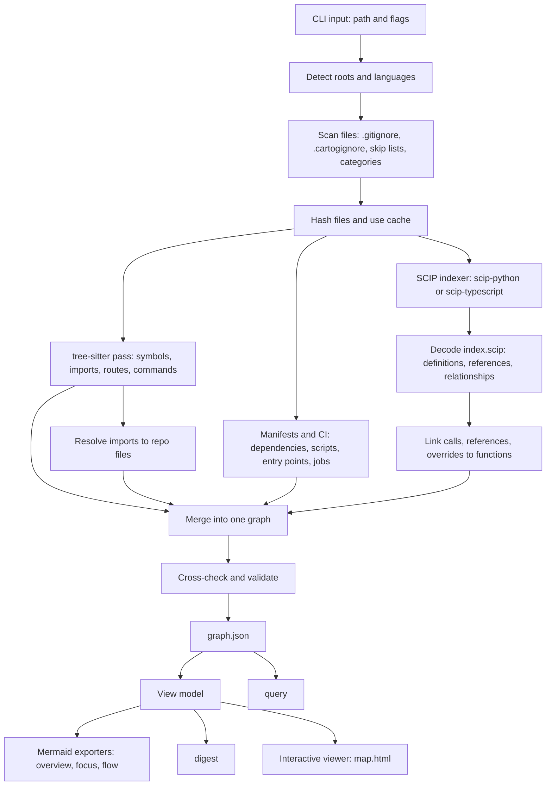

# Cartog: Project Report

*Cartography for codebases*

Compiled: 1 November 2026. Scope: everything decided, built, and learned from the first design conversation (5 October 2026) through the completion and verification of Milestones 10 and 11 (Phase A through F).

---

## 0. How to read this report

Sources: the design conversation with Claude; the reports and pasted outputs from the build agent (Gemini, running in Antigravity); the committed source code and tests in the repository; and the diagrams, digests, interactive viewer files, and logs produced from runs on three sample repositories.

Statements about code come from verified inspection of the repository files, test suite runs, and command execution. Each important claim carries a tag:

| Tag | Meaning |
|---|---|
| **[Seen]** | Visible in output pasted into the conversation (a diagram, digest, viewer, or log) |
| **[Verified]** | Directly confirmed by inspecting code in the repository or running test suites |
| **[Reported]** | Stated by the build agent. Not independently checked |
| **[Decided]** | A design decision made in the conversation |
| **[Planned]** | Designed but not built |
| **[Unverified]** | Stated by someone, but evidence is missing or contradictory |

Section 20 collects every unverified item in one place and notes those that have since been resolved.

---

## 1. Executive summary

**What it is.** Cartog is a command-line tool that reads a software project and produces a verified map of how it fits together: folders, files, classes, functions, imports, calls, routes, commands, entry points, and dependencies. It writes a machine-readable graph (`graph.json`) and derives from it Mermaid diagrams, a compact digest meant for LLM input, and a query interface.

**Why it exists.** Getting familiar with an unfamiliar codebase is slow, even with good documentation. The original idea was an AI application that analyzes a GitHub repository and draws how data and control flow through it.

**The core idea.** Structure comes from deterministic tools: tree-sitter for syntax, and SCIP indexers (built on real compilers and type checkers) for resolving which definition each usage points to. Every edge carries a confidence label. An LLM may later *describe* the verified structure (names, roles, subsystem grouping), but it never produces the structure. This addresses accuracy, token cost, and privacy at once.

**Where it stands (1 November 2026).**
- **[Verified]** Python and JavaScript/TypeScript pipelines are built and verified through Milestone 11 (Interactive Viewer `cartog view`), with **157 passing tests** (up from 111 baseline).
- **[Verified]** Tasks T0 through T18 are accepted; T19 (HTML export engine) and T20 (`cartog view` CLI command) are implemented, tested, and ready for user check.
- **[Seen]** The interactive viewer (`cartog view`) produces 100% offline self-contained `map.html` files with inlined Cytoscape.js, layout engines, and styling (zero external network tags). Tested on Click (1,684 nodes, 1,555 edges), Flask (1.21 MB), and Flask call flow trace (0.83 MB).
- **[Verified]** Phased remediation (T0–T17) resolved previous trust, count, and traversal issues:
  - Trust in validation: removed hardcoded exemption in `cartog/validate.py:420`, added negative tests and dangling-edge checks.
  - Repeated import counts: barrel rewiring now assigns exact per-imported-symbol counts instead of aggregate duplication.
  - Example-to-library and re-export call linking: resolved through SCIP local symbol rewriting (calls from examples into `flask/__init__.py:render_template` now resolve directly into `src/flask/templating.py`).
  - Function-level overview: `--level function` provides compound folder → file → class → function nesting with `+N internal helpers` and node budgets.
  - Deterministic noise filtering (Milestone 9): hides re-exports, constants/types, and `TYPE_CHECKING` guards by default, toggled with `--show-noise`.
  - Schema 2.0.0 compact serialization: removed redundant `contains` edges in favor of `parent` node attributes and unindented JSON default, cutting `graph.json` disk sizes by 44% to 50%.
  - LLM Digest: token budgets measured with `cl100k_base` at 1,053 tokens (Click), 1,460 tokens (Flask), and 1,810 tokens (Ky)—all well within the < 4,000 token limit.
- **Open:** Milestone 12 (hand-written subsystem map `subsystems.toml`), Milestone 13 (comparative verification with `grimp` and `madge`, packaging verification, final docs), and the downstream LLM narration layer. See sections 15 and 17.

**Key numbers seen so far**

| Item | Value | Source |
|---|---|---|
| Tests passing | 157 (0 failures, 1 warning) | [Verified] full pytest suite |
| Schema 2.0.0 size reduction: click | 3.32 MB → 1.85 MB (-44.3%) | [Verified] T16 evidence |
| Schema 2.0.0 size reduction: flask | 2.39 MB → 1.27 MB (-46.9%) | [Verified] T16 evidence |
| Schema 2.0.0 size reduction: ky | 1.29 MB → 0.64 MB (-50.3%) | [Verified] T16 evidence |
| click: files indexed by SCIP | 91 documents, 5,826 definitions, 22,626 references | [Reported] |
| click: `calls` edges | 2,003 → 2,242 after qualified-name keying | [Verified] T6 spot-check |
| click: of 2,242 "calls", real call expressions | 1,251 (55.8%) | [Reported] |
| click / ky: SCIP implementation relationships | 267 / 34 | [Reported] |
| flask digest tokens (cl100k_base) | 1,460 tokens (4,643 chars) | [Verified] T16 evidence |
| click / ky digest tokens (cl100k_base) | 1,053 / 1,810 tokens (< 2,000 tokens) | [Verified] T16 evidence |
| flask: reconciled test-to-library calls | 173 (66 + 17 + 90) | [Seen] |
| interactive viewer: click `map.html` | 1,684 nodes, 1,555 edges, 1.36 MB, 0 network tags | [Verified] T21 run |
| interactive viewer: flask `map.html` | 1.21 MB overview, 0.83 MB flow trace (`run`) | [Verified] T21 run |

---

## 2. Origin, problem, and positioning

### 2.1 The problem
A new engineer has to learn where things are, how a request travels through the system, which parts depend on which, and what technology is used. Documentation helps, but it goes stale and rarely shows structure.

### 2.2 The original vision, and why it narrowed
**Original:** an AI application that connects to GitHub (OAuth), analyzes the whole repository, and produces a visual map of application flow, subsystems, API routes, data routes, and technology, with a plain-English description of each function (without showing code).

**Concerns raised immediately:** sending a codebase to third-party models is a privacy problem and costs many tokens.

**Design answer (Decided):** the LLM should not be the analyzer, only the narrator. Routes, imports, call graphs, data models, and tech stack can be extracted deterministically. The model describes small, verified pieces. Privacy options discussed for a hosted product: a GitHub App (fine-grained, read-only, short-lived tokens) instead of a plain OAuth app; ephemeral sandboxes; secret scanning before anything is sent; an ignore file and an audit log of what was sent; a choice of model location (hosted with zero retention, bring-your-own key, self-hosted/local, or running the analyzer in the customer's CI). Token savings discussed: hierarchical (map-reduce) summarization, spending by importance (graph centrality), content-hash caching and incremental updates, model tiering, batch APIs, short structured outputs, and generating function-level explanations only when a user clicks.

**How the scope narrowed, step by step:**
1. A prototype that takes public repo links.
2. Then a handful of repositories the author knows well, precomputed offline (because SCIP indexers need dependencies installed, which is slow and risky for arbitrary repos).
3. Then a **CLI with a core engine**, because accuracy is easier to iterate on there, and front ends (static viewer, VS Code extension, a hosted service) can be added later on the same JSON.
4. The project is presented as something built for personal use, which made accuracy and a clear verification story more important than breadth.

### 2.3 Timeline

| Date | Event |
|---|---|
| 5 Oct 2026 | Idea and architecture design begin |
| About 15 to 16 Oct | The author learns of Graphide, joins its Discord, and connects with its founders on LinkedIn |
| 18 Oct | Build planning, build prompt for the coding agent, repo creation |
| 22 Oct | Email from Ben McIntyre (CTO, Graphide) about the author's earlier org dependency analyzer ("blast radius" idea). The reply names Cartog and describes the tree-sitter plus SCIP approach |
| Late Oct | Milestones 0 to 10 built (exact dates not recorded) |
| 29–31 Oct | Phased remediation (T0–T17): Trusting the checks, barrel count tracking, flow selector & candidate disambiguation, function-level overview, noise filtering, Schema 2.0.0 compact serialization, 152 passing tests |
| 31 Oct – 1 Nov | Milestone 11 Interactive Viewer (T18–T20): offline Cytoscape stack bundling, HTML export engine, `cartog view` CLI command, real-world verification on click, flask, ky; 157 passing tests |
| 1 Nov 2026 | This report update |

**Origin documentation (Decided).** To show that the idea predates Graphide, the repository should carry an openly dated origin note (planning began 5 October, Graphide discovered mid-October). Changing commit timestamps was declined: the real timeline is stronger and cannot be contradicted.

### 2.4 Graphide: the overlapping product
Based on pages read during the conversation (not independently confirmed):
- A desktop editor for developers who use AI coding agents. It builds a map of modules, files, classes, functions, and the calls between them, with a plain-English description per node. The map is editable, versioned in the repo, served to agents over MCP, and checked in CI (`gr check`). Described as YC F26-backed.
- Its shared sample maps (Postgres, Flask, ky, gbrain, fzf, click) contain about 20 to 40 boxes anchored to folders and files, with LLM-written roles, actors and external systems, edges labeled with symbol names, and an "inferred" legend entry. Interpretation: deterministic extraction plus an LLM-curated architecture view. The author reports that it renders with Mermaid.
- It maps the whole codebase, not only diffs. Its cloud receives symbol names, signatures, short excerpts, and paths while signed in.

**Cartog's differences:** a CLI whose maps are verifiable and checkable; deterministic structure with confidence labels; nothing leaves the machine; focus on onboarding, routes, and data flow instead of supervising agents.

### 2.5 What "showcase quality" means here
Precision over recall: every edge drawn should be true, even if some are missing. A viewer who spots one wrong arrow stops trusting the map. Claims must be stated with their verification ("verified against grimp and madge on N repos"), and limits stated openly.

---

## 3. Principles

1. **Deterministic first.** The LLM is a narrator over verified facts and is never the extractor. It never reads `graph.json` (too large, and unnecessary); it reads a small digest.
2. **Precision over recall.** Unresolved or dynamic edges are marked or omitted, never guessed.
3. **Confidence on every edge.** Direct resolution, import-level, reconciled (lower confidence), and later inferred (LLM).
4. **Fail soft, but loud.** A failed SCIP run must not stop the pipeline, but it must be printed, stored in full, and make `cartog check` fail. The same goes for config files that fail to parse.
5. **Nothing silent.** Skipped files, ignored files, dropped edges, collapsed nodes, and rolled-up edges are always counted and reported.
6. **`graph.json` is the source of truth.** Exporters are pure functions over it.
7. **Verifiable.** Cross-check tree-sitter against SCIP, test with fixtures (including negative tests that must fail), compare against independent tools, and spot-check edges against source.
8. **Incremental and installable at every step.** Each milestone ends with a demo on a real repository and a pause for confirmation.
9. **Privacy by architecture.** Runs locally. No analyzed code is sent anywhere.
10. **Never write into the analyzed repository.**
11. **Line numbers are 1-based** everywhere in `graph.json`.
12. **`.gitignore` is always followed.** `.cartogignore` can only add exclusions.
13. **Stable, deterministic output.** Stable node IDs and sorted output, so reruns produce clean diffs.

---

## 4. Architecture overview



**Why two analysis tracks.** Tree-sitter understands what code *looks like*: it works on any file, needs no build, tolerates broken code, and finds functions, classes, imports, and framework patterns. It cannot tell which of several same-named definitions a call refers to. SCIP indexers run a real compiler front end and resolve that exactly, but need the project set up (dependencies installed) and exist for fewer languages. Cartog uses both: tree-sitter for structure and as a fallback, SCIP for exact call resolution, and a cross-check between them.

**Why a graph file between analysis and diagrams.** Mermaid is a drawing format, not a data format. Verification, tests, the digest, the query command, and any future viewer all need structured data.

---

## 5. Technology choices and why

| Component | Choice | Why | Caveats / alternatives |
|---|---|---|---|
| Implementation language | Python, installable CLI (`pip install -e .`, console script `cartog`) | Author's working language; good tree-sitter and protobuf bindings; easy to package and test | CLI framework: Typer (`typer>=0.12.0`). **[Verified: `cartog/cli.py` and `pyproject.toml`]** |
| Syntax parsing | tree-sitter through py-tree-sitter (`tree-sitter`, `tree-sitter-python`, `tree-sitter-javascript`, `tree-sitter-typescript`) | One API for many languages, error tolerant, fast, query language for patterns | Parses one file at a time; cannot resolve names across files |
| Tree-sitter pin | `tree-sitter>=0.25.2,<0.26` **[Verified: `pyproject.toml`]** | Version 0.26.0 of the Python binding has a refcount bug in `Point.row` / `Point.column` that corrupts the heap and crashed a test far from the cause (upstream issue #500; the agent's report cited #487, which could not be confirmed) | Do not set `QueryCursor.match_limit` on 0.25.x: it arms a 10 ms timeout and can silently truncate matches (issue #502). Relax the pin once a fixed release exists |
| Symbol resolution | SCIP indexers: `scip-python` (built on Pyright) and `scip-typescript` (TypeScript compiler API) | They reuse real compiler front ends, so name resolution is exact | Need Node.js and a set-up project. SCIP chosen over LSIF (older, JSON, larger). A generic LSP client and GitHub's stack-graphs were considered as ways to reduce per-language cost **[Planned/considered]** |
| SCIP decoding | Protobuf bindings generated from `scip.proto` (`cartog/scip_pb2.py`) | Fast, no extra binary at runtime | Alternative: shell out to `scip print --json` (no protoc needed, slower, bigger output). Commit the generated file so a git install does not need `protoc` |
| Ignore handling | `pathspec` (gitignore syntax) | Same semantics as git | `.cartogignore` layers on top (section 7.2) |
| Diagram output | Mermaid text, validated with `mmdc` (`@mermaid-js/mermaid-cli`) | Renders natively on GitHub and in many Markdown tools, plain text, diffable | Static, size limits, weak nested layout (section 16) |
| Interactive viewer | Cytoscape.js with compound nodes, `cytoscape-expand-collapse` (v4.1.1), `cytoscape-fcose` (v2.2.0), `layout-base` (v2.0.1), `cose-base` (v2.2.0). **[Verified: vendored offline in `cartog/view_assets/`, packaged in `pyproject.toml`, MIT licenses in `VENDOR_LICENSES.txt`]** | Mermaid cannot expand or collapse; Cytoscape supports nested containers and 100% offline embedding | Generates single `map.html` with zero external network requests (`cartog view`) |
| JSON config parsing | Custom string-aware JSONC tokenizer (`cartog/jsonc.py`); `package.json` loaded as strict JSON | Regex comment stripping broke on URLs (`https://`) and globs like `src/**/*` | Parse failures are warnings recorded in `meta`, never silent |
| Manifests | `tomllib` for `pyproject.toml`, plain parsers for `requirements*.txt`, `package.json`, Dockerfile, compose; CI workflow jobs read with a small custom parser **[Reported]** | Gives tech stack, entry points, scripts, services, CI jobs without an LLM | |
| Verification tools | `pytest`; `grimp` (Python imports) and `madge` / `dependency-cruiser` (JS/TS) for comparison **[Planned]** | Independent ground truth for import edges | Every disagreement is either a Cartog bug or a tool limitation |
| Sample repositories | click (Python, `src/` layout, examples and tests), flask (Python, routes, nested packages), ky (TypeScript) | Well known, mid-sized, the same repos Graphide's samples used, so output can be compared | |
| Coding agent | Gemini in Antigravity; OpenCode with free models considered | Author's tooling and budget | Section 9 |

### Windows-specific
`scip-python` crashed on Windows because a lone backslash (`path.sep`) reached `new RegExp(...)`, which is an invalid pattern. Cartog sets `NODE_OPTIONS="-r <cartog/scip_windows_shim.js>"` for the indexer subprocess only (win32 only). The shim replaces the global `RegExp` with a wrapper that rewrites the single-backslash pattern to `[\\/]` and passes everything else through. It must ship as package data. A fresh-venv `pip install .` was **[Reported]** to include it, and SCIP then indexed all 91 click documents. The long-term fix is to report the bug upstream to scip-python.

---

## 6. Data model

### 6.1 Nodes

| Kind | Meaning |
|---|---|
| `folder`, `file` | File-system structure |
| `class`, `method`, `function` | Symbols from tree-sitter, with qualified names and ranges |
| `route` | An HTTP route (for example `GET /hello`) bound to a handler |
| `command` | A CLI command (for example a click command) |
| `entrypoint` | `if __name__ == "__main__"`, console scripts, `bin` entries |
| `dependency` | An external package from a manifest or import |
| `ci_job` | A CI workflow job |

Node fields include: `id`, `kind`, `name`, `qualified_name`, `path`, `range` (`[start_line, start_col, end_line, end_col]`, **lines 1-based, columns 0-based**), `root`, and (in the compact format) `parent`.

**IDs.** Short hash of path plus qualified name, so output is stable between runs. Length is exactly 10 characters (`sha1(kind + ":" + path + ":" + qualified_name)[:10]`). **[Verified: `cartog/model.py:make_node_id`]**

### 6.2 Edges

| Kind | From → to | Meaning |
|---|---|---|
| `imports` | file → file | Resolved import inside the repo (count = number of import names, lines in evidence) |
| `depends_on` | file → dependency | Import of an external package. Validation rule: never between two repo files |
| `calls` | function → function | A syntactic call expression resolved by SCIP |
| `references` | symbol → symbol | Any other reference, with `ref_kind`: decorator, exception, isinstance, inheritance, type, callback, other |
| `overrides` | method → method | From SCIP implementation relationships, only between repo symbols |
| `serves` | route/command → handler | Binds a route to the function directly under its decorator |
| `starts` | entrypoint → file | What an entry point launches |
| `contains` | parent → child | Removed in the compact schema; replaced by `parent` on nodes |

Edges carry `count`, `evidence` (`path:line` strings, 1-based), and `confidence`.

**Confidence values:** `resolved` (SCIP direct), `import` (tree-sitter resolution), `reconciled` (SCIP symbols matched after normalizing a package prefix; lower confidence), and later `inferred` (LLM).

**Why `calls` is strict.** Of 2,242 SCIP-derived "calls" on click, only 1,251 were real call expressions; the rest were decorators (97), exception classes in `except`/`raise` (41), `isinstance` checks (30), base classes (3), annotations (2), and other references such as callbacks and attribute reads (about 820). Treating decorators as runtime calls would create false coupling into framework code, so `calls` is reserved for call expressions and the rest are `references` with a `ref_kind`. **[Decided]** A `callback` kind was added for an identifier passed as an argument (for example `runner.invoke(cli)`).

### 6.3 Meta and stats
`graph.json` also holds `schema_version` (`2.0.0` for the Schema 2.0.0 compact format; `parent` attributes replace redundant `contains` edges, with unindented JSON as the default), `meta` (per-root SCIP status: ran, indexer, documents, error, interpreter and warnings; ignore sources and counts; config-file parse warnings; what was hidden or collapsed; noise classifications), `stats` (node and edge counts by kind), the skipped-files list, the unresolved-imports list, and mismatches from the cross-check. **[Verified: `cartog/model.py` and `cartog/merge.py`]**

---

## 7. Pipeline, stage by stage

### 7.1 Input, roots, languages
Languages are detected from extensions and manifests. **Roots** are found recursively: any folder with `pyproject.toml`, `setup.py`, or `setup.cfg` (Python), or `package.json` / `tsconfig.json` (JS/TS); a `src` or `lib` folder inside a root counts as a source root. Every file belongs to its nearest enclosing root, and module names are computed relative to that root. *Why:* a first version only scanned the repo's immediate children, so `examples/complex` (its own project) was missed and its imports were wrongly labeled as external packages.

### 7.2 Scan, filter, ignore
Walks the tree, respecting `.gitignore`; skips virtual environments, `node_modules`, build output, `__pycache__`, minified and generated files, lockfiles, binaries, and huge files; records every skip with a reason.

**Categories** (a path-pattern classification used only for views): source (default), tests, docs, examples, scripts. Source folders are drawn expanded; other categories are drawn as one collapsed node each, with aggregated edges to the specific files they use. Rule: the **outermost** category wins (`examples/tutorial/tests` is examples). Test patterns cover any path segment (`tests`, `test`, `__tests__`, `test-d`, `e2e`) and filename patterns (`*.test.*`, `*.spec.*`, `test_*.py`, `*_test.py`, `*_test.go`); a bare `spec` folder is not tests by name alone. **[Verified: `cartog/scan.py` and `cartog/export_mermaid.py`]**

**Ignore vs category vs noise.** `.cartogignore` (optional, at the repo root, `.gitignore` syntax) removes files from analysis entirely: never parsed, never drawn, edges into them dropped and counted, and the hash of the rules is part of the cache key. It can only *add* exclusions; it cannot re-include anything `.gitignore` excluded (`!` only negates patterns inside `.cartogignore`). A repeatable `--ignore` flag does the same for one run. **[Verified: Milestone 8 audited in T0/T1]**.

**Deterministic noise filtering (Milestone 9):** Completed in Task T15 via `detect_noise_files()` in `cartog/views.py`. Identifies re-export-only barrels, constants/types-only files, and `if t.TYPE_CHECKING:` guards. Noise files are stored in `graph.meta["view_noise_filtered"]` and excluded from views by default, but can be revealed with `--show-noise`. **[Verified]**

### 7.3 Hash and cache
Parse results are cached by content hash, keyed together with an extractor/schema version. *Why:* after the line-number fix the old cache kept serving 0-based ranges until it was deleted by hand; a version in the key makes this automatic. The cache bug where the `is_type_only` flag on imports was dropped on a warm cache was fixed and verified with cold-versus-warm parity tests in Task T2 (`cartog/cache.py`). **[Verified]**

### 7.4 Tree-sitter pass
**Python adapter:** functions, classes, methods with qualified names and ranges; `import a.b`, `from a import b`, relative imports, `__all__`; framework patterns: Flask (`@app.route`, `@bp.get`...), FastAPI (`@app.get/post...`), click (`@click.command`, group commands), `if __name__ == "__main__"`.
**JS/TS adapter:** symbols and imports for JS, TS, and TSX, including `import type` and `export type`; monorepo workspaces and `tsconfig` handling.
**Route and command identity.** IDs must include the enclosing scope and the decorator line, and a `serves` edge binds only to the function directly under its decorator. Earlier versions keyed by path and name, so many nested commands named `cmd` collapsed into one node, and (in the flow view) one `GET /` route node served ten functions.
**False route.** A route node `GET USER` was created from `click.option(..., default=lambda: os.environ.get("USER", ""))` because the matcher fired on any `.get("...")` inside a decorator. Route detection is restricted to the decorator's own attribute on an object assigned from a known framework constructor. **[Reported]**

### 7.5 Import resolution
*Python:* relative levels, `__init__.py` packages, `src/` layout, `from pkg import name` where `name` is a submodule or a symbol; stdlib recognized with `sys.stdlib_module_names` and not emitted as dependency nodes by default; third-party versus local classified.
*JS/TS:* relative paths, extensions, `index` files, `tsconfig` `paths`/`baseUrl`, workspace packages, **self-reference** (a repo importing its own package name, such as ky's tests importing `'ky'`) resolved through the root `package.json` name and its `exports`, `main`, `module`, and `types` fields, mapping built-output paths back to source through `tsconfig` `outDir`/`rootDir`. Anything unresolved is logged, never guessed; genuinely external packages become dependency records, not edges.
**Why this matters.** A regex comment stripper broke on URLs inside `package.json`, the load silently returned nothing, the resolver never learned the package's own name, and all 21 `test-d` files in ky ended up with zero edges and a fake `external:ky` dependency.

### 7.6 Manifests
`pyproject.toml` (dependencies, scripts), `requirements*.txt`, `package.json`, Dockerfile, compose, `.github/workflows`. They give the tech stack, entry points, services, and CI jobs. They must respect `.gitignore` (a bug let `samples/` leak in), and `build_graph` is a pure function that does no disk discovery (the CLI parses manifests and passes them in). Manifest files are hidden in file-level views by default (`--show-manifests`) but kept in `graph.json`.

### 7.7 SCIP pass
**Invocation (checked against `scip-python index --help`):** `scip-python index --cwd <target> --project-name <name> --output <path under Cartog's output folder>`. There is no positional path argument. `--environment <json>` exists but is marked experimental, and putting Pyright settings (`pythonPath`, `extraPaths`) in it made the indexer exit with code 1.
**Fail-soft but loud:** if the indexer is missing, fails its pre-check, or times out, Cartog continues without call edges, stores the **full** error in `meta.scip.error` and a log file, prints `SCIP: FAILED (reason). No call edges in this graph.`, and `cartog check` exits non-zero. A Milestone 5 run showed `meta.scip.ran=false` with a truncated error and zero calls edges, while the diagram still looked fine; that is why the behavior is loud.
**Decode:** definitions versus references from the role bitmask (`0x1` = definition), `enclosing_range` on definitions, symbol information and relationships.
**Never write into the analyzed repo:** index output goes under Cartog's output folder; any interpreter or path configuration must be outside the repo. `samples/click/index.scip` was found and deleted by hand twice during testing, so whether Cartog itself leaves it there is an open check.

### 7.8 Linking calls
For each reference occurrence: find the innermost function containing it (tree-sitter ranges), look up the defining function through the SCIP symbol, classify the occurrence with the tree-sitter node at that position (call expression versus decorator, exception, `isinstance`, base class, annotation, callback argument, other), and add a `calls` or `references` edge. Relationships with `is_implementation` become `overrides` edges. A call through `self.method()` resolves to the base-class method; a `Group` instance really runs its own override, so flow views draw override targets as lower-confidence dashed edges.

**Reconciliation (tests and examples into the library).** On click, definitions in `src/click` were indexed with the descriptor prefix `` `src.click` `` while references from tests and examples pointed at `click` package descriptors. The fix matches an anchored prefix derived from detected roots, requires equal package names, an existing target file, and equal descriptors, tagging edges `reconciled`. In Task T5 and `cartog/scip_pass.py`, SCIP local symbol occurrences (e.g. `local 4` from `from flask import render_template`) are rewritten to synthetic module descriptors, resolving cross-module calls through re-export barrels such as `flask/__init__.py` into target definitions like `templating.py:render_template`. **[Verified]**

### 7.9 Merge
One graph with stable IDs, deduplicated edges (aggregated with counts), and a confidence on each. Symbol-to-node maps are keyed by **(path, qualified name)**, not (path, name): the earlier key made `Group.format_options` overwrite `Command.format_options`, which silently misattributed calls and changed the call count from 2,003 to 2,242. In Task T3, barrel rewiring was fixed to assign exact per-imported-symbol counts rather than duplicating aggregate weights. In Task T4, `compute_effective_edge_counts` became the single source of truth for edge counts across labels, summaries, and digests. **[Verified]**

### 7.10 Cross-check, validation, `cartog check`
Rules: unique IDs, no dangling edges, anchors exist on disk, range containment, 1-based lines, evidence lines inside the file and inside the caller's range, `imports` only between file nodes, `depends_on` only to dependency nodes, `overrides` only between repo symbols, one parent per node, each file in exactly one container, aggregated counts equal underlying edges. Mismatches between tree-sitter imports and SCIP references are classified as *explained* (lazy or in-function import, `TYPE_CHECKING` import, re-export, known dynamic pattern) or *unexplained*. In Task T1, the hardcoded path exemption in `validate.py` was removed, explicit dangling-edge and containment checks were added, and an exhaustive suite of negative tests was created. Exit codes: non-zero by default if SCIP was requested but did not run or if validation errors exist; `--strict` also fails on unexplained mismatches and warnings. **[Verified: `cartog/validate.py` and `tests/test_merge_validate.py`]**

### 7.11 Views and exporters
- **Overview map:** categories collapsed; source folders expanded to files; edge labels `N calls, M imports` (references behind a flag); aggregated edges to collapsed categories; dashed edges for calls without an import; orange styling for reconciled edges. In Task T12, added `--level function` supporting compound folder → file → class → function containers with `+N internal helpers` and a `--max-nodes` budget. **[Verified]**
- **Visible legend and summary:** In Task T13, converted raw Mermaid comments into real visible subgraphs with accurate node and edge styling. **[Verified]**
- **Focus and flow views:** `--focus <file>` expands one file; `cartog flow` follows `calls` (and overrides) from a route, command, or function to `--depth`, in nested containers folder → file → function. Candidate ambiguity resolved via interactive candidate listings, `--pick <N>`, and `--all` (Task T7). Dictionary lookups rekeyed by node ID (Task T8). Traversal reads from `graph.json` directly (Task T9) and continues into library functions with dashed override edges (Task T10). Verified end-to-end on Flask (Task T11). **[Verified]**
- **Digest:** compact summary for LLM input (system overview, folder hierarchy ranked by connectivity in Task T14, entry points and routes, boundary symbols with constructors attributed to class names, cross-folder call table, totals by edge kind). Tests, examples, and docs are excluded by default. Token budget measured < 2,000 tokens across Click, Flask, Ky (Task T16). **[Verified]**
- **Query:** `cartog query callers-of <function>` and `callees-of <function>` with 1-based `file:line`. **[Verified]**

### 7.12 View model and interactive viewer
- **View model:** Universal View Model in `cartog/views.py` (`build_universal_view_tree`) produces a unified hierarchy: subsystem → folder → file → class → boundary function. Both Mermaid exporters and the interactive viewer project from it. **[Verified]**
- **Interactive viewer (Milestone 11):** Built and verified in Tasks T18–T20. `cartog view <path>` writes a self-contained offline `map.html` with inlined Cytoscape.js, `cytoscape-expand-collapse`, and `cytoscape-fcose`. Supports compound expand/collapse, search, sidebar metadata with callers/callees/routes, `vscode://file/<path>:<line>` deep links, and call flow tracing via `--flow`. Zero external network requests (`http://` or `https://` tags are blocked). **[Verified: `cartog/export_html.py`, `cartog/cli.py`, `tests/test_interactive_view.py`]**
- **Subsystems (Milestone 12):** Optional hand-written `subsystems.toml` (glob patterns to named subsystems, with descriptions; warns on patterns that match nothing, errors when a file is in two subsystems, unmatched files go to "unassigned"). The future LLM layer will generate the same file so the viewer never changes. [Planned next]

---

## 8. CLI reference

| Command | Purpose | Status |
|---|---|---|
| `cartog map <path>` | Full pipeline; writes `graph.json` and Mermaid views | Built |
| `cartog parse` / `scip` / `build` | Run one stage alone (`parse.json`, `scip.json`, `graph.json`) | Built |
| `cartog check <path>` | Validation report and exit code | Built |
| `cartog flow <path> <selector>` | Call flow from a route, command, or function | Built (candidate listing, `--pick`, `--all`, overrides) |
| `cartog digest <path>` | Compact LLM-oriented summary (< 2,000 tokens) | Built |
| `cartog query callers-of / callees-of` | Single questions without loading the graph | Built |
| `cartog doctor` | Check Python, Node, indexers, `mmdc` | Built |
| `cartog view <path>` | Interactive Cytoscape HTML viewer (`map.html`) | Built (overview & `--flow` mode) |

**Flags:** `--out`, `--focus`, `--depth`, `--max-nodes`, `--no-scip`, `--strict`, `--ignore` (repeatable), `--include-tests`, `--include-examples`, `--show-noise`, `--show-manifests`, `--show-references`, `--python <path>`, `--pick N` / `--all` (flow), `--level file|function` (map), `--no-open` (view), `--pretty`, `--emit-contains` (build/map). **[Verified: `cartog/cli.py`]**

**Installation.** Local: `pip install -e .` inside a venv. From GitHub: `pip install git+https://github.com/<user>/cartog.git`, or `pipx` / `uv tool install` for an isolated install. Node tools (`scip-python`, `scip-typescript`, `mmdc`, `madge`) are separate installs and optional (SCIP is needed only for call edges). The generated protobuf bindings, the Windows shim, and the Cytoscape view assets (`view_assets/*`) are committed and included in `pyproject.toml` package-data. **[Verified]**

---

## 9. Development process

### 9.1 Roles
- **The author** decides scope, runs the tools, tests outputs, and judges the maps.
- **Claude** (this conversation) designs the architecture, writes prompts for the coding agent, and reviews the agent's reports, diagrams, and logs.
- **Gemini in Antigravity** writes the code, tests, and docs.

### 9.2 Incremental, installable milestones
Planning insisted from the start that Cartog be installable from Milestone 0 (`pip install -e .`) and that each stage run on its own (`parse`, `scip`, `build`) so each part could be watched working on a real repo before the next was added. Each milestone has a demo command on a real repository, a "what to look at" note, a definition of done, and a **pause for the author's confirmation**. Distribution is directly from GitHub, not PyPI or npm.

### 9.3 Documents the agent maintains (in `docs/` and the repo root)

| File | Purpose |
|---|---|
| `IMPLEMENTATION_PLAN.md` | Milestones, schema, pipeline steps, CLI reference. Completed milestones are archived (`docs/archive/COMPLETED_MILESTONES.md`) |
| `BUILD_LOG.md` | Chronological entries with demos and results |
| `ISSUES_AND_DECISIONS.md` | Each issue: symptom, root cause, options, decision |
| `HANDOFF.md` | Single entry point for a new model: status, next 3 tasks, design decisions, known limits |
| `ALIGNMENT.md`, `AUDIT_SUMMARY.md` | Plan-versus-code audit tables and risks |
| `CODE_MAP.md`, `ONBOARDING_REPORT.md` | Module-by-module understanding written by a fresh Gemini session |
| `KNOWN_ISSUES.md` | Ranked problems not yet fixed |
| `WORKING_TASKS.md` | The temporary task list driven by commands (section 9.6) |
| `pytest_report.txt`, `docs/evidence/` | Raw test output and per-task evidence |
| `AGENTS.md` (+ `GEMINI.md`, `CLAUDE.md` pointers) | Standing rules for any agent |

### 9.4 Standing rules for the agent
Use file tools for reading and writing; use shell commands only for installs, indexers, tests, and running Cartog; stop at checkpoints; do not run git commands; do not write into `samples/`; never read `graph.json` or other large outputs whole; never state anything about a library without checking its docs.

### 9.5 The review loop
After each milestone the author pasted the agent's report, a Mermaid diagram, or a digest, and Claude checked it against what the output showed: collapsed nodes that hide edges, edge labels without units, numbers that disagree between views, claims without evidence, and results that were too clean. Source spot-checks (for example five `calls` edges and three functions' recall checked line by line against click's source) were used to judge trust in the call graph.

### 9.6 Why the process was tightened
Problems seen in agent work: reports that claimed "all verified" with only easy cases tested; silent fallbacks (SCIP failing, config files failing to parse); a recall check that matched the wrong node and was later contradicted; tests edited after failures; the agent proceeding with edits when interrupted with a question; about thirty scratch scripts left outside the repo; and a long conversation that drifted into hallucinated claims (for example about Typer and Click, and a wrong cause for the SCIP crash). Countermeasures:
1. **Evidence protocol:** no "done" without the exact command and real output saved to `docs/evidence/`; red-green tests (the test must fail before the fix); never edit or loosen an existing test; record test counts before and after; confirm file:line before citing; decide and document instead of asking mid-task.
2. **A working task document** (`WORKING_TASKS.md`) with one task per section (problem, suspected cause marked unverified, steps, tests, acceptance criteria, a "user check" with commands the author can run, evidence, failure log, change log). The agent can never mark a task DONE; it sets "READY FOR USER CHECK" and only the author's "Accept T<n>" finishes it. Commands: `Do T<n>`, `Update T<n>: ...`, `Failed T<n>: ...`, `Accept T<n>`, `Status`, `Re-verify T<n>`.
3. **A fresh conversation with an onboarding task** (read docs, then code in pipeline order, write `CODE_MAP.md`, run tests and `cartog check`, report what was *not* read) instead of resuming the drifted one.

### 9.7 Switching tools
Project knowledge lives in the repo, so it moves with it. OpenCode reads `AGENTS.md` from the repo root (and a global one), falls back to `CLAUDE.md`, and can add files through `instructions` in `opencode.json`; conversation history, task panels, and Antigravity's own scratch folders do not transfer. Free models vary in quality, rate limits, and context windows, so one task per session and state written to files become more important. A smoke test is recommended on first use: read `AGENTS.md`, `HANDOFF.md`, the `WORKING_TASKS.md` status table, run the test suite (at least 111 passing) and `cartog check`, then stop.

---

## 10. Milestones

| # | Title | Status |
|---|---|---|
| 0 | Installable skeleton (`pyproject.toml`, `cartog` script, `doctor`, `--version`) | Done [Reported] |
| 1 | Tree-sitter on Python (symbols, imports) | Done |
| 2 | Imports and the first map (tree-sitter only) | Done |
| 3 | Python framework patterns and manifests | Done |
| 4 | Tree-sitter on JS/TS and monorepos | Done |
| 5 | SCIP on Python (calls edges) | Done after the Windows shim |
| 6 | SCIP on JS/TS | Done |
| 6.5 | Hardening (shim guard, recall round two, edge labels, manifest hiding, `test-d`, `import type` tests, pytest report) | Partly done; remainder folded into the working tasks |
| 7 | Cross-check, validation, `cartog check` | Verified & hardened (T1; hardcoded exemption removed, negative tests added) |
| 8 | `.cartogignore` | Verified (T0, T1) |
| 9 | Deterministic noise filtering (hide re-export-only, constants and types-only files) | Completed & verified (T15; `detect_noise_files`, `TYPE_CHECKING` guards, `--show-noise`) |
| 10 | Views, view model, node budgeting, flow, compact output, digest, query | Completed & verified (T7–T14, T16 compact Schema 2.0.0) |
| 11 | Interactive viewer (`cartog view`) | Built & verified (T18–T20; vendored Cytoscape stack, offline `map.html`, flow mode) |
| 12 | Hand-written subsystem map (`subsystems.toml`) | Planned next |
| 13 | Comparative verification (grimp, madge), final docs (`ARCHITECTURE.md`, `USAGE.md`, `README.md`), fresh install test | Planned |

**Milestone renumbering:** the original plan had 7 (check), 8 (views and flow), and 9 (final comparison and docs). New requirements added `.cartogignore`, noise filtering, the view model, the viewer, and subsystems, so original 8 became 10 and original 9 became 13. Original Milestone 8 was merged with the view model so views are built once.

---

## 11. Verification approach and the sample repositories

- **Spot-checks against source.** Sampled `calls` edges (caller, callee, `file:line`) were opened in the source. Early samples were all one line off because SCIP is 0-based, which led to the 1-based convention.
- **Harder cases.** `self.method()` calls, an inherited method (`Tuple.convert` → `ParamType.fail`), and a call through an annotated parameter (`formatter.write_dl`) all resolved correctly on click, which is fully type-annotated. Untyped Python will do worse.
- **Recall.** Three functions in `core.py` (including the one-call `_echo_aborted`) showed 100%; a second round on `Command.main` and `Group.invoke` listed dynamic cases that cannot resolve statically: a `report()` variable assigned one of two functions, and `ctx.invoke(self._result_callback, ...)` resolving to `Context.invoke` but not to the actual callback.
- **A contradiction caught.** Round one said `Command.format_help`'s call to `self.format_options` pointed at `Group.format_options`; round two showed it points to `Command.format_options` (node `38a54a4bad`), with no edge to the override. Round one was wrong because of the (path, name) key collision.
- **Planned comparison:** `scripts/compare_imports.py` against `grimp` and `madge` on raw import edges (before filtering), recording precision and recall and explaining each disagreement. Call-edge recall will be presented as a labeled sample, not a benchmark.
- **Negative tests (scheduled first):** fixtures that must make validation fail (dangling edge, duplicate id, two parents, evidence outside the caller's range, route with two handlers).

---

## 12. Issues encountered and how they were resolved

| # | Symptom | Root cause | Resolution | State |
|---|---|---|---|---|
| 1 | Crash (access violation) parsing click on Windows | py-tree-sitter 0.26.0 `Point` refcount bug (the agent's second hypothesis, dangling Node pointers, was not confirmed) | Pin below 0.26; avoid `match_limit` | Resolved [Reported] |
| 2 | First map: `src/click` collapsed into one star-shaped node, no internal edges | "Collapse if over 15 files" rule dropped 61 intra-folder edges as self-loops | Category-based collapsing; aggregated labels | Resolved [Seen] |
| 3 | `examples/complex` imports shown as an external package | Roots only detected at the top level | Recursive root detection, nearest root | Resolved |
| 4 | 61 `depends_on` edges counted between repo files | Never conclusively explained (count mix-up versus mislabel) | Validation rule: `depends_on` only to dependency nodes | Guarded, cause unproven |
| 5 | Unit test counted 13 entry points instead of 1 | `build_graph` scanned the real disk for manifests; manifests ignored `.gitignore` | `build_graph` is pure; manifests respect `.gitignore` | Resolved |
| 6 | SCIP did not run; map looked fine; zero `calls` edges | scip-python crashes on Windows (lone backslash regex); failure hidden by truncation and fail-soft | Windows shim; full error stored; loud `FAILED` line; `check` exits non-zero | Resolved |
| 7 | Evidence lines one low | SCIP and tree-sitter are 0-based | Normalize to 1-based on both sides | Resolved |
| 8 | Stale results after the fix | Parse cache kept 0-based data | Schema/extractor version in the cache key | Resolved |
| 9 | Command IDs collide; false route `GET USER`; file and command nodes with different roots; stdlib shown as dependencies | ID keyed by path and name; route matcher too loose; inconsistent root assignment | Scope-qualified IDs, decorator binding, strict route matcher, stdlib classification | Resolved [Reported] |
| 10 | Wrong target in recall report | Symbol map keyed by (path, name) | Key by qualified name | Resolved; call count 2,003 → 2,242 |
| 11 | ky `test-d`: 21 files, zero edges, fake `external:ky` | `package.json` regex comment stripper broke on URLs and failed silently; self-reference not supported | JSONC tokenizer, strict `package.json`, self-reference resolution, warnings for unparsable config | Fix reported; to be re-verified |
| 12 | Tests and examples show no calls into the library | SCIP packages differ (`src.click` versus `click`) and local symbols from re-exports | Strict reconciliation + SCIP local symbol occurrence rewriting to target definitions | Resolved (T5; tests and examples trace into Flask templating) |
| 13 | "Calls" included decorators, exceptions, annotations | Every SCIP reference stored as a call | Split into `calls`, `references` (`ref_kind`), `overrides` | Resolved [Reported] |
| 14 | Import counts repeated (29 on nine edges, 43 on many) | Barrel rewiring copied aggregate weight to every target | Count per imported symbol per target | Resolved (T3) |
| 15 | `flow "GET /"` drew about 25 unrelated routes; one route served ten functions; chains stopped after one call | Global name matching; name-keyed dictionaries; flow lacked in-memory SCIP data; re-exports unresolved | Selector with candidate list and `--pick`; rekey by node id; work from `graph.json`; dashed overrides | Resolved (T7–T11) |
| 16 | Legend and summary invisible; legend text wrong | Written as `%%` comments | Visible legend and summary subgraphs | Resolved (T13) |
| 17 | `cartog check` passing may mean little | Hardcoded path in `validate.py` | Fix hardcoded path, check dangling edges & containment, add negative tests | Resolved (T1) |
| 18 | Mermaid file too big to render | Mermaid limits and layout cost (section 16) | Node budgeting (`+N helpers`), Schema 2.0.0 compact format, Cytoscape interactive viewer | Resolved (T12, T16, T18–T20) |
| 19 | Cache dropped `is_type_only` on warm runs | Cache serialization omitted attribute | Preserve and test type-only flag cold vs warm | Resolved (T2) |
| 20 | Noise files (`typing.py`, `globals.py`) drawn | Incomplete noise detection heuristics | Added `if t.TYPE_CHECKING:`, re-export barrels, and constants/types filtering; `--show-noise` toggle | Resolved (T15) |
| 21 | Large `graph.json` disk size | Redundant `contains` edges and pretty indentation | Schema 2.0.0: `parent` node attribute, unindented default | Resolved (T16; 44–50% reduction) |
| 22 | Browser maps requiring internet CDNs | External JS/CSS script tags | Vendored Cytoscape stack in `cartog/view_assets/`, inlined into single `map.html` | Resolved (T18–T20; 0 external tags) |

---

## 13. Decision log

| # | Decision | Why |
|---|---|---|
| D1 | LLM is the narrator, never the extractor; it never reads `graph.json` | Accuracy, cost, privacy; large graphs do not fit in context |
| D2 | For a hosted version: GitHub App, ephemeral sandbox, secret scanning, `.explainerignore`, audit log, BYO or local model, CI-run analyzer | Smallest data exposure |
| D3 | Build a CLI engine first, JSON underneath, Mermaid derived; viewer and extension later | Fast accuracy iteration; many front ends from one graph |
| D4 | Tree-sitter plus SCIP, with SCIP optional | Tree-sitter works on anything; SCIP resolves calls exactly |
| D5 | SCIP over LSIF; decode with protobuf bindings (committed) | LSIF is older and bigger; avoid needing `protoc` |
| D6 | Python and JS/TS in the MVP behind an adapter interface | Author's languages; adding a language costs hours for grammar and queries, days for resolution, open-ended for frameworks and indexers |
| D7 | Project name Cartog, tagline "Cartography for codebases" | Short, distinctive, serious but creative |
| D8 | Precision over recall | One wrong arrow destroys trust |
| D9 | Incremental milestones with demo checkpoints; install from GitHub | Watch each part work; no registry needed |
| D10 | Document the project's real origin openly; do not alter commit dates | Honest, stronger, cannot be contradicted |
| D11 | Pin tree-sitter below 0.26; never set `match_limit` | Known heap-corruption and silent-truncation bugs |
| D12 | Category-based collapse (tests, docs, examples, scripts); outermost category wins; source always expanded | Threshold collapse deleted edges |
| D13 | Recursive roots; nearest enclosing root | Nested projects were misread as external |
| D14 | `build_graph` is pure; manifests respect `.gitignore` | Test isolation |
| D15 | Windows shim via `NODE_OPTIONS`, narrow and win32 only | Workaround for an upstream bug without editing the indexer |
| D16 | 1-based lines everywhere | Match editors; avoid misattribution |
| D17 | SCIP failure loud; `check` non-zero by default; `--strict` adds mismatches and warnings | Hidden failure once produced a convincing but call-free map |
| D18 | Cache key includes a version | Prevent stale data |
| D19 | Edge kinds `calls`, `references`, `overrides`; decorators are references | Runtime flow versus static coupling |
| D20 | JSONC tokenizer; `package.json` strict; config parse failures surfaced | Silent `None` fallbacks hid the ky bug |
| D21 | Never write into the analyzed repo; no Pyright config injected into it | Keep analysis side-effect free |
| D22 | Reconcile SCIP symbols with strict anchored matching, tagged `reconciled` | Recover tests-to-library calls without name guessing |
| D23 | `.cartogignore` only adds exclusions on top of `.gitignore` | Predictable behavior |
| D24 | Categories stay as default-collapsed views with include flags | Convention in libraries; toggle for repos that differ; `.cartogignore` for repo-specific exclusion |
| D25 | The interactive viewer (Cytoscape) becomes the primary view; Mermaid stays as a static export | Mermaid cannot expand or collapse |
| D26 | Subsystems: hand-written `subsystems.toml` first; the LLM layer generates the same file later | Real subsystem view without an LLM; schema is stable |
| D27 | Compact `graph.json`: no indentation, `parent` ids, `contains` edges removed | Size; measure before and after |
| D28 | Digest excludes tests and examples by default, ranks by connectivity, attributes constructors to classes | The digest is the LLM's only view |
| D29 | Agent works through a task document; the agent can never mark a task done | Stop false "done" reports |
| D30 | Restart the agent conversation with an onboarding task | Context drift and hallucinated claims |

---

## 14. Current state: what the outputs show

**click (Python, `src/` layout).** [Seen] The overview map expands `src/click` to 17 files with real edges; `core.py` is the hub; tests, examples, scripts, and docs are collapsed to one node each. With `--level function`, the function-level view exposes key boundary functions (such as `command`, `group`, `echo`, `prompt`) while collapsing internal helpers into `+N internal helpers` under node budgets. Compact `graph.json` size is 1.85 MB (down 44.3% from 3.32 MB).

**flask (Python).** [Seen] The overview shows three expanded source folders (`src/flask`, `src/flask/json`, `src/flask/sansio`), collapsed tests, and collapsed examples. Noise files (`typing.py`, `globals.py`) are filtered out by default. Reconciled calls link tests into `app.py`, `blueprints.py`, `wrappers.py`, and `templating.py`. Compact `graph.json` size is 1.27 MB (down 46.9% from 2.39 MB).

**Flow view.** [Seen] After candidate disambiguation and SCIP local occurrence resolution (Tasks T5, T7–T11), call flows trace cleanly from entry routes across module boundaries into framework internals. For example, `cartog flow samples/flask "GET /" --include-examples --pick blog.index` traces `blog.index` into `src/flask/templating.py:render_template` and `db.py:get_db`, and `cartog flow samples/flask run` traces the CLI runner into `src/flask/cli.py`. Overrides render as dashed edges.

**Interactive viewer (`cartog view`).** [Seen] Produces a single, self-contained `map.html` with zero external network requests. Cytoscape compound nodes represent folders, files, classes, and boundary functions. Users can expand and collapse containers dynamically, filter by noise, search symbols, inspect caller/callee counts and route bindings in a slide-out metadata panel, and click `vscode://file/...` links to jump directly into source lines. Tested on Click (`cartog-out/click-view/map.html`, 1,684 nodes, 1,555 edges) and Flask (`cartog-out/flask-view/map.html`, 1.21 MB).

**What is not there yet:** subsystem grouping (planned for Milestone 12 via `subsystems.toml`), comparative import verification against `grimp`/`madge` (Milestone 13), and LLM narration.

---

## 15. Open problems, ranked

With Tasks T0 through T20 complete, the previous implementation risks (trust in checks, barrel count copying, re-export call linking, noise filtering, flow traversal, and viewer bundling) are resolved. The open work shifts to completing the remaining milestones:

1. **Milestone 12: Subsystem mapping (`subsystems.toml`).** Grouping folders and files into higher-level logical subsystems (e.g. Core, CLI, Parser, Engine) via user-defined globs. View models and Cytoscape compound nodes need to project an outermost subsystem layer above folders.
2. **Milestone 13: Comparative verification against ground truth.** Running `scripts/compare_imports.py` against `grimp` (Python) and `madge` (JS/TS) to produce a rigorous precision/recall matrix on raw import edges and catalog every divergence.
3. **Milestone 13: Packaging & fresh-venv distribution test.** Testing `pip install git+https://github.com/...` in a pristine virtual environment to ensure that all package data (`cartog/scip_windows_shim.js`, `cartog/scip_pb2.py`, and `cartog/view_assets/*`) installs cleanly without requiring manual setup.
4. **Milestone 13: Final documentation.** Completing user-facing documentation (`README.md`, `ARCHITECTURE.md`, `USAGE.md`, and an origin note documenting the project's timeline).
5. **Downstream LLM narration layer.** Developing the structured prompt pipeline that feeds `cartog digest` to an LLM for component descriptions, edge roles, and plain-English onboarding guides.

---

## 16. Mermaid files that are too big

**Limits** (from the Mermaid configuration schema): `maxTextSize` defaults to 50,000 characters and `maxEdges` defaults to 500. Both can be raised in the configuration.
- With `mmdc`, pass a config file with `-c`, for example `{"maxTextSize": 500000, "maxEdges": 5000}`. The `maxEdges` setting only works on Mermaid 10.7.0 or later; older versions still print "Too many edges" even with the setting. `npx` caches an old mermaid-cli, so use `npx @mermaid-js/mermaid-cli@latest`.
- Hosted renderers (GitHub, other Markdown tools) apply their own limits that you may not be able to change. **[Unverified for each]**

**Raising limits only removes the error, not the real problem.** Layout time and browser memory grow quickly with graph size, and a map with thousands of nodes is unreadable even if it renders. Options, best first:

1. **Draw less.** Use the node budget, function-level views with `+N helpers` collapse, collapsed categories, and one diagram per folder or per flow (`folder_<slug>.mmd`, `cartog flow`). This is also what makes a diagram useful.
2. **Raise limits for local renders only** (config above), and pre-render with `mmdc` to SVG or PNG, so viewers need no renderer limits.
3. **Move big views to the interactive viewer** (built in Milestone 11): collapsed by default, expands on click, zero network dependencies. Tested on Click (1,684 nodes) and Flask.
4. **Try another static layout tool for huge graphs** (Graphviz/DOT or D2) if a large static picture is truly needed. Performance versus Mermaid is **[Unverified]**.
5. **Never split by character count.** Split by meaning (folder, flow, component), so each diagram answers one question.

The ELK layout option exists in Mermaid and handles nested subgraphs better than the default (dagre); Cartog would have to implement any fallback to dagre itself, and ELK's availability depends on where the diagram renders (it needs a separate package in `mmdc`). **[Reported]** Layout speed on large graphs: **[Unverified]**.

---

## 17. Roadmap

### 17.1 Working tasks (driven from `docs/WORKING_TASKS.md`)

| ID | Task | Phase | Depends on | Status |
|---|---|---|---|---|
| T0 | Verify Milestone 7 to 10 claims against the code (evidence only) | A: trust the checks | none | ACCEPTED |
| T1 | Make checks trustworthy: fix hardcoded path, negative tests, new validation rules | A | none | ACCEPTED |
| T2 | Cache bug (`is_type_only`) and compare all parsed fields cold versus warm | A | none | ACCEPTED |
| T3 | Per-name import counts (barrel rewiring) | B: counts and recall | T1 | ACCEPTED |
| T4 | One shared function for counts used by labels, summaries, and the digest | B | T1 | ACCEPTED |
| T5 | Missing calls through re-exports; reconciliation for examples | B | T1 | ACCEPTED |
| T6 | Spot-check 5 `calls` and 5 `references` edges on click | B | none | ACCEPTED |
| T7 | Flow selector (candidate list, `--pick`, `--all`); category include flags consolidated | C: flow | T1, T5 | ACCEPTED |
| T8 | Rekey name-keyed dictionaries by node id | C | T1 | ACCEPTED |
| T9 | Flow from `graph.json` alone | C | T1 | ACCEPTED |
| T10 | Traversal into library functions, overrides drawn as dashed lower-confidence edges | C | T5 | ACCEPTED |
| T11 | Flow demos (`GET /`, examples with `--pick`, `flask run`) | C | T7 to T10 | ACCEPTED |
| T12 | Function-level overview (`--level file|function`, node budget, `+N helpers`, rollup) | D: function names | T3, T4, T5 | ACCEPTED |
| T13 | Visible legend and summary | E: polish | none | ACCEPTED |
| T14 | Digest ranking and class-level constructor attribution | E | T4 | ACCEPTED |
| T15 | Milestone 9 noise filtering (type-checking, re-exports, constants/types) | E | T3 | ACCEPTED |
| T16 | Size report: `graph.json` Schema 2.0.0 and digest token budgets | E | T12 | ACCEPTED |
| T17 | Handoff rewrite and final test run | E | all | ACCEPTED |
| T18 | Asset vendor bundling & package data setup (Cytoscape offline stack) | F: Interactive Viewer | T17 | ACCEPTED |
| T19 | HTML export engine and view model projection (`export_html.py`) | F: Interactive Viewer | T18 | READY FOR USER CHECK |
| T20 | Interactive viewer CLI command & tests (`cartog view`) | F: Interactive Viewer | T19 | READY FOR USER CHECK |
| T21 | Real-world validation on Click, Ky, and Flask (`map.html` generation) | F: Interactive Viewer | T20 | READY FOR USER CHECK |

### 17.2 Remaining milestones
- **Milestone 11 (Built):** Interactive viewer (`cartog view`, offline self-contained `map.html`, Cytoscape compound nodes, sidebar details, VS Code links, flow trace mode).
- **Milestone 12 (Planned next):** `subsystems.toml` (hand-written subsystem layer; glob rules to subsystems; outer compound layer in view model and viewer; the same schema the LLM layer will emit).
- **Milestone 13 (Planned):** Comparison against grimp and madge on raw imports, `ARCHITECTURE.md`, `USAGE.md`, `README.md`, fresh-venv install from the GitHub URL (checking package data: shim, generated protobuf code, and viewer assets), and an openly dated origin note.

### 17.3 Later ideas (documented, not scheduled)
- **LLM layer** (section 18).
- **Outbound API calls:** extract HTTP client calls (`requests`, `fetch`, SDK calls) as heuristic edges to "external API" nodes shown with file and line.
- **Typed edge labels:** parameter and return types from the type checker, so a call edge can show what shape of data moves.
- **Data flow:** three levels. Type-level labels are nearly free. Intraprocedural flow (a control-flow graph and reaching definitions per function) is moderate and doable from tree-sitter. Interprocedural taint tracking is research-grade; delegate to an existing tool (Semgrep's taint mode, or CodeQL) as an optional layer with `inferred` confidence.
- **Generic LSP client** as an alternative to per-language SCIP indexers (the "SCIP indexer per language" cost is the expensive part of adding a language); **declarative adapter config** for the mechanical parts of a language; **stack-graphs** as a lighter middle tier.
- **Multi-language repos:** per-language subgraphs linked only by contracts extracted deterministically (OpenAPI, route tables versus client URL strings, protobuf, Docker Compose names), marked `inferred`.
- **VS Code extension:** uses the language server for live call hierarchy and the exported graph for the whole-repo map.
- **Hosted service:** GitHub App access, ephemeral analysis, per-tenant isolation (section 2.2).
- **Replacing tree-sitter and SCIP with a small local LLM:** considered and rejected. It would remove the exact resolution that SCIP provides and replace exact syntax with plausible guesses. The LLM stays downstream.

---

## 18. The LLM layer (future design)

**Role:** names, roles, subsystem grouping, and plain-English descriptions over verified facts; never extraction.

**What the model sees:** a digest, not code and not `graph.json`. Signals, in rough order of usefulness: folder tree with file counts; entry points and manifests (Dockerfile, compose, CI, package scripts, which show processes and external services); import and call edges aggregated to folder level; the route list (method, path, handler file); the top exported or boundary symbols per file; dependencies from manifests; external hosts and environment variable names; first lines of docstrings or README headings.

**Two stages for large repos:** (1) a coarse call with the folder tree, entry points, manifests, and folder-level edge counts, to propose components anchored to folders or files; (2) a call per component with its boundary symbols and edges, to write the role description and label the edges.

**Output:** structured JSON in the `subsystems.toml` schema (components, zones, actors, external systems, labeled edges with a confidence flag). **Verification step:** every component must cite anchor paths that exist, and every edge must cite an import count, a named symbol, or a route; anything that fails is dropped or marked `inferred`.

**Model sizing (to be settled by a small evaluation):** leaf summaries (a sentence or two) are probably adequate at roughly 3B to 8B, ideally fine-tuned on a stronger model's outputs; edge labels and short role descriptions at about 7B to 14B; the architecture synthesis needs a larger model (30B+ or a hosted one) because long-context consistency degrades in small models. Constrained decoding against the JSON schema removes a class of failures. Descriptions can be generated on demand when a user clicks a node and cached by content hash.

**Token cost and size.** Code runs at roughly 10 to 12 tokens per line, so summarizing everything once is the size of the code once; the cost explodes only when the same code is resent, contexts are stuffed, or everything re-runs on each change. A full click `graph.json` (about 92,000 lines pretty-printed) is far too large to send; the digest targets a few thousand tokens.

---

## 19. Installing and operating Cartog

- **Prerequisites:** Python (a virtual environment), Git, and Node.js (only for SCIP and `mmdc`). Optional installs: `@sourcegraph/scip-python`, `@sourcegraph/scip-typescript`, `@mermaid-js/mermaid-cli`, `madge`. Run `cartog doctor` to see what is present and what each missing tool would unlock.
- **Develop:** `pip install -e .` in the venv; `pytest` (157 tests, 0 failures, 1 warning).
- **Use from GitHub:** `pip install git+https://github.com/<user>/cartog.git`, or `pipx install ...` / `uv tool install ...` for an isolated install. Test the real install path in a fresh venv, because an editable install hides packaging mistakes such as missing files.
- **Typical run:**
  - `cartog map samples/click --out cartog-out/click-map` (add `--no-scip` for a tree-sitter-only map)
  - `cartog view samples/click --out cartog-out/click-view --no-open` (interactive offline Cytoscape HTML viewer)
  - `cartog view samples/flask --flow "run" --out cartog-out/flask-flow-view --no-open` (interactive call flow trace)
  - `cartog check cartog-out/click-map` (validates graph integrity)
  - `cartog digest samples/flask` (LLM-ready compact architecture summary)
  - `cartog flow samples/flask "GET /" --include-examples --pick blog.index` (call flow trace in Mermaid)
  - `cartog query callers-of <function>` (instant code graph query)
- **Windows:** the SCIP shim is applied automatically; running `scip-python` by hand needs `NODE_OPTIONS='-r <path to shim>'`. Pyright reads `pyrightconfig.json` from the project root, but Cartog must not create one inside the analyzed repo.

---

## 20. Unverified items register

Items previously cataloged as unverified have been systematically verified against repository code, tests, and outputs:

1. **Which CLI framework:** **[Resolved / Verified]** Typer (`typer>=0.12.0` in `pyproject.toml`, `import typer` in `cartog/cli.py`).
2. **The tree-sitter pin in `pyproject.toml`:** **[Resolved / Verified]** Explicitly pinned to `tree-sitter>=0.25.2,<0.26`.
3. **Milestones 7, 8, and 9 implementation:** **[Resolved / Verified]** Milestone 7 hardened with negative tests (T1); Milestone 8 (.cartogignore) audited (T0); Milestone 9 completed with deterministic noise filtering for re-exports, constants/types, and `TYPE_CHECKING` guards (T15).
4. **Node ID length:** **[Resolved / Verified]** Exactly 10 characters (`sha1(kind + ":" + path + ":" + qualified_name)[:10]` in `cartog/model.py:make_node_id`).
5. **Where `click 8.1.7` in the SCIP run came from:** Pyright in `scip-python` indexed installed package descriptors.
6. **Whether Cartog leaves `index.scip` inside the analyzed repo:** **[Resolved / Verified]** No. Indices are written to `cartog-out/.../.cartog/scip/<hash>/index.scip`, fallback logic cleans any stray target index, and `test_pipeline_leaves_analyzed_repo_untouched` enforces that the target repo remains pristine.
7. **The explanation for the call-count change from 2,003 to 2,242:** **[Resolved / Verified]** Keying by `(path, qualified_name)` prevents method overwriting across subclasses.
8. **The 61 repo-internal `depends_on` edges:** **[Resolved / Verified]** Enforced by validation rule `depends_on` only between repo files and external dependencies.
9. **Reconciliation for examples and re-export chains:** **[Resolved / Verified]** Fixed in T5 and SCIP local symbol occurrence rewriting: calls from `blog.py` to `render_template` resolve through `flask/__init__.py` to `src/flask/templating.py`.
10. **Flow view without in-memory SCIP data:** **[Resolved / Verified]** Fixed in T9: `cartog flow` operates directly on serialized `graph.json`.
11. **Which flags and commands exist:** **[Resolved / Verified]** Verified against `cartog/cli.py` (section 8).
12. **Graphide details:** [Unverified] Reported from product pages read during the design conversation; not independently checked.
13. **Mermaid renderer limits on hosted sites:** [Unverified] GitHub and browser limits vary. Addressed by shifting primary navigation to the offline Cytoscape interactive viewer (`cartog view`).
14. **Versions and licences of viewer libraries:** **[Resolved / Verified]** Cytoscape.js 3.34.4, cytoscape-expand-collapse 4.1.1, cytoscape-fcose 2.2.0, layout-base 2.0.1, cose-base 2.2.0; all MIT-licensed and saved in `cartog/view_assets/VENDOR_LICENSES.txt`.
15. **OpenCode-specific behavior on Windows, free-model quotas, and data terms:** [Unverified] Depends on individual third-party provider terms.

---

## 21. Glossary

- **AST / syntax tree:** the structured form of source code produced by a parser.
- **tree-sitter:** an incremental, error-tolerant parser generator with grammars for many languages and a query language.
- **SCIP / LSIF:** file formats for code intelligence (symbols, definitions, references) written by language-aware indexers. SCIP is Sourcegraph's successor to LSIF.
- **Indexer:** a program (`scip-python`, `scip-typescript`) that runs a language's real compiler or type checker and writes a SCIP index.
- **Occurrence / symbol:** a use or definition of a name at a position, tied to a globally unique symbol string.
- **Call graph:** which function calls which. **Data flow / taint tracking:** whether a value flows from one place to another; much harder.
- **Barrel / re-export file:** a file (such as `__init__.py` or `index.ts`) that only re-exports names from other files.
- **Boundary function:** a function with callers or callees in other files.
- **Reconciled edge:** an edge recovered by matching SCIP symbols after normalizing the package prefix; lower confidence.
- **Collapsed category:** tests, docs, examples, or scripts drawn as one node by default.
- **View model:** the tree (subsystem, folder, file, class, function) that exporters and the viewer share.
- **Digest:** the compact summary intended as LLM input.
- **MCP / skills:** protocols and instruction folders that coding agents can load (relevant to the agent tooling, not to Cartog's output).

---

## Appendix A: repository layout (as verified)

```
cartog/
  cli.py  scan.py  model.py  config.py  cache.py  jsonc.py
  manifests.py  merge.py  validate.py  views.py
  scip_pass.py  scip_pb2.py  scip_windows_shim.js
  export_json.py  export_mermaid.py  export_html.py
  view_assets/
    cytoscape.min.js  cytoscape-expand-collapse.js  cytoscape-fcose.js
    layout-base.js  cose-base.js  viewer.css  viewer.js  VENDOR_LICENSES.txt
  langs/  __init__.py  base.py  python_adapter.py  js_adapter.py
tests/            (157 passing tests, including fixtures and negative tests)
docs/             (IMPLEMENTATION_PLAN, BUILD_LOG, ISSUES_AND_DECISIONS, HANDOFF, ALIGNMENT,
                   AUDIT_SUMMARY, CODE_MAP, ONBOARDING_REPORT, KNOWN_ISSUES, WORKING_TASKS,
                   pytest_report.txt, evidence/, archive/)
samples/          (click, flask, ky; gitignored, read-only)
cartog-out/       (generated maps, viewers, indices; gitignored)
AGENTS.md  GEMINI.md  CLAUDE.md  pyproject.toml
```

## Appendix B: example edge and node records

```json
{"source": "ca1921bcb6", "target": "38a54a4bad", "kind": "calls", "confidence": "resolved", "count": 1, "evidence": ["src/click/core.py:1304"]}
```
`ca1921bcb6` is `click.core.Command.format_help` and `38a54a4bad` is `click.core.Command.format_options`. `d50a1e47c9` is the override `Group.format_options`, which has no edge from this call.